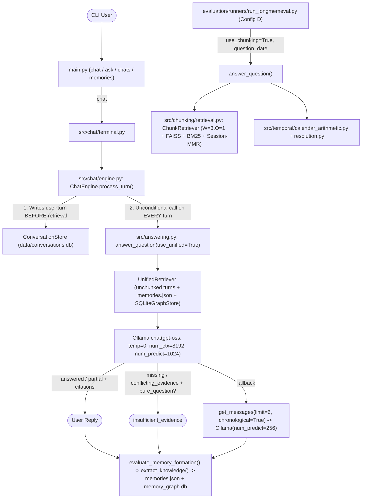

# IVARA — System Architecture

This document describes IVARA's **actual implemented architecture** as of Phase 1A, distinguishing active interactive runtime paths from batch benchmark paths and clearly identifying known limitations.

---

## 1. Repository Directory Structure

```text
IVARA/
├── .github/                  # Issue & PR templates
├── data/                     # Sanitized seed fixtures (entities.json, memories.example.json) + gitignored runtime state
├── docs/
│   ├── DEMO_GUIDE.md         # Walkthrough for demo.py
│   └── research/             # Academic paper brief
├── evaluation/               # LongMemEval harnesses (adapters, evaluators, runners), methodology, & sealed final_bakeoff/
├── scripts/                  # Manual E2E verification script (test_user_journey.py)
├── src/
│   ├── answering.py          # Prompt assembly, retrieval dispatch, Ollama call, JSON/regex parser, citation ID check
│   ├── embedding.py          # Singleton all-MiniLM-L6-v2 offline-safe loader
│   ├── memory.py             # Append-only JSON persistence (data/memories.json)
│   ├── retrieval.py          # Per-call FAISS IndexFlatIP over memories.json
│   ├── chat/                 # ChatEngine & blocking CLI REPL (terminal.py)
│   ├── conversations/        # SQLite ConversationStore (messages + episodic_turns + FTS5)
│   ├── extraction/           # Rule-based policy.py, LLM extractor.py, validation pipeline.py
│   ├── chunking/             # TurnAwareChunker(W=3, O=1), ChunkRetriever (Candidate B), & experimental strategies
│   ├── graph/                # SQLiteGraphStore, GraphBuilder, GraphSchema, bounded traversal
│   ├── ontology/             # Closed vocabulary (vocabulary.json), entity/relation resolvers, validator
│   ├── query/                # Query decomposition
│   ├── reasoning/            # Contradiction analyzer, evidence integrator, evidence gate
│   ├── temporal/             # Calendar arithmetic, resolution, supersession, event graph modules
│   └── unified_retrieval/    # Episodic/Semantic/Graph fusion (RRF-P), router, safeguards
└── tests/                    # Automated pytest suite
```

---

## 2. Actual Runtime vs. Benchmark Execution Flows

IVARA currently executes **two distinct retrieval paths** depending on entry point:



---

## 3. Core Subsystem Responsibilities

| Package / Module | Responsibility | Implementation Notes |
|---|---|---|
| `main.py`, `src/chat/` | CLI commands, interactive REPL, turn orchestration | `ChatEngine` uses `use_unified=True`, `use_adaptive_routing=False`, `min_score=0.30`. Blocking `input()` loop without streaming. |
| `src/conversations/store.py` | Persistent chats, messages, and episodic turns in SQLite (`WAL` + `FTS5`) | Stores turns redundantly in `messages` and `episodic_turns`. |
| `src/extraction/` | Formation gating (`policy.py`), structured LLM extraction (`extractor.py`), resolution & graph sync (`pipeline.py`) | `policy.py` is 100% heuristic (`llm_caller` ignored); `memory.py` is strictly append-only. |
| `src/ontology/` & `src/graph/` | Canonical entity/relation vocabulary, validation, and `SQLiteGraphStore` (`nodes`, `edges`) | Preserved as the foundation for IVARA's associative memory & relationship-driven inference vision. |
| `src/unified_retrieval/` | Tri-source retrieval (episodic + semantic + graph) with `UnifiedEvidenceFuser` (RRF-P) and `GraphSafeguards` | `EpisodicRetriever` embeds SQLite turns dynamically per query; `router.py` contains legacy synthetic entity lists. |
| `src/chunking/` | Sliding-window turn chunking (`TurnAwareChunker`), `ChunkRetriever` (Candidate B), and experimental retrievers | `ChunkRetriever` powers the 58.40% LongMemEval-S benchmark run but is not yet wired into `ChatEngine`. |
| `src/temporal/` & `src/reasoning/` | Deterministic calendar arithmetic, temporal resolution/supersession, contradiction detection, and event-graph modules | Calendar arithmetic drove `+5.26 pp` in temporal ablation; `event_extractor.py` & `relationship_builder.py` currently have no runtime callers. |
| `src/answering.py` | System/user prompt construction, Ollama `AnswerPayload` JSON generation, regex recovery, ID-based citation validation | 1,080-line module handling 6 retrieval branches. Citation validation checks key inclusion only (not NLI). |

---

## 4. Storage & Inference Configuration

- **Storage:**
  - `data/conversations.db`: SQLite database (`conversations`, `messages`, `episodic_turns`, `episodic_turns_fts`).
  - `data/memory_graph.db`: SQLite database (`nodes`, `edges`). Auto-synced from `data/memories.json` in `main.py` only when `nodes == 0` and `memories.json` is non-empty.
  - `data/memories.json`: Untracked runtime JSON array (`src/memory.py`); initialized empty if absent.
  - `data/entities.json`, `data/memories.example.json`: Tracked sanitized seed fixtures.
- **Inference (`Ollama` at `http://localhost:11434`):**
  - Default generator model: `gpt-oss` (`num_ctx=8192`, `num_predict=1024`, `temperature=0` in `answering.py`; `num_ctx=16384`, `num_predict=4096` in `extractor.py`; `num_predict=256`, `temperature=0.3` in `_generate_conversational_response`).
  - Dense embeddings: `sentence-transformers/all-MiniLM-L6-v2` (384-dim, offline cache-first).

---

## 5. Foundational Associative Memory Direction & Implemented Limitations

- **Associative Memory Vision:** IVARA preserves its graph, ontology, traversal, and safeguard modules to support future query-dependent multi-hop discovery, weighted/typed relationships, spreading activation / Personalized PageRank, hub-noise suppression, and separation of observed facts from inferred hypotheses.
- **Verified Implemented Limitations (Phase 0 Audit):**
  1. `ChatEngine` lacks pre-retrieval intent routing (`is_general_knowledge_query` is imported at `engine.py:27` but unused), causing general questions to fail into `insufficient_evidence` or waste 2–3 LLM calls.
  2. `add_turn()` runs before retrieval, allowing `EpisodicRetriever` to retrieve the user's current utterance and prior assistant errors.
  3. `ConversationStore.get_messages(limit=6, chronological=True)` (`store.py:904-906`) executes `ORDER BY sequence_num ASC LIMIT 6`, returning the **oldest** 6 messages after turn 3.
  4. `ChatEngine` (`engine.py:162`) omits `"conflicting_evidence"` from accepted `qa_status` values, discarding valid answers.
  5. `_generate_conversational_response` (`num_predict=256`) risks exhausting reasoning tokens on `gpt-oss`.
