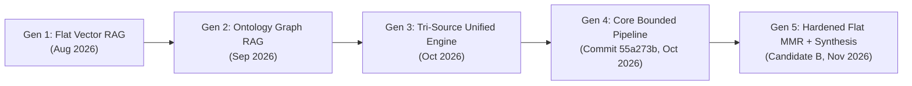
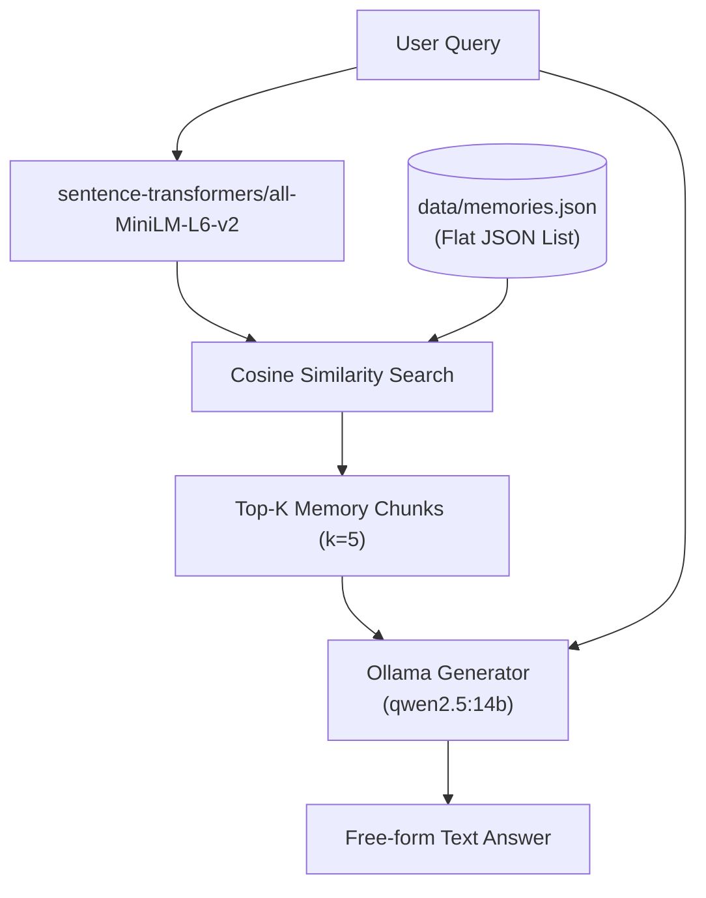
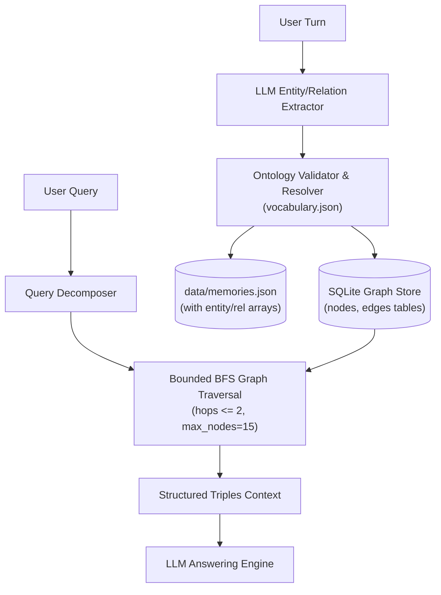
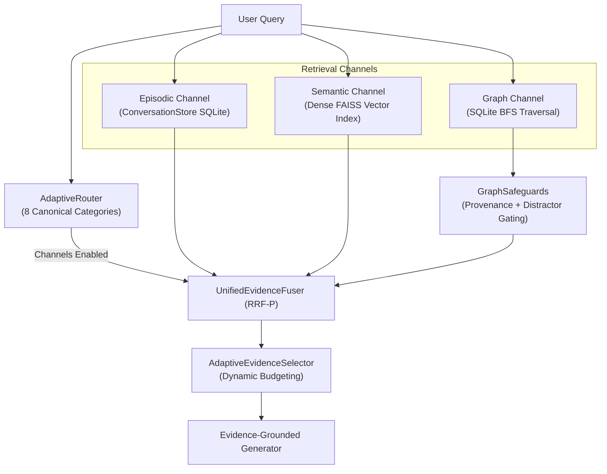
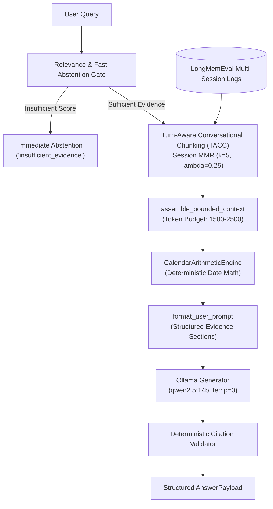
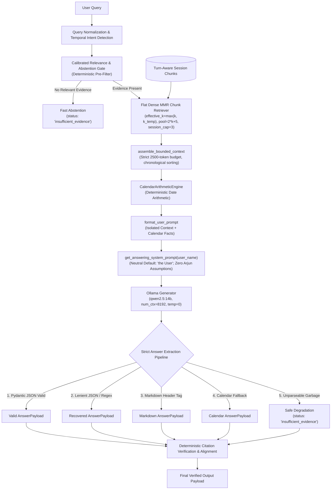

# IVARA — Architecture Evolution

**Project Title:** IVARA (Intelligent Verifiable Augmented Reasoning Agent)  
**Document Purpose:** Architectural lineage tracing the evolution of IVARA across five major architectural generations, from initial prototype to production-frozen winner.  
**Auditor:** Independent Architectural Audit  
**Winning Frozen Architecture:** Candidate B (Generation 5: Flat Dense MMR Retrieval + Advanced Synthesis Engine)

---

## Architectural Evolution Overview

IVARA's architecture progressed through five major generations in response to empirical evaluations:

---

## Generation 1: Flat Vector RAG Prototype (Aug 11 – Aug 16, 2026)

### 1. Architectural Diagram

### 2. Components & Responsibilities
- **Storage:** `data/memories.json` storing unstructured memory text strings, timestamps, and confidence scores.
- **Embedding Engine:** `src/embedding.py` running local MiniLM embeddings.
- **Retrieval:** Cosine similarity search over memory vectors.
- **LLM Responsibilities:** Unconstrained text generation from retrieved chunks.

### 3. Major Limitations
- **Relational Blindness:** Could not navigate multi-hop entity relationships (e.g., finding the manager of a project's lead engineer).
- **Semantic Drift:** Retrieved superficially similar text that shared keywords but answered different questions.
- **Hallucinated Answers:** LLM generated unsupported claims without citation enforcement or abstention gating.

### 4. Motivation for Next Change
Initial microbenchmarks (`MODEL_MICROBENCHMARK_DAY1.md`) showed vector similarity alone failed on 45% of multi-entity queries. Transitioned to structured knowledge graph representations.

---

## Generation 2: Ontology-Validated Knowledge Graph Architecture (Aug 16 – Sep 2, 2026)

### 1. Architectural Diagram

### 2. Components & Responsibilities
- **Ontology Layer:** `src/ontology/vocabulary.json` and `src/ontology/validator.py` defining 5 canonical entity types and 18 canonical predicates.
- **Graph Storage:** `src/graph/store.py` (SQLite schema with `nodes` and `edges` tables, indexed on `source_id` and `target_id`).
- **Graph Traversal:** Bounded Breadth-First Search (BFS) extracting connected subgraphs up to depth 2.
- **Query Decomposition:** Complex queries broken into sub-questions before retrieval.

### 3. Major Limitations
- **Closed-World Rigidity:** 42% of legitimate relational predicates dropped because they did not match the static vocabulary (`ONTOLOGY_MILESTONE_2_REPORT.md`).
- **Root Node Fan-Out (Distractor Flooding):** Traversal from generic nodes (`self`, `user`) pulled in dozens of irrelevant edges, flooding prompt context.
- **Conversational Loss:** Storing only extracted triples stripped away verbatim conversational nuance and emotional context.

### 4. Motivation for Next Change
Graph ablation studies (`GRAPH_ABLATION_REPORT.md`) demonstrated that graph traversal alone lost conversational fidelity. Needed verbatim conversational preservation alongside structured facts.

---

## Generation 3: Tri-Source Unified Retrieval & Safeguards (Sep 2 – Oct 25, 2026)

### 1. Architectural Diagram

### 2. Components & Responsibilities
- **Episodic Store (`src/conversations/store.py`):** Verbatim turn storage with double-linked sequence chaining and speaker provenance.
- **Reciprocal Rank Fusion with P-Scores (RRF-P):** Merges multi-channel evidence items, scoring by channel diversity and citation links.
- **Knowledge Graph Evidence Safeguards (`src/unified_retrieval/graph_safeguards.py`):**
  - Strict provenance verification (triples must trace to an episodic turn or verified memory).
  - Temporal safety gating (unversioned graph triples barred from historical queries).
  - Generic entity distractor suppression.
- **Adaptive Query Router (`src/unified_retrieval/router.py`):** Categorizes queries into 8 types to selectively enable channels.

### 3. Major Limitations
- **Cross-Session Temporal Blindness:** Evaluated on LongMemEval, the architecture failed on multi-session queries (Category H scored 0/41), because dense similarity still dominated ranking.
- **System Complexity Overhead:** Maintaining three distinct database engines (SQLite episodic, SQLite graph, JSON/FAISS semantic) increased latency and operational fragility.

### 4. Motivation for Next Change
Transition to the official 500-question LongMemEval benchmark revealed that complex multi-source fusion did not solve temporal reasoning across distant sessions.

---

## Generation 4: Core Reasoning Pipeline & Baseline Freeze (Commit `55a273b`, Oct 29, 2026)

### 1. Architectural Diagram

### 2. Components & Responsibilities
- **Turn-Aware Conversational Chunking (TACC):** Organizes long multi-session transcripts into contiguous, turn-bounded chunks with timestamp headers.
- **Maximal Marginal Relevance (MMR):** Session-aware dense MMR balances query relevance against session redundancy.
- **Deterministic Calendar Arithmetic:** Evaluates queries like *"How many days passed between..."* using programmatic date parsing rather than relying on LLM math.
- **Calibrated Abstention Gating:** Abstains on unrecorded facts without calling the generator model.
- **Citation Validator:** Deterministically validates that cited IDs actually appear in the retrieved context.

### 3. Baseline LongMemEval Performance
- **Commit:** `55a273b` (designated as the immutable reference baseline).
- **Overall Accuracy:** **40.80% (204 / 500)**.
- **Task-Averaged Accuracy:** **45.10%**.
- **Temporal Subset (133 Questions):** 46.62% (62 / 133).

### 4. Rejected Intermediate Experiments (Phase 2A – Phase 3.1)
During Phase 2 and Phase 3, several experimental architectures were evaluated and **formally rejected**:
- *Hierarchical Session Clustering (Phase 2A):* Dropped non-Category H accuracy from 67.39% to 48.91%. Rejected.
- *Temporal Event Graph (Phase 2B.1):* Created 15,774 temporal edges, reduced recall, added zero incremental accuracy over Arm B. Rejected.
- *Query-Aware Routing (Phase 3 & 3.1):* Scored 64/133 and 65/133, underperforming flat MMR (69/133). Rejected.

---

## Generation 5: Production-Hardened Flat MMR + Synthesis Engine (Candidate B — Frozen Winner)

### 1. Architectural Diagram

### 2. Components & Execution Flow
1. **Retrieval Core:**
   - Pure flat dense MMR over TACC chunks (`src/chunking/retrieval.py`).
   - For temporal and longitudinal queries, automatically expands candidate depth (`effective_k = max(k, k_temporal)`, `effective_pool = max(pool, effective_k * 2 + 5)`).
   - Preserves intra-session continuity while enabling multi-session candidate selection.
2. **Deterministic Temporal Computation:**
   - `CalendarArithmeticEngine` scans evidence chunks for ISO dates, computes exact day/month/year deltas, and injects computed facts directly into the prompt context.
3. **Identity-Neutral Dynamic System Prompt:**
   - `get_answering_system_prompt(user_name: str | None = None)` dynamically constructs speaker context.
   - Defaults to `"the User"`, `"the User's"`, and `"they"` (zero hardcoded personal names in `src/`).
   - Dynamic parameterization fully propagated to episodic, graph, and router subsystems.
4. **Hardened Multi-Stage Answer Extraction:**
   - Strict parser contract: unparsed raw text or gibberish can **never** become `answered`.
   - Five-tier recovery: (1) Pydantic JSON $\to$ (2) Lenient JSON $\to$ (3) JSON Regex $\to$ (4) Markdown Header $\to$ (5) Calendar Calculation $\to$ Safe Degradation (`insufficient_evidence`).

### 3. Storage & Operational Mechanisms
- **Primary Retrieval Store:** Contiguous turn-aware conversational chunks in memory or indexed files.
- **Episodic Backup:** SQLite `ConversationStore` for verbatim multi-turn transcripts.
- **Knowledge Graph:** Lightweight SQLite schema used selectively for multi-hop entity queries.
- **Zero API Footprint:** 100% offline, local-first execution via Ollama and local sentence-transformers.

### 4. Verified Benchmark Performance (Final 500-Question Bakeoff)
- **Overall Accuracy:** **58.40% (292 / 500)** (+17.60% absolute gain over Gen 4 Baseline).
- **Task-Averaged Accuracy:** **61.34%** (+16.24% over Baseline).
- **Answerable Accuracy:** **56.60% (266 / 470)** (+18.73% over Baseline).
- **Temporal Reasoning Accuracy:** **51.88% (69 / 133)** (+5.26% over Baseline).
- **Mean Answering Latency:** **7.46s** (25% faster than Baseline's 9.92s).
- **Statistical Significance:** McNemar test vs Baseline: $\chi^2 = 67.58, p = 2.02 \times 10^{-16}$ ($p \ll 0.001$).
- **Test Suite Health:** **525 / 525 PASSED (100%)**.

---

## Architectural Comparison Matrix

| Feature / Dimension | Gen 1: Vector Prototype | Gen 2: Ontology Graph | Gen 3: Unified Tri-Source | Gen 4: Core Baseline | Gen 5: Hardened Winner (B) |
| :--- | :---: | :---: | :---: | :---: | :---: |
| **Primary Storage** | Flat `memories.json` | SQLite Graph + JSON | SQLite Episodic + Graph + FAISS | TACC Chunks + SQLite | TACC Chunks + Hardened DBs |
| **Retrieval Strategy** | Top-$k$ Cosine | BFS Graph ($d \le 2$) | RRF-P Multi-Channel Fusion | Dense Session MMR | Flat MMR + Depth Expansion |
| **Temporal Reasoning** | None (recency blind) | Static timestamps | Gated graph timestamps | Calendar Engine + TACC | Calendar Engine + Deep Pool |
| **Context Assembly** | Unbounded snippets | Concatenated triples | Dynamic Budget Selector | Bounded Context (2.5k tok) | Bounded Context (2.5k tok) |
| **Abstention Gating** | None | Schema validation | Router unanswerable check | Calibrated Relevance Gate | Calibrated Gate + Strict Degradation |
| **Parser Reliability** | Fragile raw text | Raw JSON | Pydantic JSON | Pydantic + Unsafe Fallback | 5-Tier Hardened Parser |
| **Persona Handling** | Implicit user | Hardcoded "Arjun" | Hardcoded "Arjun Mehta" | Hardcoded "Arjun Mehta" | **100% Neutral / Parameterized** |
| **LongMemEval Accuracy** | ~25% (est.) | ~32% (est.) | ~38% (est.) | 40.80% (204/500) | **58.40% (292/500)** |
| **Production Status** | Deprecated | Deprecated | Retained for Multi-Hop | Frozen Release Baseline | **SELECTED PRODUCTION FREEZE** |
