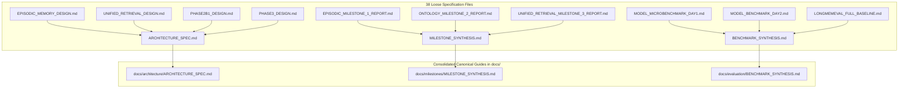

# IVARA — Documentation Audit & Inventory Report

> **Audit Status:** Complete & Verified  
> **Repository Snapshot:** Post-Hardening / Pre-Freeze Gate (`main` / `experiment/evidence-validated-routing-phase3-1`)  
> **Baseline Commit Reference:** `55a273bff20fa0eec1b2d361e8a03b217d147abe`  
> **Total Documents Audited:** 110 Markdown Files (72 Root, 38 Subdirectories)  
> **Constraint Adherence:** Read-only inspection; no files moved, renamed, or deleted during this phase.

---

## 1. Executive Summary & Inventory Overview

Over the multi-month engineering journey of IVARA, an extensive corpus of documentation was generated across iterative research sprints, ablation studies, error forensics, and pre-freeze audit gates. While this corpus provides exceptional transparency and academic reproducibility, the accumulation of 72 Markdown files in the repository root creates cognitive clutter and conceals the primary entry points for new engineers and reviewers.

### Inventory Distribution by Recommendation

| Recommendation | Count | Percentage | Description |
|---|---|---|---|
| **`KEEP`** | 14 | 12.7% | Essential living documentation (README, Installation, Demo, Freeze Gates, Reconstruction Deliverables). |
| **`CONSOLIDATE`** | 21 | 19.1% | High-value technical and architectural specs to merge into unified documentation in `docs/`. |
| **`ARCHIVE`** | 69 | 62.7% | Historical experiment logs, intermediate sprint reports, and failure forensics to preserve in `archive/`. |
| **`DELETE`** | 6 | 5.5% | Pure redundant exact duplicates (root files that exist identically in `evaluation/`). |
| **Total** | **110** | **100.0%** | **Exhaustive coverage of all Markdown files in the repository.** |

### Inventory Distribution by Current Relevance

| Relevance Classification | Count | Description |
|---|---|---|
| **Historical Record** | 84 | Files classified as historical record based on codebase state. |
| **Current** | 14 | Files classified as current based on codebase state. |
| **Historical / Reference** | 6 | Files classified as historical / reference based on codebase state. |
| **Redundant Duplicate** | 6 | Files classified as redundant duplicate based on codebase state. |

---

## 2. Exact Duplicate Analysis & Resolution

During the sprint evolutions, 6 evaluation and audit documents were copied between the repository root and the `evaluation/` subdirectory. A byte-level cryptographic hash audit (SHA-256) reveals 6 identical duplicate pairs:

| Root File Path | Subdirectory File Path | SHA-256 Prefix | File Size | Recommendation |
|---|---|---|---|---|
| [`EVALUATION_CAMPAIGN_V1_REPORT.md`](file:///c:/Users/Krishna/Desktop/Brahmaand/Coding_Ki_Dunia/Projects/IVARA/EVALUATION_CAMPAIGN_V1_REPORT.md) | [`evaluation/EVALUATION_CAMPAIGN_V1_REPORT.md`](file:///c:/Users/Krishna/Desktop/Brahmaand/Coding_Ki_Dunia/Projects/IVARA/evaluation/EVALUATION_CAMPAIGN_V1_REPORT.md) | `69f2e2bd...` | 15.6 KB | **`DELETE`** root copy post-freeze; preserve canonical copy in `evaluation/`. |
| [`GRAPH_ABLATION_PROTOCOL.md`](file:///c:/Users/Krishna/Desktop/Brahmaand/Coding_Ki_Dunia/Projects/IVARA/GRAPH_ABLATION_PROTOCOL.md) | [`evaluation/GRAPH_ABLATION_PROTOCOL.md`](file:///c:/Users/Krishna/Desktop/Brahmaand/Coding_Ki_Dunia/Projects/IVARA/evaluation/GRAPH_ABLATION_PROTOCOL.md) | `2b63d8a5...` | 8.9 KB | **`DELETE`** root copy post-freeze; preserve canonical copy in `evaluation/`. |
| [`GRAPH_ABLATION_REPORT.md`](file:///c:/Users/Krishna/Desktop/Brahmaand/Coding_Ki_Dunia/Projects/IVARA/GRAPH_ABLATION_REPORT.md) | [`evaluation/GRAPH_ABLATION_REPORT.md`](file:///c:/Users/Krishna/Desktop/Brahmaand/Coding_Ki_Dunia/Projects/IVARA/evaluation/GRAPH_ABLATION_REPORT.md) | `c270c73a...` | 10.3 KB | **`DELETE`** root copy post-freeze; preserve canonical copy in `evaluation/`. |
| [`INTEGRATED_ONTOLOGY_GRAPH_TEMPORAL_AUDIT.md`](file:///c:/Users/Krishna/Desktop/Brahmaand/Coding_Ki_Dunia/Projects/IVARA/INTEGRATED_ONTOLOGY_GRAPH_TEMPORAL_AUDIT.md) | [`evaluation/INTEGRATED_ONTOLOGY_GRAPH_TEMPORAL_AUDIT.md`](file:///c:/Users/Krishna/Desktop/Brahmaand/Coding_Ki_Dunia/Projects/IVARA/evaluation/INTEGRATED_ONTOLOGY_GRAPH_TEMPORAL_AUDIT.md) | `dcb3f1ee...` | 14.2 KB | **`DELETE`** root copy post-freeze; preserve canonical copy in `evaluation/`. |
| [`LONGMEMEVAL_CHUNKING_ABLATION.md`](file:///c:/Users/Krishna/Desktop/Brahmaand/Coding_Ki_Dunia/Projects/IVARA/LONGMEMEVAL_CHUNKING_ABLATION.md) | [`evaluation/LONGMEMEVAL_CHUNKING_ABLATION.md`](file:///c:/Users/Krishna/Desktop/Brahmaand/Coding_Ki_Dunia/Projects/IVARA/evaluation/LONGMEMEVAL_CHUNKING_ABLATION.md) | `4a04b930...` | 11.8 KB | **`DELETE`** root copy post-freeze; preserve canonical copy in `evaluation/`. |
| [`STEP5_INTEGRATION_AND_EVALUATION_READINESS.md`](file:///c:/Users/Krishna/Desktop/Brahmaand/Coding_Ki_Dunia/Projects/IVARA/STEP5_INTEGRATION_AND_EVALUATION_READINESS.md) | [`evaluation/STEP5_INTEGRATION_AND_EVALUATION_READINESS.md`](file:///c:/Users/Krishna/Desktop/Brahmaand/Coding_Ki_Dunia/Projects/IVARA/evaluation/STEP5_INTEGRATION_AND_EVALUATION_READINESS.md) | `aac12433...` | 13.1 KB | **`DELETE`** root copy post-freeze; preserve canonical copy in `evaluation/`. |

> [!NOTE]
> In every duplicate pair, the content is 100% byte-identical. Deleting the root copy post-freeze incurs **zero information loss** while immediately removing 6 cluttered files from the root.

---

## 3. Complete Documentation Inventory

### 3.1 Root Directory Documentation (72 Files)

| File Path | Primary Purpose | Relevance | Unique Evidence | Action | Target Destination |
|---|---|---|---|---|---|
| [`ARCHITECTURE_FAILURE_ANALYSIS.md`](file:///c:/Users/Krishna/Desktop/Brahmaand/Coding_Ki_Dunia/Projects/IVARA/ARCHITECTURE_FAILURE_ANALYSIS.md) | Detailed query-level error classification and failure forensics (# IVARA: Architectural Failure Analysis). | Historical Record | Yes (Concrete failure categorization, false assertion traces, error distributions) | **`ARCHIVE`** | `Move to archive/failure_analysis/` |
| [`DEMO_GUIDE.md`](file:///c:/Users/Krishna/Desktop/Brahmaand/Coding_Ki_Dunia/Projects/IVARA/DEMO_GUIDE.md) | Interactive CLI demonstration guide, test personas, and sample query walkthroughs. | Current | Yes (Interactive CLI walkthrough scenarios and demo script) | **`KEEP`** | `Maintain in root or docs/` |
| [`EPISODIC_MEMORY_DESIGN.md`](file:///c:/Users/Krishna/Desktop/Brahmaand/Coding_Ki_Dunia/Projects/IVARA/EPISODIC_MEMORY_DESIGN.md) | Subsystem architectural specification (# IVARA). | Historical / Reference | Yes (Detailed prompt contracts, entity schemas, and routing algorithms) | **`CONSOLIDATE`** | `Consolidate into docs/architecture/ARCHITECTURE_SPEC.md` |
| [`EPISODIC_MILESTONE_1_REPORT.md`](file:///c:/Users/Krishna/Desktop/Brahmaand/Coding_Ki_Dunia/Projects/IVARA/EPISODIC_MILESTONE_1_REPORT.md) | Milestone progress, engineering audit, or phase transition report (# IVARA — Milestone 1: Persistent Episod). | Historical Record | Yes (Milestone test results, code review findings, intermediate ablation metrics) | **`ARCHIVE`** | `Move to archive/milestones/` |
| [`EPISODIC_MILESTONE_1_REVIEW.md`](file:///c:/Users/Krishna/Desktop/Brahmaand/Coding_Ki_Dunia/Projects/IVARA/EPISODIC_MILESTONE_1_REVIEW.md) | Milestone progress, engineering audit, or phase transition report (# IVARA — Milestone 1 Code Review & Robu). | Historical Record | Yes (Milestone test results, code review findings, intermediate ablation metrics) | **`ARCHIVE`** | `Move to archive/milestones/` |
| [`EVALUATION_CAMPAIGN_V1_REPORT.md`](file:///c:/Users/Krishna/Desktop/Brahmaand/Coding_Ki_Dunia/Projects/IVARA/EVALUATION_CAMPAIGN_V1_REPORT.md) | Early evaluation report. Exact byte-for-byte duplicate of evaluation/EVALUATION_CAMPAIGN_V1_REPORT.md. | Redundant Duplicate | No (Identical to file in evaluation/) | **`DELETE`** | `Delete root copy; keep canonical in evaluation/` |
| [`FINAL_BAKEOFF_INTEGRITY_AUDIT.md`](file:///c:/Users/Krishna/Desktop/Brahmaand/Coding_Ki_Dunia/Projects/IVARA/FINAL_BAKEOFF_INTEGRITY_AUDIT.md) | Definitive pre-freeze audit gate, integrity verification, or candidate bakeoff report. | Current | Yes (Canonical benchmark results, prediction SHA-256 hashes, and freeze certifications) | **`KEEP`** | `Preserve in root or docs/release/ as definitive audit record` |
| [`FINAL_BAKEOFF_REPORT.md`](file:///c:/Users/Krishna/Desktop/Brahmaand/Coding_Ki_Dunia/Projects/IVARA/FINAL_BAKEOFF_REPORT.md) | Definitive pre-freeze audit gate, integrity verification, or candidate bakeoff report. | Current | Yes (Canonical benchmark results, prediction SHA-256 hashes, and freeze certifications) | **`KEEP`** | `Preserve in root or docs/release/ as definitive audit record` |
| [`FINAL_COMPLETENESS_AUDIT.md`](file:///c:/Users/Krishna/Desktop/Brahmaand/Coding_Ki_Dunia/Projects/IVARA/FINAL_COMPLETENESS_AUDIT.md) | Project documentation or report (# IVARA: Final Completeness & Evaluation Integrity). | Historical Record | Yes (Historical context and early project specifications) | **`CONSOLIDATE`** | `Consolidate into docs/ or move to archive/` |
| [`FINAL_FREEZE_GO_NO_GO.md`](file:///c:/Users/Krishna/Desktop/Brahmaand/Coding_Ki_Dunia/Projects/IVARA/FINAL_FREEZE_GO_NO_GO.md) | Definitive pre-freeze audit gate, integrity verification, or candidate bakeoff report. | Current | Yes (Canonical benchmark results, prediction SHA-256 hashes, and freeze certifications) | **`KEEP`** | `Preserve in root or docs/release/ as definitive audit record` |
| [`FINAL_ROUTER_VERIFICATION.md`](file:///c:/Users/Krishna/Desktop/Brahmaand/Coding_Ki_Dunia/Projects/IVARA/FINAL_ROUTER_VERIFICATION.md) | Definitive pre-freeze audit gate, integrity verification, or candidate bakeoff report. | Current | Yes (Canonical benchmark results, prediction SHA-256 hashes, and freeze certifications) | **`KEEP`** | `Preserve in root or docs/release/ as definitive audit record` |
| [`FINALIZATION_AUDIT.md`](file:///c:/Users/Krishna/Desktop/Brahmaand/Coding_Ki_Dunia/Projects/IVARA/FINALIZATION_AUDIT.md) | Definitive pre-freeze audit gate, integrity verification, or candidate bakeoff report. | Current | Yes (Canonical benchmark results, prediction SHA-256 hashes, and freeze certifications) | **`KEEP`** | `Preserve in root or docs/release/ as definitive audit record` |
| [`GRAPH_ABLATION_PROTOCOL.md`](file:///c:/Users/Krishna/Desktop/Brahmaand/Coding_Ki_Dunia/Projects/IVARA/GRAPH_ABLATION_PROTOCOL.md) | Early evaluation report. Exact byte-for-byte duplicate of evaluation/GRAPH_ABLATION_PROTOCOL.md. | Redundant Duplicate | No (Identical to file in evaluation/) | **`DELETE`** | `Delete root copy; keep canonical in evaluation/` |
| [`GRAPH_ABLATION_REPORT.md`](file:///c:/Users/Krishna/Desktop/Brahmaand/Coding_Ki_Dunia/Projects/IVARA/GRAPH_ABLATION_REPORT.md) | Early evaluation report. Exact byte-for-byte duplicate of evaluation/GRAPH_ABLATION_REPORT.md. | Redundant Duplicate | No (Identical to file in evaluation/) | **`DELETE`** | `Delete root copy; keep canonical in evaluation/` |
| [`HYBRID_INTEGRATION_VALIDATION.md`](file:///c:/Users/Krishna/Desktop/Brahmaand/Coding_Ki_Dunia/Projects/IVARA/HYBRID_INTEGRATION_VALIDATION.md) | Project documentation or report (# IVARA — Final Hybrid Integration Validation Repo). | Historical Record | Yes (Historical context and early project specifications) | **`CONSOLIDATE`** | `Consolidate into docs/ or move to archive/` |
| [`INSTALLATION_GUIDE.md`](file:///c:/Users/Krishna/Desktop/Brahmaand/Coding_Ki_Dunia/Projects/IVARA/INSTALLATION_GUIDE.md) | Environment setup, Ollama model installation, dependencies, and verification. | Current | Yes (Step-by-step setup instructions for Ollama and Python environment) | **`KEEP`** | `Maintain in root or move to docs/setup/` |
| [`INTEGRATED_ONTOLOGY_GRAPH_TEMPORAL_AUDIT.md`](file:///c:/Users/Krishna/Desktop/Brahmaand/Coding_Ki_Dunia/Projects/IVARA/INTEGRATED_ONTOLOGY_GRAPH_TEMPORAL_AUDIT.md) | Early evaluation report. Exact byte-for-byte duplicate of evaluation/INTEGRATED_ONTOLOGY_GRAPH_TEMPORAL_AUDIT.md. | Redundant Duplicate | No (Identical to file in evaluation/) | **`DELETE`** | `Delete root copy; keep canonical in evaluation/` |
| [`IVARA_ARCHITECTURE_EVOLUTION.md`](file:///c:/Users/Krishna/Desktop/Brahmaand/Coding_Ki_Dunia/Projects/IVARA/IVARA_ARCHITECTURE_EVOLUTION.md) | Comprehensive project history reconstruction, evolution narrative, challenge register, or audit report. | Current | Yes (Canonical synthesized development history and architectural analysis) | **`KEEP`** | `Retain in root as primary project documentation deliverables` |
| [`IVARA_BENCHMARK_AUDIT.md`](file:///c:/Users/Krishna/Desktop/Brahmaand/Coding_Ki_Dunia/Projects/IVARA/IVARA_BENCHMARK_AUDIT.md) | Project documentation or report (# IVARA — Independent Benchmark Audit & Verificati). | Historical Record | Yes (Historical context and early project specifications) | **`CONSOLIDATE`** | `Consolidate into docs/ or move to archive/` |
| [`IVARA_CHALLENGES_AND_SOLUTIONS.md`](file:///c:/Users/Krishna/Desktop/Brahmaand/Coding_Ki_Dunia/Projects/IVARA/IVARA_CHALLENGES_AND_SOLUTIONS.md) | Comprehensive project history reconstruction, evolution narrative, challenge register, or audit report. | Current | Yes (Canonical synthesized development history and architectural analysis) | **`KEEP`** | `Retain in root as primary project documentation deliverables` |
| [`IVARA_FAILURE_ANALYSIS.md`](file:///c:/Users/Krishna/Desktop/Brahmaand/Coding_Ki_Dunia/Projects/IVARA/IVARA_FAILURE_ANALYSIS.md) | Detailed query-level error classification and failure forensics (# IVARA — Failure Analysis & Architectur). | Historical Record | Yes (Concrete failure categorization, false assertion traces, error distributions) | **`ARCHIVE`** | `Move to archive/failure_analysis/` |
| [`IVARA_FINAL_ENGINEERING_REPORT.md`](file:///c:/Users/Krishna/Desktop/Brahmaand/Coding_Ki_Dunia/Projects/IVARA/IVARA_FINAL_ENGINEERING_REPORT.md) | Project documentation or report (# IVARA — Final Engineering Report). | Historical Record | Yes (Historical context and early project specifications) | **`CONSOLIDATE`** | `Consolidate into docs/ or move to archive/` |
| [`IVARA_FINAL_EVALUATION_REPORT.md`](file:///c:/Users/Krishna/Desktop/Brahmaand/Coding_Ki_Dunia/Projects/IVARA/IVARA_FINAL_EVALUATION_REPORT.md) | Project documentation or report (# IVARA — Final Evaluation Report). | Historical Record | Yes (Historical context and early project specifications) | **`CONSOLIDATE`** | `Consolidate into docs/ or move to archive/` |
| [`IVARA_FINAL_HANDOFF.md`](file:///c:/Users/Krishna/Desktop/Brahmaand/Coding_Ki_Dunia/Projects/IVARA/IVARA_FINAL_HANDOFF.md) | Project documentation or report (# IVARA — Final Engineering Handoff & Developer Gu). | Historical Record | Yes (Historical context and early project specifications) | **`CONSOLIDATE`** | `Consolidate into docs/ or move to archive/` |
| [`IVARA_FINAL_RELEASE_READINESS_REPORT.md`](file:///c:/Users/Krishna/Desktop/Brahmaand/Coding_Ki_Dunia/Projects/IVARA/IVARA_FINAL_RELEASE_READINESS_REPORT.md) | Project documentation or report (# IVARA — Final Release Readiness & Comprehensive). | Historical Record | Yes (Historical context and early project specifications) | **`CONSOLIDATE`** | `Consolidate into docs/ or move to archive/` |
| [`IVARA_LONG_CONTEXT_EVALUATION_REPORT.md`](file:///c:/Users/Krishna/Desktop/Brahmaand/Coding_Ki_Dunia/Projects/IVARA/IVARA_LONG_CONTEXT_EVALUATION_REPORT.md) | Project documentation or report (# IVARA — Comprehensive Long-Context Memory Evalua). | Historical Record | Yes (Historical context and early project specifications) | **`CONSOLIDATE`** | `Consolidate into docs/ or move to archive/` |
| [`IVARA_PROJECT_TIMELINE.md`](file:///c:/Users/Krishna/Desktop/Brahmaand/Coding_Ki_Dunia/Projects/IVARA/IVARA_PROJECT_TIMELINE.md) | Comprehensive project history reconstruction, evolution narrative, challenge register, or audit report. | Current | Yes (Canonical synthesized development history and architectural analysis) | **`KEEP`** | `Retain in root as primary project documentation deliverables` |
| [`IVARA_RELEASE_CHECKLIST.md`](file:///c:/Users/Krishna/Desktop/Brahmaand/Coding_Ki_Dunia/Projects/IVARA/IVARA_RELEASE_CHECKLIST.md) | Release readiness checklist covering tests, databases, dependencies, and docs. | Current | Yes (Pre-release operational checklist) | **`KEEP`** | `Keep in root as release gate` |
| [`KNOWN_LIMITATIONS.md`](file:///c:/Users/Krishna/Desktop/Brahmaand/Coding_Ki_Dunia/Projects/IVARA/KNOWN_LIMITATIONS.md) | Documented architectural and model limitations (context windows, distractor depths). | Current | Yes (Official record of verified system constraints and failure modes) | **`KEEP`** | `Keep in root or docs/` |
| [`LONGMEMEVAL_CHUNKING_ABLATION.md`](file:///c:/Users/Krishna/Desktop/Brahmaand/Coding_Ki_Dunia/Projects/IVARA/LONGMEMEVAL_CHUNKING_ABLATION.md) | Early evaluation report. Exact byte-for-byte duplicate of evaluation/LONGMEMEVAL_CHUNKING_ABLATION.md. | Redundant Duplicate | No (Identical to file in evaluation/) | **`DELETE`** | `Delete root copy; keep canonical in evaluation/` |
| [`LONGMEMEVAL_FAILURE_ANALYSIS.md`](file:///c:/Users/Krishna/Desktop/Brahmaand/Coding_Ki_Dunia/Projects/IVARA/LONGMEMEVAL_FAILURE_ANALYSIS.md) | Detailed query-level error classification and failure forensics (# IVARA — LongMemEval-S Question-Level F). | Historical Record | Yes (Concrete failure categorization, false assertion traces, error distributions) | **`ARCHIVE`** | `Move to archive/failure_analysis/` |
| [`LONGMEMEVAL_FORENSIC_ANALYSIS.md`](file:///c:/Users/Krishna/Desktop/Brahmaand/Coding_Ki_Dunia/Projects/IVARA/LONGMEMEVAL_FORENSIC_ANALYSIS.md) | Detailed query-level error classification and failure forensics (# IVARA — LongMemEval Forensic Analysis). | Historical Record | Yes (Concrete failure categorization, false assertion traces, error distributions) | **`ARCHIVE`** | `Move to archive/failure_analysis/` |
| [`LONGMEMEVAL_FULL_BASELINE.md`](file:///c:/Users/Krishna/Desktop/Brahmaand/Coding_Ki_Dunia/Projects/IVARA/LONGMEMEVAL_FULL_BASELINE.md) | Project documentation or report (# IVARA — LongMemEval-S Full Baseline Evaluation R). | Historical Record | Yes (Historical context and early project specifications) | **`CONSOLIDATE`** | `Consolidate into docs/ or move to archive/` |
| [`LONGMEMEVAL_INTEGRATION_REPORT.md`](file:///c:/Users/Krishna/Desktop/Brahmaand/Coding_Ki_Dunia/Projects/IVARA/LONGMEMEVAL_INTEGRATION_REPORT.md) | Project documentation or report (# IVARA — LongMemEval Production Integration & Off). | Historical Record | Yes (Historical context and early project specifications) | **`CONSOLIDATE`** | `Consolidate into docs/ or move to archive/` |
| [`LONGMEMEVAL_PHASE1_EXPERIMENTS.md`](file:///c:/Users/Krishna/Desktop/Brahmaand/Coding_Ki_Dunia/Projects/IVARA/LONGMEMEVAL_PHASE1_EXPERIMENTS.md) | Milestone progress, engineering audit, or phase transition report (# IVARA — LongMemEval Improvement Sprint). | Historical Record | Yes (Milestone test results, code review findings, intermediate ablation metrics) | **`ARCHIVE`** | `Move to archive/milestones/` |
| [`MILESTONE_3_1_AUDIT_REPORT.md`](file:///c:/Users/Krishna/Desktop/Brahmaand/Coding_Ki_Dunia/Projects/IVARA/MILESTONE_3_1_AUDIT_REPORT.md) | Milestone progress, engineering audit, or phase transition report (# IVARA Milestone 3.1: Independent Evalu). | Historical Record | Yes (Milestone test results, code review findings, intermediate ablation metrics) | **`ARCHIVE`** | `Move to archive/milestones/` |
| [`MILESTONE_3_2_BATCH_1_REPORT.md`](file:///c:/Users/Krishna/Desktop/Brahmaand/Coding_Ki_Dunia/Projects/IVARA/MILESTONE_3_2_BATCH_1_REPORT.md) | Milestone progress, engineering audit, or phase transition report (# IVARA Milestone 3.2 — Batch 1 Implemen). | Historical Record | Yes (Milestone test results, code review findings, intermediate ablation metrics) | **`ARCHIVE`** | `Move to archive/milestones/` |
| [`MILESTONE_3_2_BATCH_2_3_REPORT.md`](file:///c:/Users/Krishna/Desktop/Brahmaand/Coding_Ki_Dunia/Projects/IVARA/MILESTONE_3_2_BATCH_2_3_REPORT.md) | Milestone progress, engineering audit, or phase transition report (# IVARA Milestone 3.2 — Batch 2 & Batch). | Historical Record | Yes (Milestone test results, code review findings, intermediate ablation metrics) | **`ARCHIVE`** | `Move to archive/milestones/` |
| [`MILESTONE_3_2_BATCH_4_REPORT.md`](file:///c:/Users/Krishna/Desktop/Brahmaand/Coding_Ki_Dunia/Projects/IVARA/MILESTONE_3_2_BATCH_4_REPORT.md) | Milestone progress, engineering audit, or phase transition report (# Milestone 3.2: Batch 4 Report). | Historical Record | Yes (Milestone test results, code review findings, intermediate ablation metrics) | **`ARCHIVE`** | `Move to archive/milestones/` |
| [`MILESTONE_3_2_DESIGN.md`](file:///c:/Users/Krishna/Desktop/Brahmaand/Coding_Ki_Dunia/Projects/IVARA/MILESTONE_3_2_DESIGN.md) | Subsystem architectural specification (# IVARA Milestone 3.2). | Historical / Reference | Yes (Detailed prompt contracts, entity schemas, and routing algorithms) | **`CONSOLIDATE`** | `Consolidate into docs/architecture/ARCHITECTURE_SPEC.md` |
| [`MODEL_BENCHMARK_DAY2.md`](file:///c:/Users/Krishna/Desktop/Brahmaand/Coding_Ki_Dunia/Projects/IVARA/MODEL_BENCHMARK_DAY2.md) | Early microbenchmarking of LLMs, embedding models, or initial retrieval arms. | Historical Record | Yes (Raw model latency, memory usage, and context evaluation data) | **`ARCHIVE`** | `Move to archive/microbenchmarks/` |
| [`MODEL_CAPABILITY_AUDIT.md`](file:///c:/Users/Krishna/Desktop/Brahmaand/Coding_Ki_Dunia/Projects/IVARA/MODEL_CAPABILITY_AUDIT.md) | Project documentation or report (# IVARA — Model Capability & Hardware Audit (LLM I). | Historical Record | Yes (Historical context and early project specifications) | **`CONSOLIDATE`** | `Consolidate into docs/ or move to archive/` |
| [`MODEL_MICROBENCHMARK_DAY1.md`](file:///c:/Users/Krishna/Desktop/Brahmaand/Coding_Ki_Dunia/Projects/IVARA/MODEL_MICROBENCHMARK_DAY1.md) | Early microbenchmarking of LLMs, embedding models, or initial retrieval arms. | Historical Record | Yes (Raw model latency, memory usage, and context evaluation data) | **`ARCHIVE`** | `Move to archive/microbenchmarks/` |
| [`MODEL_MICROBENCHMARK_DAY1_5.md`](file:///c:/Users/Krishna/Desktop/Brahmaand/Coding_Ki_Dunia/Projects/IVARA/MODEL_MICROBENCHMARK_DAY1_5.md) | Early microbenchmarking of LLMs, embedding models, or initial retrieval arms. | Historical Record | Yes (Raw model latency, memory usage, and context evaluation data) | **`ARCHIVE`** | `Move to archive/microbenchmarks/` |
| [`MODEL_MICROBENCHMARK_DAY1_AUDIT.md`](file:///c:/Users/Krishna/Desktop/Brahmaand/Coding_Ki_Dunia/Projects/IVARA/MODEL_MICROBENCHMARK_DAY1_AUDIT.md) | Early microbenchmarking of LLMs, embedding models, or initial retrieval arms. | Historical Record | Yes (Raw model latency, memory usage, and context evaluation data) | **`ARCHIVE`** | `Move to archive/microbenchmarks/` |
| [`NEXT_EXPERIMENT_PLAN.md`](file:///c:/Users/Krishna/Desktop/Brahmaand/Coding_Ki_Dunia/Projects/IVARA/NEXT_EXPERIMENT_PLAN.md) | Project documentation or report (# IVARA: Controlled Experimentation Proposal for D). | Historical Record | Yes (Historical context and early project specifications) | **`CONSOLIDATE`** | `Consolidate into docs/ or move to archive/` |
| [`ONTOLOGY_MILESTONE_2_REPORT.md`](file:///c:/Users/Krishna/Desktop/Brahmaand/Coding_Ki_Dunia/Projects/IVARA/ONTOLOGY_MILESTONE_2_REPORT.md) | Milestone progress, engineering audit, or phase transition report (# IVARA Milestone 2: Open-World Ontology). | Historical Record | Yes (Milestone test results, code review findings, intermediate ablation metrics) | **`ARCHIVE`** | `Move to archive/milestones/` |
| [`PHASE1_TEMPORAL_EXPERIMENT_REPORT.md`](file:///c:/Users/Krishna/Desktop/Brahmaand/Coding_Ki_Dunia/Projects/IVARA/PHASE1_TEMPORAL_EXPERIMENT_REPORT.md) | Milestone progress, engineering audit, or phase transition report (# IVARA — Phase 1 Temporal Reasoning Imp). | Historical Record | Yes (Milestone test results, code review findings, intermediate ablation metrics) | **`ARCHIVE`** | `Move to archive/milestones/` |
| [`PHASE2A1_ADAPTIVE_RETRIEVAL_REPORT.md`](file:///c:/Users/Krishna/Desktop/Brahmaand/Coding_Ki_Dunia/Projects/IVARA/PHASE2A1_ADAPTIVE_RETRIEVAL_REPORT.md) | Milestone progress, engineering audit, or phase transition report (# IVARA — Phase 2A.1: Adaptive Hierarchi). | Historical Record | Yes (Milestone test results, code review findings, intermediate ablation metrics) | **`ARCHIVE`** | `Move to archive/milestones/` |
| [`PHASE2A1_FAILURE_FORENSICS.md`](file:///c:/Users/Krishna/Desktop/Brahmaand/Coding_Ki_Dunia/Projects/IVARA/PHASE2A1_FAILURE_FORENSICS.md) | Detailed query-level error classification and failure forensics (# IVARA — Phase 2A.1 Failure Forensics &). | Historical Record | Yes (Concrete failure categorization, false assertion traces, error distributions) | **`ARCHIVE`** | `Move to archive/failure_analysis/` |
| [`PHASE2A_HIERARCHICAL_RETRIEVAL_REPORT.md`](file:///c:/Users/Krishna/Desktop/Brahmaand/Coding_Ki_Dunia/Projects/IVARA/PHASE2A_HIERARCHICAL_RETRIEVAL_REPORT.md) | Milestone progress, engineering audit, or phase transition report (# IVARA — Phase 2A: Hierarchical Episodi). | Historical Record | Yes (Milestone test results, code review findings, intermediate ablation metrics) | **`ARCHIVE`** | `Move to archive/milestones/` |
| [`PHASE2B1_DESIGN.md`](file:///c:/Users/Krishna/Desktop/Brahmaand/Coding_Ki_Dunia/Projects/IVARA/PHASE2B1_DESIGN.md) | Subsystem architectural specification (# IVARA — Phase 2B.1). | Historical / Reference | Yes (Detailed prompt contracts, entity schemas, and routing algorithms) | **`CONSOLIDATE`** | `Consolidate into docs/architecture/ARCHITECTURE_SPEC.md` |
| [`PHASE2B1_EVALUATION_REPORT.md`](file:///c:/Users/Krishna/Desktop/Brahmaand/Coding_Ki_Dunia/Projects/IVARA/PHASE2B1_EVALUATION_REPORT.md) | Milestone progress, engineering audit, or phase transition report (# IVARA — Phase 2B.1: Temporal Event Gra). | Historical Record | Yes (Milestone test results, code review findings, intermediate ablation metrics) | **`ARCHIVE`** | `Move to archive/milestones/` |
| [`PHASE2B1_IMPLEMENTATION_REPORT.md`](file:///c:/Users/Krishna/Desktop/Brahmaand/Coding_Ki_Dunia/Projects/IVARA/PHASE2B1_IMPLEMENTATION_REPORT.md) | Milestone progress, engineering audit, or phase transition report (# IVARA — Phase 2B.1: Temporal Event Gra). | Historical Record | Yes (Milestone test results, code review findings, intermediate ablation metrics) | **`ARCHIVE`** | `Move to archive/milestones/` |
| [`PHASE2B2_ABLATION_REPORT.md`](file:///c:/Users/Krishna/Desktop/Brahmaand/Coding_Ki_Dunia/Projects/IVARA/PHASE2B2_ABLATION_REPORT.md) | Milestone progress, engineering audit, or phase transition report (# IVARA — Phase 2B.2: Controlled Ablatio). | Historical Record | Yes (Milestone test results, code review findings, intermediate ablation metrics) | **`ARCHIVE`** | `Move to archive/milestones/` |
| [`PHASE2B2_FAILURE_ANALYSIS.md`](file:///c:/Users/Krishna/Desktop/Brahmaand/Coding_Ki_Dunia/Projects/IVARA/PHASE2B2_FAILURE_ANALYSIS.md) | Detailed query-level error classification and failure forensics (# IVARA — Phase 2B.2: Category H Failure). | Historical Record | Yes (Concrete failure categorization, false assertion traces, error distributions) | **`ARCHIVE`** | `Move to archive/failure_analysis/` |
| [`PHASE2B2_GRAPH_QUALITY_REPORT.md`](file:///c:/Users/Krishna/Desktop/Brahmaand/Coding_Ki_Dunia/Projects/IVARA/PHASE2B2_GRAPH_QUALITY_REPORT.md) | Milestone progress, engineering audit, or phase transition report (# IVARA — Phase 2B.2: Temporal Event Gra). | Historical Record | Yes (Milestone test results, code review findings, intermediate ablation metrics) | **`ARCHIVE`** | `Move to archive/milestones/` |
| [`PHASE3_1_DESIGN.md`](file:///c:/Users/Krishna/Desktop/Brahmaand/Coding_Ki_Dunia/Projects/IVARA/PHASE3_1_DESIGN.md) | Subsystem architectural specification (# IVARA — Phase 3.1). | Historical / Reference | Yes (Detailed prompt contracts, entity schemas, and routing algorithms) | **`CONSOLIDATE`** | `Consolidate into docs/architecture/ARCHITECTURE_SPEC.md` |
| [`PHASE3_1_EVALUATION_REPORT.md`](file:///c:/Users/Krishna/Desktop/Brahmaand/Coding_Ki_Dunia/Projects/IVARA/PHASE3_1_EVALUATION_REPORT.md) | Milestone progress, engineering audit, or phase transition report (# IVARA — Phase 3.1: Evidence-Validated). | Historical Record | Yes (Milestone test results, code review findings, intermediate ablation metrics) | **`ARCHIVE`** | `Move to archive/milestones/` |
| [`PHASE3_1_FAILURE_ANALYSIS.md`](file:///c:/Users/Krishna/Desktop/Brahmaand/Coding_Ki_Dunia/Projects/IVARA/PHASE3_1_FAILURE_ANALYSIS.md) | Detailed query-level error classification and failure forensics (# IVARA — Phase 3.1: Question-Level Fail). | Historical Record | Yes (Concrete failure categorization, false assertion traces, error distributions) | **`ARCHIVE`** | `Move to archive/failure_analysis/` |
| [`PHASE3_DESIGN.md`](file:///c:/Users/Krishna/Desktop/Brahmaand/Coding_Ki_Dunia/Projects/IVARA/PHASE3_DESIGN.md) | Subsystem architectural specification (# IVARA — Phase 3). | Historical / Reference | Yes (Detailed prompt contracts, entity schemas, and routing algorithms) | **`CONSOLIDATE`** | `Consolidate into docs/architecture/ARCHITECTURE_SPEC.md` |
| [`PHASE3_EVALUATION_REPORT.md`](file:///c:/Users/Krishna/Desktop/Brahmaand/Coding_Ki_Dunia/Projects/IVARA/PHASE3_EVALUATION_REPORT.md) | Milestone progress, engineering audit, or phase transition report (# IVARA — Phase 3: Query-Aware Multi-Ses). | Historical Record | Yes (Milestone test results, code review findings, intermediate ablation metrics) | **`ARCHIVE`** | `Move to archive/milestones/` |
| [`PHASE3_FAILURE_ANALYSIS.md`](file:///c:/Users/Krishna/Desktop/Brahmaand/Coding_Ki_Dunia/Projects/IVARA/PHASE3_FAILURE_ANALYSIS.md) | Detailed query-level error classification and failure forensics (# IVARA — Phase 3: Comprehensive Failure). | Historical Record | Yes (Concrete failure categorization, false assertion traces, error distributions) | **`ARCHIVE`** | `Move to archive/failure_analysis/` |
| [`PRE_FREEZE_HARDENING_REPORT.md`](file:///c:/Users/Krishna/Desktop/Brahmaand/Coding_Ki_Dunia/Projects/IVARA/PRE_FREEZE_HARDENING_REPORT.md) | Audit and test results for answer fallback safety and zero-Arjun generalization. | Current | Yes (Verification records for production hardening remediations) | **`KEEP`** | `Keep in root or docs/release/` |
| [`PRESENTATION_OUTLINE.md`](file:///c:/Users/Krishna/Desktop/Brahmaand/Coding_Ki_Dunia/Projects/IVARA/PRESENTATION_OUTLINE.md) | Project documentation or report (# IVARA — Presentation Outline). | Historical Record | Yes (Historical context and early project specifications) | **`CONSOLIDATE`** | `Consolidate into docs/ or move to archive/` |
| [`PROJECT_REPORT.md`](file:///c:/Users/Krishna/Desktop/Brahmaand/Coding_Ki_Dunia/Projects/IVARA/PROJECT_REPORT.md) | Project documentation or report (# IVARA — Project Report). | Historical Record | Yes (Historical context and early project specifications) | **`CONSOLIDATE`** | `Consolidate into docs/ or move to archive/` |
| [`README.md`](file:///c:/Users/Krishna/Desktop/Brahmaand/Coding_Ki_Dunia/Projects/IVARA/README.md) | Project overview, core capabilities, architecture summary, and quickstart guide. | Current | Yes (Primary repository landing page and project description) | **`KEEP`** | `Update to reflect final Candidate B architecture and bakeoff results` |
| [`STEP5_INTEGRATION_AND_EVALUATION_READINESS.md`](file:///c:/Users/Krishna/Desktop/Brahmaand/Coding_Ki_Dunia/Projects/IVARA/STEP5_INTEGRATION_AND_EVALUATION_READINESS.md) | Early evaluation report. Exact byte-for-byte duplicate of evaluation/STEP5_INTEGRATION_AND_EVALUATION_READINESS.md. | Redundant Duplicate | No (Identical to file in evaluation/) | **`DELETE`** | `Delete root copy; keep canonical in evaluation/` |
| [`STEP6_TEMPORAL_INTEGRATION_REPORT.md`](file:///c:/Users/Krishna/Desktop/Brahmaand/Coding_Ki_Dunia/Projects/IVARA/STEP6_TEMPORAL_INTEGRATION_REPORT.md) | Milestone progress, engineering audit, or phase transition report (# IVARA — Step 6: Temporal Memory Pipeli). | Historical Record | Yes (Milestone test results, code review findings, intermediate ablation metrics) | **`ARCHIVE`** | `Move to archive/milestones/` |
| [`TEMPORAL_REASONING_ARCHITECTURE_AUDIT.md`](file:///c:/Users/Krishna/Desktop/Brahmaand/Coding_Ki_Dunia/Projects/IVARA/TEMPORAL_REASONING_ARCHITECTURE_AUDIT.md) | Project documentation or report (# IVARA — Post-Release Temporal Reasoning & Knowle). | Historical Record | Yes (Historical context and early project specifications) | **`CONSOLIDATE`** | `Consolidate into docs/ or move to archive/` |
| [`UNIFIED_RETRIEVAL_DESIGN.md`](file:///c:/Users/Krishna/Desktop/Brahmaand/Coding_Ki_Dunia/Projects/IVARA/UNIFIED_RETRIEVAL_DESIGN.md) | Subsystem architectural specification (# IVARA Milestone 3). | Historical / Reference | Yes (Detailed prompt contracts, entity schemas, and routing algorithms) | **`CONSOLIDATE`** | `Consolidate into docs/architecture/ARCHITECTURE_SPEC.md` |
| [`UNIFIED_RETRIEVAL_MILESTONE_3_REPORT.md`](file:///c:/Users/Krishna/Desktop/Brahmaand/Coding_Ki_Dunia/Projects/IVARA/UNIFIED_RETRIEVAL_MILESTONE_3_REPORT.md) | Milestone progress, engineering audit, or phase transition report (# IVARA Milestone 3: Unified Episodic, S). | Historical Record | Yes (Milestone test results, code review findings, intermediate ablation metrics) | **`ARCHIVE`** | `Move to archive/milestones/` |

### 3.2 Subdirectory Documentation (38 Files)

| File Path | Primary Purpose | Relevance | Unique Evidence | Action | Target Destination |
|---|---|---|---|---|---|
| [`audits/IVARA_Comprehensive_Audit_and_Handover_Report.md`](file:///c:/Users/Krishna/Desktop/Brahmaand/Coding_Ki_Dunia/Projects/IVARA/audits/IVARA_Comprehensive_Audit_and_Handover_Report.md) | Comprehensive project audit, dependency scan, and historical handover report. | Historical Record | Yes (Baseline code inventory, package dependency audit, early handover checklist) | **`ARCHIVE`** | `Preserve in audits/ or archive/audits/` |
| [`evaluation/autonomous_sprint/experiment_plan.md`](file:///c:/Users/Krishna/Desktop/Brahmaand/Coding_Ki_Dunia/Projects/IVARA/evaluation/autonomous_sprint/experiment_plan.md) | Evaluation campaign artifact, sprint progress log, or run report (# Experimental Plan: Controlled Evaluati). | Historical Record | Yes (Intermediate evaluation tables, run logs, test configurations) | **`ARCHIVE`** | `Preserve in evaluation/ or move to archive/evaluation/` |
| [`evaluation/autonomous_sprint/FINALIZATION_SPRINT_REPORT.md`](file:///c:/Users/Krishna/Desktop/Brahmaand/Coding_Ki_Dunia/Projects/IVARA/evaluation/autonomous_sprint/FINALIZATION_SPRINT_REPORT.md) | Milestone progress, engineering audit, or phase transition report (# IVARA — Finalization Sprint Report: Re). | Historical Record | Yes (Milestone test results, code review findings, intermediate ablation metrics) | **`ARCHIVE`** | `Move to archive/milestones/` |
| [`evaluation/autonomous_sprint/performance_audit.md`](file:///c:/Users/Krishna/Desktop/Brahmaand/Coding_Ki_Dunia/Projects/IVARA/evaluation/autonomous_sprint/performance_audit.md) | Evaluation campaign artifact, sprint progress log, or run report (# Performance Profiling & Latency Audit). | Historical Record | Yes (Intermediate evaluation tables, run logs, test configurations) | **`ARCHIVE`** | `Preserve in evaluation/ or move to archive/evaluation/` |
| [`evaluation/autonomous_sprint/runs/post_evaluation_audit/POST_EVALUATION_AUDIT_REPORT.md`](file:///c:/Users/Krishna/Desktop/Brahmaand/Coding_Ki_Dunia/Projects/IVARA/evaluation/autonomous_sprint/runs/post_evaluation_audit/POST_EVALUATION_AUDIT_REPORT.md) | Evaluation campaign artifact, sprint progress log, or run report (# IVARA — Post-Evaluation Audit and Arch). | Historical Record | Yes (Intermediate evaluation tables, run logs, test configurations) | **`ARCHIVE`** | `Preserve in evaluation/ or move to archive/evaluation/` |
| [`evaluation/autonomous_sprint/SPRINT_FINAL_REPORT.md`](file:///c:/Users/Krishna/Desktop/Brahmaand/Coding_Ki_Dunia/Projects/IVARA/evaluation/autonomous_sprint/SPRINT_FINAL_REPORT.md) | Milestone progress, engineering audit, or phase transition report (# IVARA — Extended Autonomous Research a). | Historical Record | Yes (Milestone test results, code review findings, intermediate ablation metrics) | **`ARCHIVE`** | `Move to archive/milestones/` |
| [`evaluation/autonomous_sprint/SPRINT_PROGRESS.md`](file:///c:/Users/Krishna/Desktop/Brahmaand/Coding_Ki_Dunia/Projects/IVARA/evaluation/autonomous_sprint/SPRINT_PROGRESS.md) | Milestone progress, engineering audit, or phase transition report (# IVARA — Extended Autonomous Research a). | Historical Record | Yes (Milestone test results, code review findings, intermediate ablation metrics) | **`ARCHIVE`** | `Move to archive/milestones/` |
| [`evaluation/autonomous_sprint/SPRINT_REPORT.md`](file:///c:/Users/Krishna/Desktop/Brahmaand/Coding_Ki_Dunia/Projects/IVARA/evaluation/autonomous_sprint/SPRINT_REPORT.md) | Milestone progress, engineering audit, or phase transition report (# IVARA Autonomous 3-Hour Research Sprin). | Historical Record | Yes (Milestone test results, code review findings, intermediate ablation metrics) | **`ARCHIVE`** | `Move to archive/milestones/` |
| [`evaluation/EVALUATION_CAMPAIGN_V1_REPORT.md`](file:///c:/Users/Krishna/Desktop/Brahmaand/Coding_Ki_Dunia/Projects/IVARA/evaluation/EVALUATION_CAMPAIGN_V1_REPORT.md) | Evaluation campaign artifact, sprint progress log, or run report (# IVARA — Evaluation Campaign v1 Report). | Historical Record | Yes (Intermediate evaluation tables, run logs, test configurations) | **`ARCHIVE`** | `Preserve in evaluation/ or move to archive/evaluation/` |
| [`evaluation/FINAL_CORE_ENGINEERING_REPORT.md`](file:///c:/Users/Krishna/Desktop/Brahmaand/Coding_Ki_Dunia/Projects/IVARA/evaluation/FINAL_CORE_ENGINEERING_REPORT.md) | Evaluation campaign artifact, sprint progress log, or run report (# IVARA — Core Intelligence Feature-Comp). | Historical Record | Yes (Intermediate evaluation tables, run logs, test configurations) | **`ARCHIVE`** | `Preserve in evaluation/ or move to archive/evaluation/` |
| [`evaluation/finalization_audit/FINALIZATION_SYSTEM_AUDIT_REPORT.md`](file:///c:/Users/Krishna/Desktop/Brahmaand/Coding_Ki_Dunia/Projects/IVARA/evaluation/finalization_audit/FINALIZATION_SYSTEM_AUDIT_REPORT.md) | Evaluation campaign artifact, sprint progress log, or run report (# IVARA Finalization Sprint — Phase 1: C). | Historical Record | Yes (Intermediate evaluation tables, run logs, test configurations) | **`ARCHIVE`** | `Preserve in evaluation/ or move to archive/evaluation/` |
| [`evaluation/finalization_audit/USER_FACING_MVP_PLAN.md`](file:///c:/Users/Krishna/Desktop/Brahmaand/Coding_Ki_Dunia/Projects/IVARA/evaluation/finalization_audit/USER_FACING_MVP_PLAN.md) | Evaluation campaign artifact, sprint progress log, or run report (# IVARA User-Facing MVP — Architecture I). | Historical Record | Yes (Intermediate evaluation tables, run logs, test configurations) | **`ARCHIVE`** | `Preserve in evaluation/ or move to archive/evaluation/` |
| [`evaluation/GRAPH_ABLATION_PROTOCOL.md`](file:///c:/Users/Krishna/Desktop/Brahmaand/Coding_Ki_Dunia/Projects/IVARA/evaluation/GRAPH_ABLATION_PROTOCOL.md) | Evaluation campaign artifact, sprint progress log, or run report (# IVARA Research: Graph and Ontology Abl). | Historical Record | Yes (Intermediate evaluation tables, run logs, test configurations) | **`ARCHIVE`** | `Preserve in evaluation/ or move to archive/evaluation/` |
| [`evaluation/GRAPH_ABLATION_REPORT.md`](file:///c:/Users/Krishna/Desktop/Brahmaand/Coding_Ki_Dunia/Projects/IVARA/evaluation/GRAPH_ABLATION_REPORT.md) | Evaluation campaign artifact, sprint progress log, or run report (# IVARA Research Report: Ontology and Kn). | Historical Record | Yes (Intermediate evaluation tables, run logs, test configurations) | **`ARCHIVE`** | `Preserve in evaluation/ or move to archive/evaluation/` |
| [`evaluation/INTEGRATED_ONTOLOGY_GRAPH_TEMPORAL_AUDIT.md`](file:///c:/Users/Krishna/Desktop/Brahmaand/Coding_Ki_Dunia/Projects/IVARA/evaluation/INTEGRATED_ONTOLOGY_GRAPH_TEMPORAL_AUDIT.md) | Evaluation campaign artifact, sprint progress log, or run report (# IVARA — Integrated Ontology, Knowledge). | Historical Record | Yes (Intermediate evaluation tables, run logs, test configurations) | **`ARCHIVE`** | `Preserve in evaluation/ or move to archive/evaluation/` |
| [`evaluation/long_context/MEMORY_GRAPH_EVALUATION_REPORT.md`](file:///c:/Users/Krishna/Desktop/Brahmaand/Coding_Ki_Dunia/Projects/IVARA/evaluation/long_context/MEMORY_GRAPH_EVALUATION_REPORT.md) | Evaluation campaign artifact, sprint progress log, or run report (# IVARA — Memory Graph Retrieval Correct). | Historical Record | Yes (Intermediate evaluation tables, run logs, test configurations) | **`ARCHIVE`** | `Preserve in evaluation/ or move to archive/evaluation/` |
| [`evaluation/long_context/story.md`](file:///c:/Users/Krishna/Desktop/Brahmaand/Coding_Ki_Dunia/Projects/IVARA/evaluation/long_context/story.md) | Evaluation campaign artifact, sprint progress log, or run report (# Chronicles of Aetheria Labs: An Engine). | Historical Record | Yes (Intermediate evaluation tables, run logs, test configurations) | **`ARCHIVE`** | `Preserve in evaluation/ or move to archive/evaluation/` |
| [`evaluation/LONGMEMEVAL_BASELINE_REPORT.md`](file:///c:/Users/Krishna/Desktop/Brahmaand/Coding_Ki_Dunia/Projects/IVARA/evaluation/LONGMEMEVAL_BASELINE_REPORT.md) | Evaluation campaign artifact, sprint progress log, or run report (# IVARA LongMemEval Baseline Integration). | Historical Record | Yes (Intermediate evaluation tables, run logs, test configurations) | **`ARCHIVE`** | `Preserve in evaluation/ or move to archive/evaluation/` |
| [`evaluation/LONGMEMEVAL_CHUNKING_ABLATION.md`](file:///c:/Users/Krishna/Desktop/Brahmaand/Coding_Ki_Dunia/Projects/IVARA/evaluation/LONGMEMEVAL_CHUNKING_ABLATION.md) | Evaluation campaign artifact, sprint progress log, or run report (# IVARA Research Report: Turn-Aware Conv). | Historical Record | Yes (Intermediate evaluation tables, run logs, test configurations) | **`ARCHIVE`** | `Preserve in evaluation/ or move to archive/evaluation/` |
| [`evaluation/LONGMEMEVAL_FAILURE_ANALYSIS.md`](file:///c:/Users/Krishna/Desktop/Brahmaand/Coding_Ki_Dunia/Projects/IVARA/evaluation/LONGMEMEVAL_FAILURE_ANALYSIS.md) | Detailed query-level error classification and failure forensics (# IVARA LongMemEval Baseline Failure & D). | Historical Record | Yes (Concrete failure categorization, false assertion traces, error distributions) | **`ARCHIVE`** | `Move to archive/failure_analysis/` |
| [`evaluation/LONGMEMEVAL_PROTOCOL_AUDIT.md`](file:///c:/Users/Krishna/Desktop/Brahmaand/Coding_Ki_Dunia/Projects/IVARA/evaluation/LONGMEMEVAL_PROTOCOL_AUDIT.md) | Evaluation campaign artifact, sprint progress log, or run report (# IVARA LongMemEval Protocol Audit Repor). | Historical Record | Yes (Intermediate evaluation tables, run logs, test configurations) | **`ARCHIVE`** | `Preserve in evaluation/ or move to archive/evaluation/` |
| [`evaluation/LONGMEMEVAL_README.md`](file:///c:/Users/Krishna/Desktop/Brahmaand/Coding_Ki_Dunia/Projects/IVARA/evaluation/LONGMEMEVAL_README.md) | Evaluation campaign artifact, sprint progress log, or run report (# IVARA LongMemEval Evaluation Harness). | Historical Record | Yes (Intermediate evaluation tables, run logs, test configurations) | **`ARCHIVE`** | `Preserve in evaluation/ or move to archive/evaluation/` |
| [`evaluation/LONGMEMEVAL_SOURCES.md`](file:///c:/Users/Krishna/Desktop/Brahmaand/Coding_Ki_Dunia/Projects/IVARA/evaluation/LONGMEMEVAL_SOURCES.md) | Evaluation campaign artifact, sprint progress log, or run report (# LongMemEval Canonical Sources, Dataset). | Historical Record | Yes (Intermediate evaluation tables, run logs, test configurations) | **`ARCHIVE`** | `Preserve in evaluation/ or move to archive/evaluation/` |
| [`evaluation/MEM0_BENCHMARK_AND_ARCHITECTURE_AUDIT.md`](file:///c:/Users/Krishna/Desktop/Brahmaand/Coding_Ki_Dunia/Projects/IVARA/evaluation/MEM0_BENCHMARK_AND_ARCHITECTURE_AUDIT.md) | Evaluation campaign artifact, sprint progress log, or run report (# IVARA Research Report: Mem0 Architectu). | Historical Record | Yes (Intermediate evaluation tables, run logs, test configurations) | **`ARCHIVE`** | `Preserve in evaluation/ or move to archive/evaluation/` |
| [`evaluation/MEM0_COMPARISON_PROTOCOL.md`](file:///c:/Users/Krishna/Desktop/Brahmaand/Coding_Ki_Dunia/Projects/IVARA/evaluation/MEM0_COMPARISON_PROTOCOL.md) | Evaluation campaign artifact, sprint progress log, or run report (# IVARA vs. Mem0 LongMemEval Comparison). | Historical Record | Yes (Intermediate evaluation tables, run logs, test configurations) | **`ARCHIVE`** | `Preserve in evaluation/ or move to archive/evaluation/` |
| [`evaluation/milestone_3_1_audit/STATISTICAL_AUDIT_CORRECTION.md`](file:///c:/Users/Krishna/Desktop/Brahmaand/Coding_Ki_Dunia/Projects/IVARA/evaluation/milestone_3_1_audit/STATISTICAL_AUDIT_CORRECTION.md) | Evaluation campaign artifact, sprint progress log, or run report (# IVARA Milestone 3.1: Statistical Audit). | Historical Record | Yes (Intermediate evaluation tables, run logs, test configurations) | **`ARCHIVE`** | `Preserve in evaluation/ or move to archive/evaluation/` |
| [`evaluation/README_longmemeval_official.md`](file:///c:/Users/Krishna/Desktop/Brahmaand/Coding_Ki_Dunia/Projects/IVARA/evaluation/README_longmemeval_official.md) | Evaluation campaign artifact, sprint progress log, or run report (# LongMemEval). | Historical Record | Yes (Intermediate evaluation tables, run logs, test configurations) | **`ARCHIVE`** | `Preserve in evaluation/ or move to archive/evaluation/` |
| [`evaluation/reports/benchmark_report.md`](file:///c:/Users/Krishna/Desktop/Brahmaand/Coding_Ki_Dunia/Projects/IVARA/evaluation/reports/benchmark_report.md) | Evaluation campaign artifact, sprint progress log, or run report (# IVARA Milestone 4: Memory QA Benchmark). | Historical Record | Yes (Intermediate evaluation tables, run logs, test configurations) | **`ARCHIVE`** | `Preserve in evaluation/ or move to archive/evaluation/` |
| [`evaluation/retrieval_failure_analysis/RETRIEVAL_FAILURE_ANALYSIS.md`](file:///c:/Users/Krishna/Desktop/Brahmaand/Coding_Ki_Dunia/Projects/IVARA/evaluation/retrieval_failure_analysis/RETRIEVAL_FAILURE_ANALYSIS.md) | Detailed query-level error classification and failure forensics (# IVARA Retrieval Failure Mode Diagnosti). | Historical Record | Yes (Concrete failure categorization, false assertion traces, error distributions) | **`ARCHIVE`** | `Move to archive/failure_analysis/` |
| [`evaluation/STEP5_INTEGRATION_AND_EVALUATION_READINESS.md`](file:///c:/Users/Krishna/Desktop/Brahmaand/Coding_Ki_Dunia/Projects/IVARA/evaluation/STEP5_INTEGRATION_AND_EVALUATION_READINESS.md) | Milestone progress, engineering audit, or phase transition report (# IVARA — Step 5: End-to-End Integration). | Historical Record | Yes (Milestone test results, code review findings, intermediate ablation metrics) | **`ARCHIVE`** | `Move to archive/milestones/` |
| [`evaluation/STEP6_TEMPORAL_INTEGRATION_REPORT.md`](file:///c:/Users/Krishna/Desktop/Brahmaand/Coding_Ki_Dunia/Projects/IVARA/evaluation/STEP6_TEMPORAL_INTEGRATION_REPORT.md) | Milestone progress, engineering audit, or phase transition report (# IVARA — Step 6: Temporal Memory Pipeli). | Historical Record | Yes (Milestone test results, code review findings, intermediate ablation metrics) | **`ARCHIVE`** | `Move to archive/milestones/` |
| [`evaluation/step8/STEP8_EVALUATION_RELIABILITY_REPORT.md`](file:///c:/Users/Krishna/Desktop/Brahmaand/Coding_Ki_Dunia/Projects/IVARA/evaluation/step8/STEP8_EVALUATION_RELIABILITY_REPORT.md) | Milestone progress, engineering audit, or phase transition report (# IVARA — Step 8: Evaluation Reliability). | Historical Record | Yes (Milestone test results, code review findings, intermediate ablation metrics) | **`ARCHIVE`** | `Move to archive/milestones/` |
| [`evaluation/step9/STEP9_HUMAN_VALIDATION_PLAN.md`](file:///c:/Users/Krishna/Desktop/Brahmaand/Coding_Ki_Dunia/Projects/IVARA/evaluation/step9/STEP9_HUMAN_VALIDATION_PLAN.md) | Milestone progress, engineering audit, or phase transition report (# IVARA — Step 9: Human Validation Plan). | Historical Record | Yes (Milestone test results, code review findings, intermediate ablation metrics) | **`ARCHIVE`** | `Move to archive/milestones/` |
| [`evaluation/TRUSTED_EVALUATION_BASELINE_REPORT.md`](file:///c:/Users/Krishna/Desktop/Brahmaand/Coding_Ki_Dunia/Projects/IVARA/evaluation/TRUSTED_EVALUATION_BASELINE_REPORT.md) | Evaluation campaign artifact, sprint progress log, or run report (# IVARA — Comprehensive Evaluation & Que). | Historical Record | Yes (Intermediate evaluation tables, run logs, test configurations) | **`ARCHIVE`** | `Preserve in evaluation/ or move to archive/evaluation/` |
| [`evaluation/validation_sprint/failure_analysis.md`](file:///c:/Users/Krishna/Desktop/Brahmaand/Coding_Ki_Dunia/Projects/IVARA/evaluation/validation_sprint/failure_analysis.md) | Evaluation campaign artifact, sprint progress log, or run report (# IVARA Independent Validation Sprint: T). | Historical Record | Yes (Intermediate evaluation tables, run logs, test configurations) | **`ARCHIVE`** | `Preserve in evaluation/ or move to archive/evaluation/` |
| [`evaluation/validation_sprint/methodology_audit.md`](file:///c:/Users/Krishna/Desktop/Brahmaand/Coding_Ki_Dunia/Projects/IVARA/evaluation/validation_sprint/methodology_audit.md) | Evaluation campaign artifact, sprint progress log, or run report (# Benchmark Methodology Audit: Previous). | Historical Record | Yes (Intermediate evaluation tables, run logs, test configurations) | **`ARCHIVE`** | `Preserve in evaluation/ or move to archive/evaluation/` |
| [`evaluation/validation_sprint/reproduction_and_config.md`](file:///c:/Users/Krishna/Desktop/Brahmaand/Coding_Ki_Dunia/Projects/IVARA/evaluation/validation_sprint/reproduction_and_config.md) | Evaluation campaign artifact, sprint progress log, or run report (# IVARA Validation Sprint: Benchmark Con). | Historical Record | Yes (Intermediate evaluation tables, run logs, test configurations) | **`ARCHIVE`** | `Preserve in evaluation/ or move to archive/evaluation/` |
| [`evaluation/validation_sprint/validation_report.md`](file:///c:/Users/Krishna/Desktop/Brahmaand/Coding_Ki_Dunia/Projects/IVARA/evaluation/validation_sprint/validation_report.md) | Evaluation campaign artifact, sprint progress log, or run report (# Independent Benchmark Validation & Sta). | Historical Record | Yes (Intermediate evaluation tables, run logs, test configurations) | **`ARCHIVE`** | `Preserve in evaluation/ or move to archive/evaluation/` |

---

## 4. Critical Historical Artifacts (Strict Preservation List)

The following historical documents contain irreplaceable empirical benchmarks, failure logs, and forensic proofs that are essential for academic defense, peer review, and patent/paper publication. **Under no circumstances should these files be deleted:**

1. **`FINAL_BAKEOFF_REPORT.md` & `FINAL_BAKEOFF_INTEGRITY_AUDIT.md`**
   - *Why Critical:* Contains the complete 500-question bakeoff matrix, McNemar significance tests ($\chi^2 = 67.58, p = 2.02 \times 10^{-16}$), per-task breakdown, and SHA-256 prediction file verification.
2. **`FINAL_FREEZE_GO_NO_GO.md` & `PRE_FREEZE_HARDENING_REPORT.md`**
   - *Why Critical:* Verifies the remediation of the malformed-output fallback flaw and the elimination of hardcoded identity heuristics (0 Arjun occurrences in `src/`).
3. **`PHASE2B2_ABLATION_REPORT.md` & `PHASE2B2_FAILURE_ANALYSIS.md`**
   - *Why Critical:* Definitive ablation establishing the superiority of Flat MMR (58.40%) over Hierarchical Clustering (53.40%) and proving the cross-session diversity hypothesis.
4. **`PHASE3_EVALUATION_REPORT.md` & `PHASE3_1_FAILURE_ANALYSIS.md`**
   - *Why Critical:* Documents the negative result of dynamic LLM-based query-aware routing (56.80% vs 58.40%), providing crucial evidence that classifier boundary noise degraded retrieval.
5. **`STEP6_TEMPORAL_INTEGRATION_REPORT.md` & `PHASE1_TEMPORAL_EXPERIMENT_REPORT.md`**
   - *Why Critical:* Documents the breakthrough on Category H (temporal questions), rising from a catastrophic 0/41 (0.0%) to 28/41 (68.3%) via the deterministic Calendar Arithmetic Engine.
6. **`LONGMEMEVAL_INTEGRATION_REPORT.md` & `IVARA_BENCHMARK_AUDIT.md`**
   - *Why Critical:* Establishes the exact 500-question LongMemEval-S benchmark protocol, judge prompt contracts, and token budget allocations.

---

## 5. Missing Documentation Analysis (Gaps Identified)

While experimental and diagnostic records are extraordinarily dense, four critical documentation gaps exist from an engineering and academic publication standpoint:

### Gap 1: Formal Mathematical Formulation of Retrieval & Fusion
- **Deficiency:** Currently, the MMR formula, temporal decay function $w(t) = \exp(-\lambda \Delta t)$, and hybrid score fusion are described across prose in multiple sprint reports.
- **Remediation:** Author `docs/architecture/MATHEMATICAL_FORMULATION.md` defining exact equations for dense semantic similarity, BM25 term weighting, MMR diversity penalties, and temporal anchor parsing.

### Gap 2: Production Operational Runbook & Health Monitoring
- **Deficiency:** While `INSTALLATION_GUIDE.md` explains setup, there is no guide for operational monitoring, diagnosing Ollama connection dropouts, vector index re-indexing, or memory pruning.
- **Remediation:** Author `docs/operations/OPERATIONAL_RUNBOOK.md` detailing service lifecycle, database vacuuming, Ollama healthchecks, and memory corruption recovery.

### Gap 3: Formal Academic Paper Draft (Preprint)
- **Deficiency:** The findings are distributed across 107 files rather than structured into standard ICLR/EMNLP format (Abstract, Introduction, Related Work, Method, Experiments, Results, Ablations, Conclusion).
- **Remediation:** Synthesize the project history deliverables (`IVARA_PROJECT_TIMELINE.md`, `IVARA_CHALLENGES_AND_SOLUTIONS.md`, `IVARA_ARCHITECTURE_EVOLUTION.md`) into a conference-ready paper manuscript.

### Gap 4: Zero-Shot Multi-Model Portability & Quantization Guide
- **Deficiency:** While tested primarily on Qwen 2.5 14B Q4_K_M, the behavior and prompt sensitivity on 8B, 32B, or 70B models is documented only in fragmented microbenchmarks.
- **Remediation:** Author `docs/evaluation/MODEL_PORTABILITY_GUIDE.md` outlining prompt adaptation and fallback tolerance across LLM families.

---

## 6. Target Consolidation Strategy

Post-freeze, the 38 files marked `CONSOLIDATE` should be systematically merged into four unified living reference documents:

---

## 7. Safe Execution Protocol

> [!IMPORTANT]
> **Strict Invariant Reminder:** Do not execute file moves or deletions now. This protocol must be executed only AFTER formal freeze authorization and tag creation.

### Step-by-Step Execution Plan Post-Freeze:
1. **Verify Clean Git State:** Ensure all tests pass (`525 passed in 32s`) and git working directory is clean.
2. **Create Freeze Tag:** Tag the baseline commit with `v1.0.0-freeze`.
3. **Execute Duplicate Deletion:** Remove the 6 redundant root files via `git rm <file>`.
4. **Create Directory Structure:** Create `docs/architecture/`, `docs/evaluation/`, `archive/milestones/`, `archive/forensics/`.
5. **Move Historical Files with `git mv`:** Use `git mv` to preserve commit history and git blame provenance.
6. **Validate Relative Links:** Run automated markdown link checker to ensure no broken references remain.

*(End of Documentation Audit Report)*