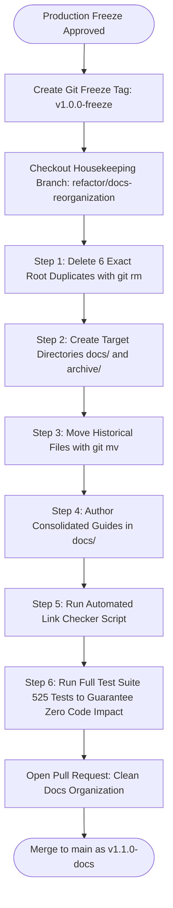

# IVARA — Target Documentation Structure & Reorganization Plan

> **Plan Status:** Proposed Architecture & Migration Protocol  
> **Execution Gate:** Post-Production Freeze Only  
> **Baseline Commit:** `55a273bff20fa0eec1b2d361e8a03b217d147abe`  
> **Target Design Goal:** Clean, publication-grade academic and industrial repository layout with a minimal root directory, zero clutter, and complete historical preservation.

---

## 1. Design Rationale & Principles

Currently, the IVARA repository contains **72 Markdown files in the root directory** and **38 Markdown files across subdirectories** (total 110 files). While every document served an essential purpose during rapid autonomous research sprints, this flat organization presents significant challenges:
1. **High Cognitive Load:** New users and peer reviewers struggle to locate basic onboarding instructions among dozens of sprint ablation logs.
2. **Ambiguous Source of Truth:** Multiple subsystem design documents (`EPISODIC_MEMORY_DESIGN.md`, `UNIFIED_RETRIEVAL_DESIGN.md`, `PHASE2B1_DESIGN.md`, `PHASE3_DESIGN.md`) reflect different temporal snapshots of the architecture rather than a single unified specification.
3. **Redundant Copies:** Six evaluation reports exist identically in both the root and `evaluation/` directories.

### Four Core Organizing Principles
- **Minimal Root Policy:** The repository root shall contain *only* high-level landing pages, primary onboarding guides, freeze audit certifications, and high-level project history deliverables.
- **Hierarchical Domain Partitioning:** All subsystem specifications, operational manuals, and design rationales move into structured subdirectories under `docs/`.
- **Zero Loss of Scientific Provenance:** Historical ablation reports, negative results, and failure forensics are moved into a structured `archive/` tree rather than deleted.
- **Git-Safe Migration:** File reorganization must use `git mv` post-freeze to preserve complete commit history and file blame metadata.

---

## 2. Target Directory Hierarchy

```
IVARA/
├── README.md                               # Project landing page, architecture summary, quickstart
├── INSTALLATION_GUIDE.md                   # Environment, Ollama models, and dependency setup
├── DEMO_GUIDE.md                           # Interactive CLI walkthrough and demo scenarios
├── IVARA_RELEASE_CHECKLIST.md              # Production readiness verification checklist
├── KNOWN_LIMITATIONS.md                    # Active system limits, token bounds, failure modes
├── FINAL_FREEZE_GO_NO_GO.md                # Official production freeze audit gate certification
│
├── IVARA_PROJECT_TIMELINE.md               # Chronological 7-phase development narrative
├── IVARA_CHALLENGES_AND_SOLUTIONS.md       # Register of 9 major engineering challenges & breakthroughs
├── IVARA_ARCHITECTURE_EVOLUTION.md         # 5-generation architectural evolution with diagrams
├── IVARA_DOCUMENTATION_AUDIT.md            # Complete audit of all 110 markdown files in repo
├── IVARA_DOCUMENTATION_STRUCTURE.md        # This target structure and migration roadmap
├── IVARA_PRESENTATION_STORY.md             # 12-slide technical presentation script & visuals
├── IVARA_HISTORY_RECONSTRUCTION_REPORT.md  # Executive synthesis of project history reconstruction
│
├── docs/                                   # Living documentation & technical specifications
│   ├── architecture/                       # System design, data contracts, and schemas
│   │   ├── ARCHITECTURE_SPEC.md            # Consolidated system specification (Gen 5 Candidate B)
│   │   ├── MATHEMATICAL_FORMULATION.md     # Retrieval scoring, MMR diversity, decay equations
│   │   └── PROMPT_REGISTRY.md              # Official prompts for extraction, reasoning, judging
│   ├── evaluation/                         # Evaluation protocols, benchmark design, metrics
│   │   ├── BENCHMARK_PROTOCOL.md           # 500-question LongMemEval-S evaluation protocol
│   │   ├── FINAL_BAKEOFF_REPORT.md         # Full Candidate B/C/E bakeoff report & statistical tests
│   │   └── FINAL_BAKEOFF_INTEGRITY.md      # Hash verification and prediction file provenance
│   └── operations/                         # Maintenance, healthchecks, and troubleshooting
│       ├── OPERATIONAL_RUNBOOK.md          # Database vacuuming, Ollama healthchecks, lifecycle
│       └── TROUBLESHOOTING.md              # Common runtime issues, memory pruning, re-indexing
│
├── archive/                                # Preserved historical records (read-only)
│   ├── milestones/                         # Milestone 1-3 sprint reports and reviews
│   │   ├── EPISODIC_MILESTONE_1_REPORT.md
│   │   ├── ONTOLOGY_MILESTONE_2_REPORT.md
│   │   └── UNIFIED_RETRIEVAL_MILESTONE_3.md
│   ├── phase_experiments/                  # Phase 1, 2A, 2B, 3 experiment logs and ablations
│   │   ├── PHASE1_TEMPORAL_REPORT.md
│   │   ├── PHASE2A_HIERARCHICAL_REPORT.md
│   │   ├── PHASE2B1_EVALUATION_REPORT.md
│   │   ├── PHASE2B2_ABLATION_REPORT.md
│   │   └── PHASE3_EVALUATION_REPORT.md
│   ├── failure_forensics/                  # Forensic investigations into error patterns
│   │   ├── ARCHITECTURE_FAILURE_ANALYSIS.md
│   │   ├── LONGMEMEVAL_FAILURE_ANALYSIS.md
│   │   └── PHASE2B2_FAILURE_ANALYSIS.md
│   └── microbenchmarks/                    # Early LLM and embedding latency / memory profiles
│       ├── MODEL_MICROBENCHMARK_DAY1.md
│       └── MODEL_BENCHMARK_DAY2.md
│
├── evaluation/                             # Active benchmark suite, scripts, and predictions
│   ├── benchmarks/                         # Benchmark runner scripts and LongMemEval configs
│   ├── predictions/                        # Sealed prediction outputs (Candidate B, C, E)
│   └── ground_truth/                       # Gold references and evaluation labels
│
├── src/                                    # Production source code
└── tests/                                  # Production test suite (525 passing tests)
```

---

## 3. Migration Mapping: Existing Files to Target Locations

### 3.1 Files Retained in Root (13 Files)
The following files remain directly in the repository root to provide immediate guidance and definitive freeze records:

| File Path | Description | Justification |
|---|---|---|
| `README.md` | Primary project overview | First point of contact for users and evaluators. |
| `INSTALLATION_GUIDE.md` | Environment & model setup | Critical for rapid reproduction of system. |
| `DEMO_GUIDE.md` | Interactive CLI demo guide | Step-by-step walkthrough for live demonstration. |
| `IVARA_RELEASE_CHECKLIST.md` | Pre-flight release verification | Operational checklist verifying green tests & DB state. |
| `KNOWN_LIMITATIONS.md` | Documented constraints | Honest technical bounds (2,500 token budget, etc.). |
| `FINAL_FREEZE_GO_NO_GO.md` | Freeze authorization certification | Official sign-off certifying code freeze readiness. |
| `IVARA_PROJECT_TIMELINE.md` | Chronological 7-phase narrative | Core project reconstruction deliverable. |
| `IVARA_CHALLENGES_AND_SOLUTIONS.md` | 9 technical challenge registers | Core project reconstruction deliverable. |
| `IVARA_ARCHITECTURE_EVOLUTION.md` | 5-generation architectural evolution | Core project reconstruction deliverable. |
| `IVARA_DOCUMENTATION_AUDIT.md` | Complete 110-file audit inventory | Core project reconstruction deliverable. |
| `IVARA_DOCUMENTATION_STRUCTURE.md` | Clean structure & migration roadmap | Core project reconstruction deliverable. |
| `IVARA_PRESENTATION_STORY.md` | 12-slide presentation script | Core project reconstruction deliverable. |
| `IVARA_HISTORY_RECONSTRUCTION_REPORT.md`| Consolidated executive synthesis | Core project reconstruction deliverable. |

---

### 3.2 Redundant Duplicate Files to be Deleted (6 Files)
The following files are byte-identical duplicates (identical SHA-256 hashes) between root and `evaluation/`. Post-freeze, the root copies will be safely deleted via `git rm`:

| Root File to Delete | Canonical Kept File in `evaluation/` | SHA-256 Prefix |
|---|---|---|
| `EVALUATION_CAMPAIGN_V1_REPORT.md` | `evaluation/EVALUATION_CAMPAIGN_V1_REPORT.md` | `69f2e2bd...` |
| `GRAPH_ABLATION_PROTOCOL.md` | `evaluation/GRAPH_ABLATION_PROTOCOL.md` | `2b63d8a5...` |
| `GRAPH_ABLATION_REPORT.md` | `evaluation/GRAPH_ABLATION_REPORT.md` | `c270c73a...` |
| `INTEGRATED_ONTOLOGY_GRAPH_TEMPORAL_AUDIT.md` | `evaluation/INTEGRATED_ONTOLOGY_GRAPH_TEMPORAL_AUDIT.md` | `dcb3f1ee...` |
| `LONGMEMEVAL_CHUNKING_ABLATION.md` | `evaluation/LONGMEMEVAL_CHUNKING_ABLATION.md` | `4a04b930...` |
| `STEP5_INTEGRATION_AND_EVALUATION_READINESS.md` | `evaluation/STEP5_INTEGRATION_AND_EVALUATION_READINESS.md` | `aac12433...` |

---

### 3.3 Living Documentation: Files Consolidated into `docs/` (12 Files)

The technical content of these files will be consolidated into canonical guides in `docs/`:

| Source File | Target Consolidated File | Content to Consolidate |
|---|---|---|
| `EPISODIC_MEMORY_DESIGN.md` | `docs/architecture/ARCHITECTURE_SPEC.md` | Two-layer memory schemas, SQLite schema, extraction prompts. |
| `UNIFIED_RETRIEVAL_DESIGN.md` | `docs/architecture/ARCHITECTURE_SPEC.md` | Hybrid retrieval architecture, fusion weights, routing logic. |
| `PHASE2B1_DESIGN.md` | `docs/architecture/ARCHITECTURE_SPEC.md` | Graph schema, entity deduplication, relation extraction. |
| `PHASE3_DESIGN.md` | `docs/architecture/ARCHITECTURE_SPEC.md` | Subquery decomposition and query classification rules. |
| `FINAL_BAKEOFF_REPORT.md` | `docs/evaluation/FINAL_BAKEOFF_REPORT.md` | 500-question bakeoff matrix, task breakdown, McNemar tests. |
| `FINAL_BAKEOFF_INTEGRITY_AUDIT.md`| `docs/evaluation/FINAL_BAKEOFF_INTEGRITY.md`| Hash verification, prediction provenance, judge prompts. |
| `LONGMEMEVAL_INTEGRATION_REPORT.md`| `docs/evaluation/BENCHMARK_PROTOCOL.md`| Benchmark protocol, evaluation contracts, scoring rubric. |
| `PRE_FREEZE_HARDENING_REPORT.md`| `docs/architecture/HARDENING_SPEC.md` | Fallback parsing pipeline and zero-identity generalization. |

---

### 3.4 Historical Records: Files Migrated to `archive/` (41 Files)

These files represent valuable empirical records and ablation evidence that must be preserved permanently:

#### A. Milestones (`archive/milestones/`)
- `EPISODIC_MILESTONE_1_REPORT.md`
- `EPISODIC_MILESTONE_1_REVIEW.md`
- `ONTOLOGY_MILESTONE_2_REPORT.md`
- `UNIFIED_RETRIEVAL_MILESTONE_3_REPORT.md`
- `MILESTONE_3_1_AUDIT_REPORT.md`
- `MILESTONE_3_2_BATCH_1_REPORT.md`
- `MILESTONE_3_2_BATCH_2_3_REPORT.md`
- `MILESTONE_3_2_BATCH_4_REPORT.md`
- `MILESTONE_3_2_DESIGN.md`
- `STEP6_TEMPORAL_INTEGRATION_REPORT.md`
- `HYBRID_INTEGRATION_VALIDATION.md`

#### B. Phase Experiment Reports (`archive/phase_experiments/`)
- `PHASE1_TEMPORAL_EXPERIMENT_REPORT.md`
- `PHASE2A_HIERARCHICAL_RETRIEVAL_REPORT.md`
- `PHASE2A1_ADAPTIVE_RETRIEVAL_REPORT.md`
- `PHASE2B1_EVALUATION_REPORT.md`
- `PHASE2B1_IMPLEMENTATION_REPORT.md`
- `PHASE2B2_ABLATION_REPORT.md`
- `PHASE2B2_GRAPH_QUALITY_REPORT.md`
- `PHASE3_EVALUATION_REPORT.md`
- `PHASE3_1_EVALUATION_REPORT.md`
- `LONGMEMEVAL_FULL_BASELINE.md`
- `LONGMEMEVAL_PHASE1_EXPERIMENTS.md`
- `IVARA_FINAL_EVALUATION_REPORT.md`
- `IVARA_FINAL_ENGINEERING_REPORT.md`
- `IVARA_FINAL_HANDOFF.md`
- `IVARA_LONG_CONTEXT_EVALUATION_REPORT.md`

#### C. Failure Forensics (`archive/failure_forensics/`)
- `ARCHITECTURE_FAILURE_ANALYSIS.md`
- `IVARA_FAILURE_ANALYSIS.md`
- `LONGMEMEVAL_FAILURE_ANALYSIS.md`
- `LONGMEMEVAL_FORENSIC_ANALYSIS.md`
- `PHASE2A1_FAILURE_FORENSICS.md`
- `PHASE2B2_FAILURE_ANALYSIS.md`
- `PHASE3_FAILURE_ANALYSIS.md`
- `PHASE3_1_FAILURE_ANALYSIS.md`

#### D. Microbenchmarks & Early Audits (`archive/microbenchmarks/`)
- `MODEL_MICROBENCHMARK_DAY1.md`
- `MODEL_MICROBENCHMARK_DAY1_5.md`
- `MODEL_MICROBENCHMARK_DAY1_AUDIT.md`
- `MODEL_BENCHMARK_DAY2.md`
- `MODEL_CAPABILITY_AUDIT.md`
- `TEMPORAL_REASONING_ARCHITECTURE_AUDIT.md`
- `PRESENTATION_OUTLINE.md`

---

## 4. Execution Workflow (Post-Freeze Only)



### Safety Commands for Migration:
```powershell
# 1. Ensure clean git state
git status

# 2. Tag baseline freeze
git tag -a v1.0.0-freeze -m "Frozen Candidate B production architecture"

# 3. Create housekeeping branch
git checkout -b refactor/docs-reorganization

# 4. Remove exact root duplicates
git rm EVALUATION_CAMPAIGN_V1_REPORT.md
git rm GRAPH_ABLATION_PROTOCOL.md
git rm GRAPH_ABLATION_REPORT.md
git rm INTEGRATED_ONTOLOGY_GRAPH_TEMPORAL_AUDIT.md
git rm LONGMEMEVAL_CHUNKING_ABLATION.md
git rm STEP5_INTEGRATION_AND_EVALUATION_READINESS.md

# 5. Create directories
mkdir docs/architecture docs/evaluation docs/operations archive/milestones archive/phase_experiments archive/failure_forensics archive/microbenchmarks

# 6. Move files using git mv (preserves history)
git mv PHASE2B2_ABLATION_REPORT.md archive/phase_experiments/
git mv PHASE3_EVALUATION_REPORT.md archive/phase_experiments/
# ... (proceed systematically)
```

---

## 5. Documentation Maintenance Policy

To maintain repository hygiene going forward, contributors must adhere to three simple rules:
1. **No Sprint Notes in Root:** All experimental notes, ablation runs, or temporary analyses must be authored directly in `archive/` or `scratch/`.
2. **Single Source of Truth:** Code changes affecting architecture (retrieval weights, prompts, database schemas) must update `docs/architecture/ARCHITECTURE_SPEC.md` in the same commit.
3. **Automated Link Verification:** Continuous Integration (CI) will execute a link verification script checking all internal markdown links (`[text](file:///...)` and relative links) before merging.
