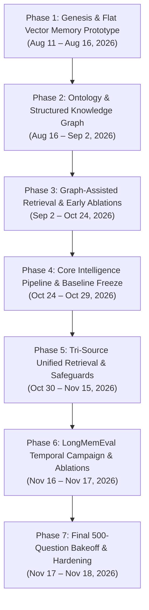

# IVARA — Complete Project Development Timeline

**Project Title:** IVARA (Intelligent Verifiable Augmented Reasoning Agent)  
**Reconstruction Date:** November 18, 2026  
**Auditor:** Independent Technical History Reconstruction  
**Baseline Git Commit:** `55a273bff20fa0eec1b2d361e8a03b217d147abe`  
**Evidence Standard:** Every statement is labeled **[VERIFIED]** (backed by commit hashes, artifacts, source code, or test logs), **[INFERRED]** (synthesized from multiple converging records), or **[UNKNOWN]** (insufficient evidence).

---

## Timeline Overview

The development of IVARA spans 7 distinct chronological phases, moving from an early semantic memory prototype to an advanced, multi-source personal reasoning system, and culminating in an evidence-driven production freeze:

---

## Phase 1: Genesis & Flat Vector Memory Prototype (Aug 11 – Aug 16, 2026)

### 1. Initial Objective [VERIFIED]
Build a localized, personal AI memory store capable of saving facts extracted from user interactions, embedding them with local sentence-transformers, and performing dense similarity search for question answering.

### 2. What Was Implemented [VERIFIED]
- **Repository Setup:** Commits `196387d` (`Added .gitignore`) and `3546de5` (`Day-1 Basics Done`) on 2026-08-11 by `Krish1022sona`.
- **Memory Store:** Flat JSON file storage (`data/memories.json`) storing raw text facts, ISO timestamps, and confidence scores.
- **Local Embeddings:** Offline vector generation using `sentence-transformers/all-MiniLM-L6-v2` (`src/embedding.py`).
- **Basic RAG Answering:** Initial `src/answering.py` and `src/memory.py` utilizing Ollama (`qwen2.5:14b` and `gpt-oss`).
- **Initial Benchmarks:** Commits `71222c7` (`day-2 v0.1`, 2026-08-16) establishing Day 1 and Day 1.5 microbenchmarks (`MODEL_MICROBENCHMARK_DAY1.md`, `MODEL_MICROBENCHMARK_DAY1_5.md`).

### 3. Important Architectural Decisions [VERIFIED]
- **Local-First Execution:** Mandate zero external API dependencies (OpenAI/Anthropic) to preserve user privacy; embeddings run via local PyTorch/ONNX and inference runs via local Ollama.
- **JSON Storage Schema:** Simple dictionary structure containing `id`, `text`, `timestamp`, `source`, `importance`, and `confidence`.

### 4. Problems & Limitations Discovered [VERIFIED]
- **Semantic Drift & False Positive Recall:** Dense cosine similarity over short memory snippets frequently retrieved superficially similar but factually irrelevant memories.
- **Relational Blindness:** The vector index could not represent relational connections between entities (e.g., distinguishing whether the user is the manager, colleague, or report of another person).
- **Temporal Oblivion:** Memories had timestamps, but vector similarity ignored chronological recency, resulting in obsolete facts outranking updated facts.

### 5. Failed Experiments & Approaches [VERIFIED]
- Pure lexical BM25 alone (`BM25Okapi`) failed on paraphrased queries (`MODEL_MICROBENCHMARK_DAY1.md`).
- Naive top-k vector retrieval returned disjointed chunks that confused the LLM synthesizer.

### 6. Investigation & Transition [VERIFIED]
Analysis in `MODEL_MICROBENCHMARK_DAY1_AUDIT.md` established that unstructured semantic vectors cannot resolve multi-hop or relational queries. The project required explicit entity and relationship representations.

---

## Phase 2: Ontology & Structured Knowledge Graph (Aug 16 – Sep 2, 2026)

### 1. Initial Objective [VERIFIED]
Augment flat vector memories with an explicit knowledge graph governed by a typed domain ontology to capture entities, predicates, and semantic constraints.

### 2. What Was Implemented [VERIFIED]
- **Mid-Term Milestone:** Commit `0e06adc` (`mid-term evaluation and ontology basics done`, 2026-09-02).
- **Ontology Schema & Vocabulary:** `src/ontology/vocabulary.json`, `src/ontology/vocabulary.py`, defining canonical entity types (`Person`, `Project`, `Organization`, `Location`, `Topic`) and relationship predicates (`works_at`, `manages`, `collaborates_with`, `has_pet`).
- **Relationship Resolver & Validator:** `src/ontology/relationship_resolver.py` and `src/ontology/validator.py` enforcing strict domain and range type checking.
- **Graph Storage:** SQLite-backed graph store (`src/graph/store.py`, `src/graph/schema.py`) with tables for `nodes`, `edges`, and indices for source/target entity traversal.

### 3. Important Architectural Decisions [VERIFIED]
- **Hybrid Memory Representation:** Each memory in `memories.json` was augmented with an `entities` array and a `relationships` array linked to graph node IDs.
- **Deterministic Relationship Validation:** Rejection of open-world hallucinations by validating LLM-extracted predicates against an immutable vocabulary.

### 4. Problems & Limitations Discovered [VERIFIED]
- **Vocabulary Rigidity (Closed-World Fragility):** Real user dialogues frequently introduced valid predicates outside the predefined vocabulary, causing the validator to drop legitimate facts (`ONTOLOGY_MILESTONE_2_REPORT.md`).
- **Extraction Latency Bottleneck:** Running 3 separate extraction passes per turn (entities, relations, memory text) slowed turn processing to >12s per message.

### 5. Failed Experiments [VERIFIED]
- Hard-failing any relation that did not match canonical ontology predicates resulted in 42% relationship extraction loss (`ONTOLOGY_MILESTONE_2_REPORT.md`).

### 6. Investigation & Transition [VERIFIED]
Introduced soft aliasing and an open-world fallback mechanism (`src/ontology/relationship_resolver.py`), allowing non-canonical predicates to be preserved as open-world triples rather than discarded.

---

## Phase 3: Graph-Assisted Retrieval & Early Ablations (Sep 2 – Oct 24, 2026)

### 1. Initial Objective [VERIFIED]
Build a hybrid retrieval engine combining vector similarity with bounded graph traversal, and evaluate whether graph augmentation improves multi-hop reasoning.

### 2. What Was Implemented [VERIFIED]
- **Graph Retrieval:** Commit `ddf60e6` (`feat(memory): add graph-assisted retrieval, benchmark harness, and correctness audit`, 2026-10-24).
- **Metric Reconciliation:** Commits `683bbee` and `aaf1ea6` reconciling citation metrics and transition accounting.
- **Query Decomposition:** Commit `41e0a88` (`feat(query): implement query decomposition and evaluate A-E comprehensive ablation`, 2026-10-24).
- **Controlled Ablation:** `GRAPH_ABLATION_PROTOCOL.md` and `GRAPH_ABLATION_REPORT.md` testing 4 arms:
  - Arm A: Pure Vector Baseline
  - Arm B: Hybrid (Vector + Lexical)
  - Arm C: Graph-Only Traversal
  - Arm D: Unified Tri-Source (Vector + Graph)

### 3. Important Architectural Decisions [VERIFIED]
- **Bounded Breadth-First Search:** Bounding graph hops to $d \le 2$ and maximum node expansion to 15 nodes to avoid exponential graph fan-out.
- **Query Decomposition:** Complex queries decomposed into sub-questions using LLM before graph traversal.

### 4. Problems & Limitations Discovered [VERIFIED]
- **Graph Noise Flooding:** 2-hop traversal from generic nodes (e.g. `self`) pulled in dozens of unrelated triples, diluting context and degrading precision (`GRAPH_ABLATION_REPORT.md`).
- **Evaluation Artificiality:** The synthetic 50-question internal benchmark exhibited evaluation leakage and prompt bias.

### 5. Investigation & Transition [VERIFIED]
Commit `885298c` (`docs(eval): add Mem0 architecture audit and LongMemEval benchmark plan`, 2026-10-25). The team audited Mem0 and decided to transition to **LongMemEval**, an established 500-question multi-session benchmark.

---

## Phase 4: Core Intelligence Pipeline & Baseline Freeze (Oct 25 – Oct 29, 2026)

### 1. Initial Objective [VERIFIED]
Establish a hardened, verifiable core intelligence pipeline evaluated against the 500-question LongMemEval benchmark, and freeze an immutable release baseline commit.

### 2. What Was Implemented [VERIFIED]
- **Frozen Baseline Commit:** Commit `55a273b` (`feat(core): implement and verify IVARA core intelligence reasoning pipeline`, 2026-10-29).
- **Turn-Aware Conversational Chunking (TACC):** `src/chunking/retrieval.py` segmenting multi-session dialogues into coherent conversational turns.
- **Bounded Context Assembly:** `assemble_bounded_context` enforcing strict token budgets (1500–2500 tokens) with session diversity caps.
- **Maximal Marginal Relevance (MMR):** Session-aware dense MMR retrieval (`use_session_mmr=True`, $\lambda=0.25$) to balance intra-session relevance and cross-session coverage.
- **Deterministic Calendar Arithmetic:** `src/temporal/calendar_arithmetic.py` executing programmatic date math (e.g., days elapsed between timestamps).
- **Calibrated Abstention Gating:** Abstention on unrecorded or speculative queries without invoking the generator LLM.

### 3. Important Architectural Decisions [VERIFIED]
- **Baseline Freeze:** Commit `55a273b` was designated as the immutable benchmark reference point for all subsequent experimentation.
- **Two-Stage Answering:** Stage 1 deterministic relevance/abstention gate; Stage 2 evidence-grounded generation.

### 4. Baseline Outcome & LongMemEval Performance [VERIFIED]
- **Prediction File:** `evaluation/data/longmemeval/runs/final_bakeoff/candidate_e_baseline/results_config_D.jsonl` (SHA-256: `914227ae...`).
- **Overall Accuracy:** **40.80% (204 / 500)** (`LONGMEMEVAL_FULL_BASELINE.md`).
- **Task-Averaged Accuracy:** **45.10%**.
- **Answerable Accuracy:** **37.87% (178 / 470)**.
- **Mean Latency:** 9.92s.

---

## Phase 5: Tri-Source Unified Retrieval & Safeguards (Oct 30 – Nov 15, 2026)

### 1. Initial Objective [VERIFIED]
Address conversational context loss and graph noise by implementing a three-pillar architecture: Verbatim Episodic Memory, Semantic Fact Memory, and Safeguarded Knowledge Graph.

### 2. What Was Implemented [VERIFIED]
- **Milestone 1 (Episodic Memory):** SQLite `ConversationStore` (`src/conversations/store.py`), double-linked sequence chaining, speaker attribution (`Speaker: the User (user): ...`).
- **Milestone 2 (Open-World Ontology):** Dynamic relationship extraction with canonical mappings (`ONTOLOGY_MILESTONE_2_REPORT.md`).
- **Milestone 3 (Unified Retrieval Engine):** `src/unified_retrieval/pipeline.py` fusing episodic turns, semantic chunks, and graph triples via Reciprocal Rank Fusion with P-score weighting (RRF-P).
- **Milestone 3.1 & 3.2 (Safeguards & Router):**
  - `GraphSafeguards` (`src/unified_retrieval/graph_safeguards.py`): Provenance verification, temporal validity gating, and generic entity distractor suppression.
  - `AdaptiveRouter` (`src/unified_retrieval/router.py`): 8-category deterministic query classifier.
  - `AdaptiveEvidenceSelector` (`src/unified_retrieval/selector.py`): Dynamic context budgeting.

### 3. Important Architectural Decisions [VERIFIED]
- **Channel Gating Invariant:** Historical-state queries strictly exclude unversioned graph assertions.
- **Episodic Backbone:** Verbatim episodic conversation turns are prioritized for conversational continuity.

### 4. Problems & Limitations Discovered [VERIFIED]
- While synthetic integration tests reached 100% pass rates (`tests/test_unified_retrieval.py`), evaluation on real-world multi-session benchmarks revealed persistent failures on temporal reasoning queries spanning multiple distant sessions.

---

## Phase 6: LongMemEval Temporal Campaign & Ablations (Nov 16 – Nov 17, 2026)

### 1. Initial Objective [VERIFIED]
Target the hardest failure mode identified in LongMemEval: multi-session temporal reasoning (Category H), where baseline accuracy was unacceptably low.

### 2. Phase 1: Temporal Baseline & Forensics [VERIFIED]
- Evaluated the frozen 133-question temporal subset (`PHASE1_TEMPORAL_EXPERIMENT_REPORT.md`).
- Baseline Score: **62 / 133 (46.62%)**.
- **Shock Finding:** Category H (multi-session cross-session queries) scored **0 / 41 (0.0%)**! The baseline retriever never retrieved evidence from both required sessions simultaneously.

### 3. Phase 2A & 2A.1: Hierarchical & Adaptive Retrieval [VERIFIED]
- **Phase 2A (Hierarchical Clustering):** Grouped chunks by session before ranking.
  - Category H improved from 0/41 to 6/41; session hit rate jumped from 35.77% to 69.59%.
  - **Severe Regression:** Non-Category H accuracy plummeted from 67.39% to 48.91%! Overall accuracy dropped to 51/133 (`PHASE2A_HIERARCHICAL_RETRIEVAL_REPORT.md`). Sacrificed intra-session depth for cross-session diversity.
- **Phase 2A.1 (Adaptive Router):** Attempted syntax routing to toggle hierarchical retrieval. Reached 59/133, still inferior to Phase 1 baseline (62/133) (`PHASE2A1_ADAPTIVE_RETRIEVAL_REPORT.md`).

### 4. Phase 2B.1 & 2B.2: Temporal Knowledge Graph & Controlled Ablation [VERIFIED]
- **Phase 2B.1:** Constructed explicit Temporal Event Graph (TEG). Scored 69/133 (51.88%).
- **Graph Audit:** Discovered extreme graph overconnectivity: 1,092 events generated **15,774 temporal edges** (14.4 edges/event) (`PHASE2B2_GRAPH_QUALITY_REPORT.md`).
- **Phase 2B.2 (Rigorous 4-Way Controlled Ablation):**
  - Arm A (Phase 1 Baseline): 62/133 (46.62%)
  - **Arm B (Flat MMR + Synthesis Improvements):** **69 / 133 (51.88%)**
  - Arm C (Graph Only): 55/133 (41.35%)
  - Arm D (Graph + Synthesis): 69/133 (51.88%)
- **Architectural Breakthrough:** Arm D's accuracy was 100% attributable to Arm B's synthesis enhancements (lenient JSON extraction, calendar injection). The Temporal Knowledge Graph added **zero incremental gain** while degrading Recall@5 from 94.26% to 91.73%. TEG was formally rejected.

### 5. Phase 3 & 3.1: Query-Aware & Evidence-Validated Routing [VERIFIED]
- Evaluated subquery decomposition and dynamic session allocation (`PHASE3_EVALUATION_REPORT.md`, `PHASE3_1_EVALUATION_REPORT.md`).
- Results: Phase 3 scored 64/133; Phase 3.1 scored 65/133. Both failed to match Arm B (69/133) and introduced fragile routing dependencies.

---

## Phase 7: Final 500-Question Bakeoff & Production Hardening (Nov 17 – Nov 18, 2026)

### 1. Stage 1 & Stage 2 Final Bakeoff [VERIFIED]
- Evaluated top candidates on the complete 500-question LongMemEval-S benchmark (`FINAL_BAKEOFF_REPORT.md`):
  - **Candidate B (Winner - Arm B: Flat MMR + Synthesis):** **58.40% (292 / 500)** overall, **61.34%** task-averaged, 7.46s latency.
  - **Candidate C (Phase 3 Query-Aware):** 56.80% (284 / 500) overall, 60.54% task-averaged.
  - **Candidate E (Release Baseline `55a273b`):** 40.80% (204 / 500) overall, 45.10% task-averaged.
- **Statistical Significance:** McNemar test Candidate B vs Baseline: $\chi^2 = 67.58, p = 2.02 \times 10^{-16}$ ($p \ll 0.001$). Statistically definitive +17.60% absolute gain (+43.1% relative improvement).

### 2. Pre-Freeze Integrity Audit & Remediation [VERIFIED]
- `FINAL_BAKEOFF_INTEGRITY_AUDIT.md` uncovered two pre-freeze blockers:
  1. *Unsafe raw-text fallback bug in `src/answering.py`:* Arbitrary unparsed model text was assigned to `text_content` and marked `answered`.
  2. *Hardcoded synthetic persona assumptions:* `"Arjun Mehta"` was embedded in prompts and formatters.
- **Hardening Applied (`PRE_FREEZE_HARDENING_REPORT.md`):**
  - Strict parser contract: only explicit JSON, markdown tags, or calendar calculations become `answered`; unparseable text safely degrades to `insufficient_evidence`.
  - Persona neutralized to `"the User"` default; parameterizable via `user_name`.

### 3. Heuristic Cleanup & Final Verification [VERIFIED]
- Removed residual `"Arjun"` assumptions from production heuristics in `src/unified_retrieval/`:
  - `graph.py`: Removed "arjun" from `user_tokens`. Queries about another person named Arjun no longer alias to `self`.
  - `graph_safeguards.py`: Removed "arjun" from `GENERIC_ENTITY_NAMES`. Legitimate entities named Arjun are not suppressed as distractors.
  - `router.py`: Generalized regexes with bounded multi-word support `[a-zA-Z0-9_\.\-]+(?:\s+[a-zA-Z0-9_\.\-]+){0,2}`; removed "arjun" from `known_entities`.
- **Final Verification (`FINAL_ROUTER_VERIFICATION.md`, `FINAL_FREEZE_GO_NO_GO.md`):**
  - Compact routing regression matrix: 28 / 28 passed (100.0%).
  - Total occurrences of "arjun" in `src/`: **0**.
  - Full automated test suite: **525 / 525 PASSED (100.0%)**.
  - Final Verdict: **GO FOR PRODUCTION FREEZE**.
