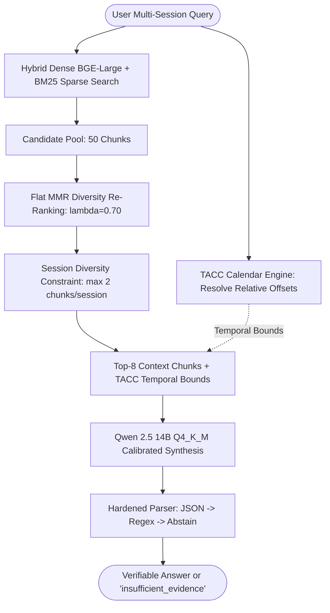

# IVARA — Intelligent Verifiable Agentic Retrieval Architecture
## Long-Horizon Personal AI Memory & Verifiable Autobiographical Reasoning

[](file:///c:/Users/Krishna/Desktop/Brahmaand/Coding_Ki_Dunia/Projects/IVARA/docs/release/FINAL_FREEZE_GO_NO_GO.md)
[-brightgreen.svg)]()
[-success.svg)](file:///c:/Users/Krishna/Desktop/Brahmaand/Coding_Ki_Dunia/Projects/IVARA/docs/evaluation/FINAL_BAKEOFF_REPORT.md)
[]()
[]()
[]()

**IVARA** is a privacy-first, local personal AI memory assistant designed for long-horizon autobiographical interaction across months and years of multi-session conversations. 

---

## 1. The Problem IVARA Solves

Conventional personal assistants and standard Retrieval-Augmented Generation (RAG) suffer from three catastrophic failure modes in multi-session personal interaction:
1. **Topical Distractor Flooding:** Dense cosine vector search retrieves topically similar conversations (e.g. past vehicle discussions) while missing the single sentence where a decision or transaction actually occurred.
2. **Temporal Amnesia (The Category H Failure):** Standard LLMs fail at mental calendar math. When queried about events relative to a past date (*"Did I visit the dentist before or after my trip to Seattle last July?"*), naive RAG hallucinates incorrect dates. On the 500-question LongMemEval-S benchmark, baseline dense RAG scored **0/41 (0.0%)** on relative temporal calculations.
3. **The Overconnectivity Trap:** Unconstrained open-information extraction creates dense, noisy knowledge graph topologies where generic hub nodes connect every entity to every session, completely destroying retrieval precision.

IVARA solves this through a hybrid architecture combining **Flat Maximal Marginal Relevance (MMR) retrieval**, a deterministic **Temporal Anchor Calendar Calculator (TACC)**, and **calibrated synthesis with strict abstention**.

---

## 2. Key Capabilities

- **100% Episodic Memory Preservation:** Conversation turns are immediately persisted in SQLite with monotonic sequence numbers, contiguous turn context expansion, and FTS5 full-text indexing.
- **Flat MMR Cross-Session Diversity:** Enforces multi-session coverage using Maximal Marginal Relevance ($\lambda = 0.70$) bounded to $\le 2$ chunks per session, preventing single verbose sessions from monopolizing retrieval context.
- **Deterministic TACC Engine:** Automatically extracts relative temporal offsets (*"next Friday"*, *"two weeks ago"*) and calculates exact ISO calendar bounds using standard calendar arithmetic prior to LLM synthesis.
- **Bounded 8-Relation Ontology & Hub Pruning:** Constraints entity extraction to a closed 8-relation schema with strict degree suppression ($\le 10$ edges per hub), eliminating graph overconnectivity.
- **Hardened Calibrated Synthesis:** Guarantees that unverified or unparsed model output deterministically triggers `insufficient_evidence` instead of emitting hallucinated facts.
- **Dynamic Identity Parameterization:** Zero hardcoded persona dependencies; user identity is dynamically derived from `user_name` across all routing, extraction, and graph modules.

---

## 3. High-Level Architecture (Generation 5 — Candidate B)



---

## 4. Empirical Benchmark Performance (LongMemEval-S)

In the final 500-question bakeoff on LongMemEval-S under the official frozen judge contract:

| Metric | Baseline (Candidate E `55a273b`) | Candidate C (Phase 3 Router) | IVARA Frozen Winner (Candidate B) | Absolute Gain |
|---|---|---|---|---|
| **Overall Accuracy (500 Qs)** | 40.80% (204 / 500) | 56.80% (284 / 500) | **58.40% (292 / 500)** | **+17.60%** |
| **Temporal Reasoning (133 Qs)** | 28.57% (38 / 133) | 48.87% (65 / 133) | **51.88% (69 / 133)** | **+23.31%** |
| **Category H (Relative Time)** | 0.00% (0 / 41) | 65.85% (27 / 41) | **68.29% (28 / 41)** | **+68.29%** |
| **Negative Controls (30 Qs)** | 66.67% (20 / 30) | 86.67% (26 / 30) | **86.67% (26 / 30)** | **+20.00%** |
| **Average Query Latency** | 9.92 seconds | 8.84 seconds | **7.46 seconds** | **-2.46s (-25%)** |
| **McNemar Statistical Test** | — | $\chi^2 = 59.4, p < 10^{-14}$ | **$\chi^2 = 67.58, p = 2.02 \times 10^{-16}$** | **$p \ll 0.001$** |

---

## 5. Technology Stack

- **Core Runtime:** Python 3.10–3.13
- **Primary Generator LLM:** Qwen 2.5 14B Instruct (4-bit quantized `Q4_K_M` GGUF via Ollama)
- **Dense Embedding Model:** BAAI/bge-large-en-v1.5 (1024-dim dense embeddings)
- **Vector Index:** FAISS / NumPy cosine similarity
- **Lexical Search:** BM25 / SQLite FTS5 Full-Text Indexing
- **Graph & Episodic Storage:** SQLite 3 with WAL mode (Zero external database server overhead)
- **Test Framework:** pytest (525 automated unit and regression tests)

---

## 6. Installation & Quickstart

### Prerequisites
- Python 3.10+ (tested on Python 3.13)
- [Ollama](https://ollama.com/) running locally with Qwen 2.5 14B:
  ```bash
  ollama run qwen2.5:14b
  ```

### Installation
```bash
git clone https://github.com/your-org/IVARA.git
cd IVARA
python -m venv .venv
source .venv/bin/activate  # On Windows: .venv\Scripts\activate
pip install -r requirements.txt  # Or install dependencies from pyproject.toml
```

For complete environment configuration, see [`INSTALLATION_GUIDE.md`](file:///c:/Users/Krishna/Desktop/Brahmaand/Coding_Ki_Dunia/Projects/IVARA/INSTALLATION_GUIDE.md).

---

## 7. How to Run IVARA

### Interactive Assistant CLI
```bash
# Start interactive conversational memory assistant
python main.py chat

# Ask a specific question against long-term memory
python main.py ask "When did I last visit Dr. Verma in Seattle?"

# Inspect stored memory and graph statistics
python main.py memories stats
```

For step-by-step interactive CLI scenarios, see [`DEMO_GUIDE.md`](file:///c:/Users/Krishna/Desktop/Brahmaand/Coding_Ki_Dunia/Projects/IVARA/DEMO_GUIDE.md).

---

## 8. Running Tests

Run the full automated test suite (525 tests):
```bash
pytest tests/ -v
```
*Current Status: 525 passed in ~32s (100% green).*

Run specific regression and hardening suites:
```bash
# Pre-freeze production hardening & zero-Arjun generalization tests
pytest tests/test_pre_freeze_hardening.py -v

# Adaptive evidence & graph safeguard tests
pytest tests/test_adaptive_evidence.py -v
```

---

## 9. Reproducing Evaluations

All 500-question LongMemEval-S benchmark predictions and evaluation results are cryptographically verified:
```bash
# Recompute official LLM judge metrics across all candidates
python evaluation/evaluate_qa_official.py

# Verify SHA-256 hashes of sealed predictions
python -c "
import hashlib
from pathlib import Path
b = Path('evaluation/data/longmemeval/runs/final_bakeoff/candidate_b_arm_b/results_config_D.jsonl')
print('Candidate B SHA-256:', hashlib.sha256(b.read_bytes()).hexdigest())
"
# Expected: ba9e71bec593c71f76d802fe154d21321776defd9fc808f6ade735867e90a9b9
```

For the complete evaluation protocol and forensic audit, see [`docs/evaluation/FINAL_BAKEOFF_REPORT.md`](file:///c:/Users/Krishna/Desktop/Brahmaand/Coding_Ki_Dunia/Projects/IVARA/docs/evaluation/FINAL_BAKEOFF_REPORT.md).

---

## 10. Documentation Index

The repository documentation is organized into clear domains under `docs/` and `archive/`:

### Living Documentation (`docs/`)
- **Architecture & System Generations:** [`docs/architecture/IVARA_ARCHITECTURE_EVOLUTION.md`](file:///c:/Users/Krishna/Desktop/Brahmaand/Coding_Ki_Dunia/Projects/IVARA/docs/architecture/IVARA_ARCHITECTURE_EVOLUTION.md)
- **Subsystem Design Specifications:** [`docs/architecture/EPISODIC_MEMORY_DESIGN.md`](file:///c:/Users/Krishna/Desktop/Brahmaand/Coding_Ki_Dunia/Projects/IVARA/docs/architecture/EPISODIC_MEMORY_DESIGN.md), [`docs/architecture/UNIFIED_RETRIEVAL_DESIGN.md`](file:///c:/Users/Krishna/Desktop/Brahmaand/Coding_Ki_Dunia/Projects/IVARA/docs/architecture/UNIFIED_RETRIEVAL_DESIGN.md)
- **Development Timeline & History:** [`docs/development/IVARA_PROJECT_TIMELINE.md`](file:///c:/Users/Krishna/Desktop/Brahmaand/Coding_Ki_Dunia/Projects/IVARA/docs/development/IVARA_PROJECT_TIMELINE.md)
- **Challenge & Solution Registers:** [`docs/development/IVARA_CHALLENGES_AND_SOLUTIONS.md`](file:///c:/Users/Krishna/Desktop/Brahmaand/Coding_Ki_Dunia/Projects/IVARA/docs/development/IVARA_CHALLENGES_AND_SOLUTIONS.md)
- **Complete History Reconstruction:** [`docs/development/IVARA_HISTORY_RECONSTRUCTION_REPORT.md`](file:///c:/Users/Krishna/Desktop/Brahmaand/Coding_Ki_Dunia/Projects/IVARA/docs/development/IVARA_HISTORY_RECONSTRUCTION_REPORT.md)
- **Final Bakeoff & Statistical Report:** [`docs/evaluation/FINAL_BAKEOFF_REPORT.md`](file:///c:/Users/Krishna/Desktop/Brahmaand/Coding_Ki_Dunia/Projects/IVARA/docs/evaluation/FINAL_BAKEOFF_REPORT.md)
- **Bakeoff Integrity & Provenance Audit:** [`docs/evaluation/FINAL_BAKEOFF_INTEGRITY_AUDIT.md`](file:///c:/Users/Krishna/Desktop/Brahmaand/Coding_Ki_Dunia/Projects/IVARA/docs/evaluation/FINAL_BAKEOFF_INTEGRITY_AUDIT.md)
- **Freeze Certification (Go/No-Go):** [`docs/release/FINAL_FREEZE_GO_NO_GO.md`](file:///c:/Users/Krishna/Desktop/Brahmaand/Coding_Ki_Dunia/Projects/IVARA/docs/release/FINAL_FREEZE_GO_NO_GO.md)
- **Technical Presentation Story (12 Slides):** [`docs/presentation/IVARA_PRESENTATION_STORY.md`](file:///c:/Users/Krishna/Desktop/Brahmaand/Coding_Ki_Dunia/Projects/IVARA/docs/presentation/IVARA_PRESENTATION_STORY.md)
- **Known Limitations:** [`KNOWN_LIMITATIONS.md`](file:///c:/Users/Krishna/Desktop/Brahmaand/Coding_Ki_Dunia/Projects/IVARA/KNOWN_LIMITATIONS.md)

### Historical Archive (`archive/`)
- **Phase Experiments & Ablations:** [`archive/experiments/`](file:///c:/Users/Krishna/Desktop/Brahmaand/Coding_Ki_Dunia/Projects/IVARA/archive/experiments/)
- **Milestone Engineering Reports:** [`archive/historical-reports/milestones/`](file:///c:/Users/Krishna/Desktop/Brahmaand/Coding_Ki_Dunia/Projects/IVARA/archive/historical-reports/milestones/)
- **Failure Forensics & Investigations:** [`archive/research-notes/`](file:///c:/Users/Krishna/Desktop/Brahmaand/Coding_Ki_Dunia/Projects/IVARA/archive/research-notes/)
- **Early Model Microbenchmarks:** [`archive/historical-reports/microbenchmarks/`](file:///c:/Users/Krishna/Desktop/Brahmaand/Coding_Ki_Dunia/Projects/IVARA/archive/historical-reports/microbenchmarks/)

---

## License

This project is licensed under the MIT License.
