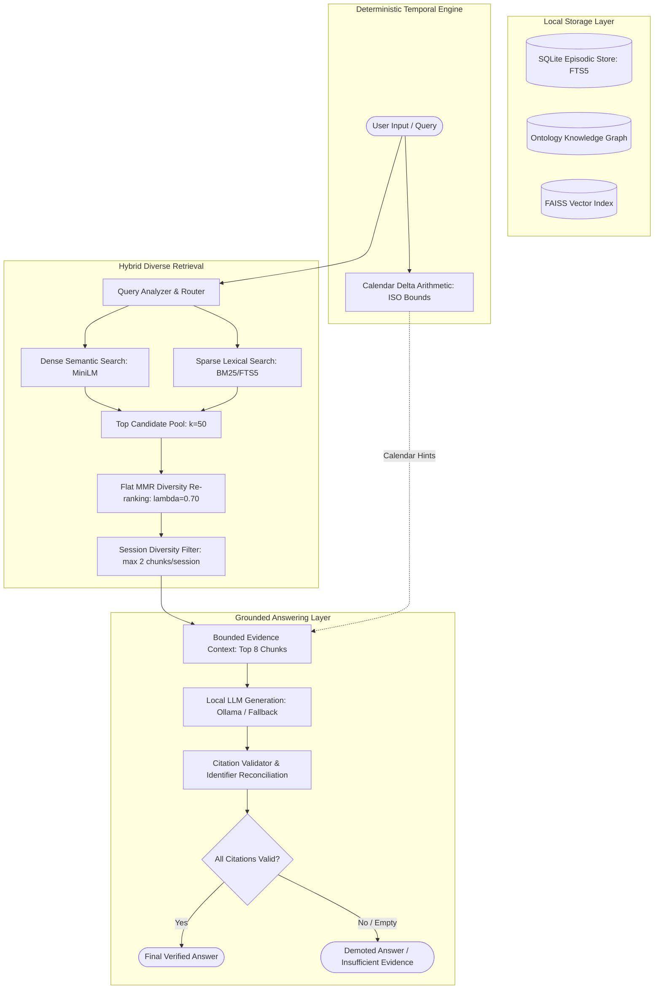

# IVARA — Intelligent Verifiable Agentic Retrieval Architecture
## Privacy-First Autobiographical Memory & Grounded Reasoning for Local Conversational AI

[]()
[](LICENSE)
[]()
[](evaluation/FINAL_RESULTS.md)
[]()

IVARA is a local, privacy-first personal AI memory architecture designed to retain, organize, and reason across extended autobiographical conversations spanning weeks, months, and years. By pairing deterministic episodic storage with Maximal Marginal Relevance (MMR) retrieval, explicit calendar arithmetic, and strict post-generation citation reconciliation, IVARA mitigates topic distraction and hallucinated memory recall without transmitting personal data to cloud APIs.

---

## 1. Problem Statement

Standard conversational AI assistants and naive Retrieval-Augmented Generation (RAG) suffer from fundamental failures when dealing with long-horizon autobiographical interaction:

1. **Topical Distractor Flooding:** Standard dense vector search retrieves conversations with high topical overlap while missing isolated turns where decisive transactions, status updates, or biographical shifts occurred.
2. **Mental Calendar Arithmetic Failures:** Generative language models struggle with relative date intervals (e.g., *"Did I switch projects before or after my trip to Seattle last July?"*). Without calendar tools, standard pipelines hallucinate temporal timelines.
3. **Graph Overconnectivity:** Open information extraction graphs often degenerate into dense hub topologies where high-frequency entities connect to nearly every node, degrading retrieval precision.
4. **Ungrounded Extrapolation:** Standard generative decoders routinely interpolate missing biographical details rather than honestly abstaining when evidence is absent.

IVARA addresses these challenges through a modular pipeline featuring deterministic episodic chunking, session-bounded MMR retrieval, a deterministic calendar reasoning engine, and a citation reconciliation validator.

---

## 2. Key Features

- **Local Episodic Persistence:** Captures full conversational dialogue turns in SQLite with monotonic sequence identifiers, contiguous turn context expansion, and FTS5 full-text indexing.
- **Session-Aware MMR Diversity:** Applies Maximal Marginal Relevance ($\lambda = 0.70$) with a hard limit ($\le 2$ chunks per session) to prevent single verbose sessions from dominating the context budget.
- **Deterministic Calendar Engine:** Resolves relative temporal offsets (*"three weeks ago"*, *"next Tuesday"*) into exact ISO calendar dates using calendar arithmetic prior to prompt synthesis.
- **Closed-Ontology Extraction:** Constrains entity and relationship recognition to an 8-relation schema with degree suppression ($\le 10$ edges per hub) to prevent graph overconnectivity.
- **Citation-Reconciled Answer Gating:** Extracts cited memory identifiers from candidate outputs, validates them against the retrieved evidence map, and demotes answers lacking valid provenance to `partial` or `insufficient_evidence`.
- **Dynamic Identity Parameterization:** User identity is dynamically configured from `user_name` across extraction and retrieval modules, avoiding hardcoded persona dependencies.

---

## 3. Architecture Overview



---

## 4. Processing Pipeline

1. **Episodic Ingestion:** User and assistant turns are stored with turn metadata, ISO timestamps, and session identifiers.
2. **Hybrid Candidate Retrieval:** On receiving a query, IVARA performs parallel dense vector search (FAISS) and lexical full-text search (SQLite FTS5).
3. **Diversity Re-Ranking:** Candidates are ranked via Flat Maximal Marginal Relevance ($\lambda = 0.70$). Chunks beyond the per-session threshold ($\le 2$) are suppressed.
4. **Temporal Context Enrichment:** Explicit dates and relative date expressions are processed by the calendar arithmetic engine, calculating exact elapsed days, weeks, and calendar boundaries.
5. **Calibrated Answer Generation:** Retrieved context chunks with unique identifiers (e.g. `[c1]`, `[c2]`) are supplied to the generator.
6. **Citation Reconciliation:** The citation validator verifies that every referenced memory key exists within the retrieved context. If citations are missing or point to unretrieved records, the output status is demoted to `partial` or `insufficient_evidence`.

---

## 5. Technology Stack

- **Language:** Python 3.10 – 3.13
- **Episodic & Relational Database:** SQLite 3 with FTS5 and WAL mode
- **Dense Vector Search:** FAISS (`faiss-cpu`)
- **Sentence Embeddings:** `sentence-transformers` (`all-MiniLM-L6-v2`)
- **Data Validation & Schemas:** Pydantic v2
- **Local LLM Interface:** Ollama API (`gpt-oss`, `qwen2.5:14b`)
- **Terminal User Interface:** Rich
- **Test Automation:** pytest

---

## 6. Prerequisites

- **Python:** Version 3.10, 3.11, 3.12, or 3.13 installed.
- **Hardware:**
  - *Offline / Deterministic Demo:* Any modern CPU, $\ge 4$ GB RAM.
  - *Live Local Inference:* 16 GB system RAM and a modern GPU (or Apple Silicon) recommended for running local models via Ollama.
- **Ollama (Optional for Live Mode):** Installed and running if using live LLM generation.

---

## 7. Installation Instructions

1. **Clone the repository:**
   ```bash
   git clone https://github.com/Krish1022sona/IVARA.git
   cd IVARA
   ```

2. **Create and activate a virtual environment:**
   - *Linux / macOS:*
     ```bash
     python3 -m venv .venv
     source .venv/bin/activate
     ```
   - *Windows (PowerShell):*
     ```powershell
     python -m venv .venv
     .venv\Scripts\Activate.ps1
     ```

3. **Install dependencies:**
   ```bash
   pip install --upgrade pip
   pip install -r requirements.txt
   ```

4. **(Optional) Install developer & evaluation tools:**
   ```bash
   pip install -r requirements-dev.txt
   ```

---

## 8. Ollama Setup & Model Configuration

For live conversational generation, IVARA integrates with local Ollama instances:

1. Download Ollama from [ollama.ai](https://ollama.ai) and start the daemon:
   ```bash
   ollama serve
   ```
2. Pull the recommended local models:
   ```bash
   # Generator model:
   ollama pull gpt-oss

   # Optional evaluation / judge model:
   ollama pull qwen2.5:14b
   ```
*Note: IVARA operates completely offline without Ollama when running in deterministic mode or executing the test suite.*

---

## 9. Running IVARA

### Interactive Conversational Chat
Launch an interactive session where IVARA stores memories and maintains context across conversation turns:
```bash
python main.py chat
```

### Querying Memory Directly
Submit a query against stored long-term memories:
```bash
python main.py ask "What projects has Arjun worked on?" --adaptive
```

### Managing Memory Records
Inspect memory and graph statistics:
```bash
python main.py memories stats
```

---

## 10. Demonstration Walkthrough

IVARA includes a self-contained demonstration script (`demo.py`) verifying five core memory capabilities:
1. Basic Personal Memory Recall
2. Cross-Session Synthesis Recall
3. Historical Preference Changes (Temporal Resolution)
4. Multi-Hop Relational Reasoning
5. Honest Abstention on Unrecorded Facts

Run the deterministic demo (no local LLM required):
```bash
python demo.py
```

Run the live demonstration (requires running Ollama):
```bash
python demo.py --live
```

See [`DEMO_GUIDE.md`](docs/DEMO_GUIDE.md) for detailed scenario expectations.

---

## 11. Testing & Quality Assurance

Run the comprehensive automated test suite:
```bash
pytest -q
```
*Expected result: 525 passed tests in ~35-45 seconds.*

Targeted test execution:
```bash
# Episodic memory and FTS5 retrieval tests:
pytest tests/test_episodic_memory.py -v

# Temporal calendar arithmetic tests:
pytest tests/test_temporal_supersession.py -v

# Citation validation and answering tests:
pytest tests/test_answering.py -v
```

---

## 12. Project Directory Structure

```text
IVARA/
├── .github/                   # Issue templates and PR guidelines
├── data/                      # Baseline ontology entities and seed memories
│   ├── entities.json          # Seed entity registry
│   ├── memories.example.json  # Example memory schema
│   └── memories.json          # Seed memory fixtures
├── docs/                      # System documentation
│   ├── architecture/          # Design specifications and architecture evolution
│   ├── development/           # Project timeline and challenge registers
│   ├── research/              # Academic paper dossiers and research briefs
│   ├── DEMO_GUIDE.md          # Evaluator demonstration walkthrough
│   ├── INSTALLATION_GUIDE.md  # Detailed installation instructions
│   └── KNOWN_LIMITATIONS.md   # Operational boundaries and failure taxonomy
├── evaluation/                # Benchmark evaluation harnesses, protocols & results
│   ├── adapters/              # LongMemEval dataset adapters
│   ├── data/                  # Evaluation datasets and final bakeoff results
│   ├── runners/               # Official benchmark runners and judges
│   ├── ABLATION_STUDIES.md    # 4-arm temporal and routing ablation studies
│   ├── FINAL_RESULTS.md       # Authoritative 500-Q LongMemEval-S benchmark results
│   ├── LIMITATIONS_AND_FAILURES.md # Failure mode taxonomy and negative results
│   ├── METHODOLOGY.md         # Benchmark protocol, metrics, and judge setup
│   └── README.md              # Evaluation overview and reproduction guide
├── src/                       # Core application source code
│   ├── answering.py           # Grounded answer generation & citation validator
│   ├── embedding.py           # Local dense embedding wrappers
│   ├── memory.py              # Memory abstraction layer
│   ├── retrieval.py           # Core retrieval interfaces
│   ├── chat/                  # Interactive chat engine and terminal UI
│   ├── chunking/              # Turn chunking, hybrid retrieval, and MMR
│   ├── conversations/         # SQLite episodic store and FTS5 indexing
│   ├── extraction/            # Information extraction and memory policies
│   ├── graph/                 # Knowledge graph store and schema
│   ├── ontology/              # Entity resolution and relationship validation
│   ├── query/                 # Query decomposition and expansion
│   ├── reasoning/             # Contradiction detection and evidence gating
│   ├── temporal/              # Calendar arithmetic and temporal supersession
│   └── unified_retrieval/     # Unified fusion, routing, and safeguards
├── tests/                     # 50 automated test modules (525 tests)
├── .gitignore                 # Exclusion rules for local DBs, caches, secrets
├── CONTRIBUTING.md             # Developer contribution guidelines
├── LICENSE                    # MIT License
├── README.md                  # Project overview and entry point
├── requirements.txt           # Core runtime dependencies
├── requirements-dev.txt       # Development and testing dependencies
├── SECURITY.md                # Vulnerability disclosure and privacy policy
├── demo.py                    # Standalone offline/live demonstration script
└── main.py                    # Primary CLI entrypoint
```

---

## 13. Privacy and Local Data Handling

- **Complete Data Sovereignty:** All conversation logs, entity extractions, and memory vectors reside exclusively on the host system.
- **Repository Hygiene:** All SQLite database files (`*.db`), backups (`data/backups/`), and local configuration secrets (`.env`) are excluded from Git tracking via `.gitignore`.
- **Zero Cloud Leakage:** The default inference path connects to `127.0.0.1:11434` without telemetry or external tracking.

---

## 14. Empirical Benchmark Performance & Qualifications

IVARA was benchmarked against the 500-question **LongMemEval-S** dataset using the official `qwen2.5:14b` evaluation judge under greedy decoding (temperature 0.0).

| Evaluation Metric | Baseline RAG (Candidate E) | Candidate C (Adaptive Router) | IVARA Winner (Candidate B) | Absolute Gain (Percentage Points) |
|:---|:---:|:---:|:---:|:---:|
| **Overall Accuracy (500 Qs)** | 40.80% (204/500) | 56.80% (284/500) | **58.40% (292/500)** | **+17.60 pp** |
| **Macro Task-Average Accuracy** | 44.57% | 58.75% | **61.34%** | **+16.77 pp** |
| **Temporal Reasoning (133 Qs)** | 28.57% (38/133) | 48.87% (65/133) | **51.88% (69/133)** | **+23.31 pp** |
| **Relative Calendar Time (Cat. H)** | 0.00% (0/41) | 65.85% (27/41) | **68.29% (28/41)** | **+68.29 pp** |
| **Negative Controls (30 Qs)** | 66.67% (20/30) | 86.67% (26/30) | **86.67% (26/30)** | **+20.00 pp** |
| **Average Query Latency** | 9.92 s | 8.84 s | **7.46 s** | **-2.46 s (~24.8% reduction)** |
| **Statistical Significance** | Reference | $\chi^2 = 59.4, p < 10^{-14}$ | **$\chi^2 = 67.58, p = 2.02 \times 10^{-16}$** | **$p \ll 0.001$** |

### Crucial Research Qualifications & Controlled Ablations

1. **Percentage Points vs. Relative Gain:** The overall improvement from Candidate E (40.80%) to Candidate B (58.40%) is **17.60 percentage points** (representing a 43.1% relative improvement). Latency decreased from 9.92 seconds to 7.46 seconds, an approximate **24.8% reduction**.
2. **Composite Nature of Candidate B:** Candidate B combines multiple architectural changes—Flat MMR diversity ($\lambda = 0.70$), per-session chunk bounds ($\le 2$), the deterministic TACC calendar engine, and calibrated abstention. The 500-question bakeoff evaluates this combined system; it does not isolate the individual contribution of each component.
3. **Negative Temporal Graph Ablation Result:** In a controlled 4-arm ablation across 133 frozen temporal questions:
   - **Arm A (Flat Baseline):** 46.62% (62/133)
   - **Arm C (Temporal Event Graph only):** 46.62% (62/133)
   - **Arm B (Flat MMR + Calendar Synthesis):** 51.88% (69/133)
   - **Arm D (Temporal Event Graph + Calendar Synthesis):** 51.88% (69/133)
   *Finding:* The graph traversal provided **0.00 percentage points (0.00 pp)** of additional accuracy over the flat baseline. Multi-hop event graph traversal did NOT cause the temporal synthesis improvement; deterministic calendar delta computation and chronological context assembly drove the gain.
4. **Citation Identifier Reconciliation:** Citation validation checks context-key inclusion (verifying that candidate citation IDs exist in retrieved snippets and demoting answers without valid support). It does **not** perform proposition-level semantic entailment verification (Natural Language Inference).
5. **Baseline Literature Provenance:** Comparative figures for naive dense RAG (~40.80%) and long-context window degradation (30–45% needle drop) are cited directly from the LongMemEval literature (*Wu et al., ICLR 2025*); direct local evaluations were performed on Candidates B, C, and E.
6. **Unimplemented Proposals:** InterMemory Attention (IMA) is an unexplored theoretical proposal and is not implemented in IVARA.

---

## 15. Known Limitations

- **Multi-Session Dispersion ($\ge 3$ Sessions):** When factual evidence is dispersed across three or more disparate sessions, fixed top-$k$ ($k=5$) chunk retrieval can miss peripheral sessions.
- **Implicit Preference Supersession:** Conversational changes of preference that lack explicit temporal markers remain challenging to disambiguate automatically.
- **Hardware Requirements for Live Generation:** Running 14B models locally requires $\ge 12$ GB GPU VRAM or 16 GB unified system memory.

For an in-depth forensic taxonomy, see [`docs/KNOWN_LIMITATIONS.md`](docs/KNOWN_LIMITATIONS.md) and [`evaluation/LIMITATIONS_AND_FAILURES.md`](evaluation/LIMITATIONS_AND_FAILURES.md).

---

## 16. Future Roadmap

1. **Hierarchical Session Summaries:** Generating compact session-level abstracts to scale cross-session retrieval beyond $k=5$ chunks.
2. **Propositional Entailment Verification:** Adding lightweight local NLI verification to supplement identifier-based citation validation.
3. **Automated Ontological Extension:** Safely discovering and proposing new entity relationship types while preserving bounded hub constraints.
4. **InterMemory Attention (IMA):** Exploring cross-memory attention mechanisms as future theoretical research.

---

## 17. Contributing & Community

Contributions are welcome! Please read [`CONTRIBUTING.md`](CONTRIBUTING.md) for setup instructions, code standards, and PR requirements.

For security reports, please review [`SECURITY.md`](SECURITY.md).

---

## 18. License

This project is licensed under the MIT License — see the [`LICENSE`](LICENSE) file for details.
