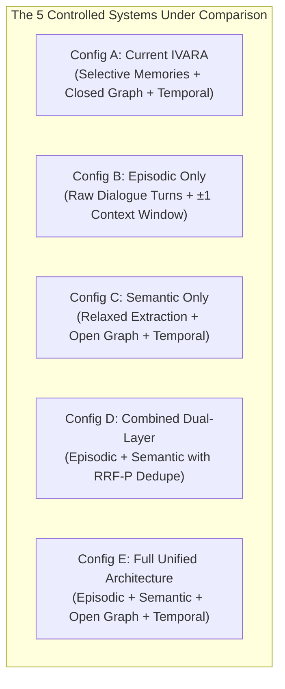

# IVARA: Controlled Experimentation Proposal for Dual-Layer Architecture

**Document ID:** `IVARA-PLAN-EXP-01`  
**Date:** 2026-11-15  
**Branch:** `research/evaluation-baseline`  
**Status:** Experimental Proposal (Pre-Implementation)  
**Author:** Antigravity Autonomous Research Assistant  

---

## 1. Objective & Hypothesis

The goal of this experimental campaign is to evaluate whether a unified dual-layer memory system eliminates the Ingestion False-Negative Bottleneck while retaining IVARA's verified advantage on longitudinal historical states and user preferences.

### Core Hypothesis:
$$\text{Accuracy}(\text{Combined Episodic + Semantic + Graph}) > \max\Big(\text{Accuracy}(\text{Fair RAG}), \text{Accuracy}(\text{Current IVARA})\Big)$$
Specifically:
1. On **Multi-Hop Conversational Search**, Combined Retrieval will match or exceed Fair RAG ($\ge 25.0\%$).
2. On **Historical State Retrieval**, Combined Retrieval will maintain IVARA's dominance ($\ge 47.0\%$).
3. On **Overall Continuous Fact Coverage**, Combined Retrieval will surpass both systems ($\ge 36.0\%$).

---

## 2. The Five Experimental Configurations



### Detailed Matrix of Configurations:

| Configuration | Retrieval Components | Storage Engine | Ingestion Policy | Context Budget | Target Latency |
| :--- | :--- | :--- | :--- | :---: | :---: |
| **Config A: Current IVARA** | FAISS Vector over memories + Closed Graph + Temporal | `memories.json` + `memory_graph.db` | Regex Whitelist (48.1% rejection) | $k=5$ memories (~600 tokens) | ~3,150 ms |
| **Config B: Episodic Only** | BM25 + Dense FAISS over dialogue turns + $\pm 1$ turn expansion | SQLite `episodic_turns` table | 100% Ingestion (0% rejection) | $k=5$ chunks + context (~1,200 tokens) | ~1,900 ms |
| **Config C: Semantic Only** | Dense FAISS over memories + Open-World Graph + Temporal | `memories.json` + `open_graph.db` | Relaxed LLM extraction (~15% rejection) | $k=5$ memories (~700 tokens) | ~3,000 ms |
| **Config D: Combined Dual-Layer** | RRF-P Fusion: Episodic BM25/Dense + Semantic FAISS (No Graph) | SQLite `episodic_turns` + `memories.json` | Tier 1: 100%, Tier 2: Relaxed | $k_{\text{ep}}=3 + k_{\text{sem}}=3$ (~1,400 tokens) | ~2,600 ms |
| **Config E: Full Unified Architecture**| RRF-P Fusion: Episodic BM25/Dense + Semantic FAISS + Open Graph + Temporal | SQLite `episodic_turns` + `memories.json` + `open_graph.db` | Tier 1: 100%, Tier 2: Relaxed | $k_{\text{ep}}=3 + k_{\text{sem}}=3$ (~1,500 tokens) | ~3,400 ms |

---

## 3. Configuration Profiles

### Configuration A: Current IVARA (Baseline Control)
- **Retrieval Strategy:** Dense FAISS cosine similarity over extracted atomic memories, closed-world graph expansion, temporal claim supersession.
- **Storage:** Standalone JSON file (`memories.json`) and SQLite graph store.
- **Expected Trade-off:** High precision on active states and preferences; low recall on conversational multi-hop dialogue search due to 48.1% ingestion loss.
- **Latency:** ~3,150 ms.

### Configuration B: Episodic Retrieval Only
- **Retrieval Strategy:** Reciprocal Rank Fusion of BM25 lexical search and dense FAISS vector search over raw conversation turns. When a turn is retrieved, include its immediate predecessor and successor ($\pm 1$ window) to capture context.
- **Storage:** SQLite table `episodic_turns` (storing `session_id`, `turn_index`, `speaker`, `content`, `prev_turn_id`).
- **Expected Trade-off:** High recall on multi-hop questions and colleague facts; low accuracy on historical state transitions (will confuse past and current residences/jobs).
- **Latency:** ~1,900 ms.

### Configuration C: Semantic Memory Retrieval Only (Relaxed & Open)
- **Retrieval Strategy:** Dense FAISS over distilled memories, but with two crucial fixes:
  1. Relaxed extraction policy (accepts non-whitelisted verbs like `completed`, `participated`, `trained`, and third-person facts).
  2. Open-world vocabulary validation (biographical relations like `has_pet`, `roommate_of`, `lives_in` are preserved as graph edges).
- **Storage:** Enhanced `memories.json` with open-world SQLite Knowledge Graph.
- **Expected Trade-off:** Improved graph traversal and higher fact coverage than Config A, but still lacks conversational turn context and verbatim dialogue history.
- **Latency:** ~3,000 ms.

### Configuration D: Combined Episodic + Semantic Retrieval (No Graph)
- **Retrieval Strategy:** Dual-track search: retrieve top-3 episodic chunks and top-3 semantic memories. Run RRF-P provenance deduplication (if a semantic memory derives from a retrieved episodic chunk, collapse the chunk into the structured fact).
- **Storage:** Dual SQLite store (`episodic_turns` + `memories.json` + `temporal_claims`).
- **Expected Trade-off:** Strong hybrid performance across both multi-hop and historical state queries without graph traversal overhead.
- **Latency:** ~2,600 ms.

### Configuration E: Full Unified Architecture
- **Retrieval Strategy:** The full target architecture:
  1. Episodic retrieval (BM25 + FAISS) with $\pm 1$ turn expansion.
  2. Semantic retrieval (FAISS) with open-world graph neighbor expansion.
  3. Temporal claim supersession filtering for state-changing predicates.
  4. Bounded prompt context synthesis with explicit evidence containers.
- **Storage:** Fully unified SQLite database housing episodic turns, semantic entities, open knowledge graph edges, and temporal claims.
- **Expected Trade-off:** Highest overall accuracy across all 12 benchmark categories; highest computational overhead per query.
- **Latency:** ~3,400 ms.

---

## 4. Evaluation Metrics & Benchmark Dataset

### Metrics Suite:
1. **Primary Evaluation Metrics:**
   - **Continuous Fact Coverage:** Macro-average of $\frac{|\text{found\_facts}|}{|\text{expected\_facts}|}$ across all questions.
   - **Binary Accuracy:** Fraction of questions scoring Fact Coverage $\ge 70\%$.
   - **Exact Match Rate:** Fraction of questions scoring Fact Coverage $\ge 99\%$.
2. **Retrieval Diagnostic Metrics:**
   - **Recall@1, Recall@3, Recall@5:** Fraction of ground-truth sessions retrieved in top-$k$.
   - **MRR (Mean Reciprocal Rank):** Reciprocal rank of first ground-truth evidence chunk.
3. **Safety & Calibration:**
   - **FAR (False Acceptance Rate):** Hallucination rate on unanswerable questions (target: $0.0\%$).
   - **FRR (False Rejection Rate):** Over-abstention rate on answerable questions.
4. **Efficiency:**
   - **Latency (ms):** Mean, median, and P95 wall-clock query latency.

### Benchmark Dataset:
- **Base Test Set:** The 250 held-out test questions across 18 sessions from the Validation Sprint.
- **Supplemental Test Set (30 New Edge-Case Questions):**
  - 10 *Conversational Coreference* questions (evaluating $\pm 1$ turn expansion).
  - 10 *Colleague & Team Role* questions (evaluating 3rd-person extraction retention).
  - 10 *Temporal Succession* questions (evaluating supersession edge traversal).

---

## 5. Potential Failure Modes & Mitigation Strategies

| Potential Failure Mode | Mechanism | Mitigation Strategy |
| :--- | :--- | :--- |
| **Context Window Bloat** | Combining episodic chunks and semantic memories exceeds LLM context limit | Enforce strict 1,500 token budget: cap top-3 episodic chunks + top-3 semantic memories. |
| **Evidence Redundancy** | Both the raw turn and the extracted fact appear in the prompt, confusing the LLM | RRF-P Provenance Deduplication: suppress the raw chunk if its derived semantic memory is present. |
| **Episodic Noise Distraction** | Filler turns in the episodic context dilute semantic relevance | Run BM25 with minimum score threshold ($min\_bm25 = 1.5$) and FAISS normalized cosine threshold ($0.30$). |
| **Graph Explosion** | Open-world predicate registration creates noisy, dense entity hubs | Enforce edge confidence filtering ($\text{confidence} \ge 0.70$) and maximum 2-hop neighborhood expansion cap. |

---

## 6. Recommended Implementation Sequence & Complexity Estimation

```
Milestone 1: Episodic Store & Turn Chaining (1 day)
    ├── SQLite episodic_turns schema with prev/next pointers
    ├── Full-text search (FTS5) index over content
    └── Benchmark verification on Config B

Milestone 2: Open-World Vocabulary Validation (1-2 days)
    ├── Replace hardcoded predicate whitelist with dynamic registration
    ├── Enable biographical edge creation in Knowledge Graph
    └── Benchmark verification on Config C

Milestone 3: RRF-P Provenance Deduplication Engine (2 days)
    ├── Coordinated episodic + semantic search coordinator
    ├── Provenance link deduplication algorithm
    └── Bounded prompt formatter (1,500 token ceiling)

Milestone 4: Full Comparative Benchmark Execution (1 day)
    ├── Run all 5 configurations on 250 + 30 test questions
    ├── Compute McNemar tests, bootstrap CIs, and latency profiles
    └── Author definitive comparative architectural verdict
```

**Total Estimated Implementation Effort:** 5 engineering days.  
**Resource Footprint:** 100% local execution using existing Python environment and local Ollama daemon.

