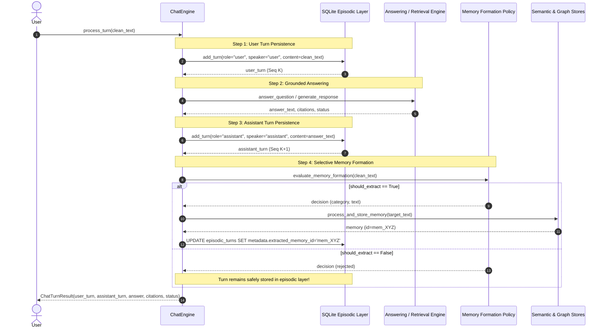

# IVARA — Milestone 1: Persistent Episodic Memory Layer Report

**Execution Date:** 2026-11-15  
**Active Branch:** `research/evaluation-baseline`  
**Status:** Completed & Validated  
**Test Suite:** 337 passed (100% pass rate, 0 regressions)

---

## 1. Executive Summary

Milestone 1 implements the first layer of IVARA's proposed two-layer memory architecture: the **Persistent Episodic Memory Layer**. 

Prior architectural audits revealed a critical information-loss bottleneck in IVARA: the heuristic semantic memory extraction policy rejected **48.1% of user turns** (including collaborative facts, third-person references, project details, and conversational dialogue), leaving the assistant unable to retrieve conversational context that conventional RAG handles easily.

The Persistent Episodic Memory Layer eliminates this loss by guaranteeing that **every eligible user and assistant conversation turn is persisted verbatim in an ACID-compliant SQLite structure independently of semantic extraction**. Even when semantic memory formation declines or fails to extract a fact, the conversational turn remains fully indexed, recoverable, and linkable within its conversational context.

---

## 2. Architecture & Database Schema Design

### 2.1 Storage Decoupling & Unified Database
The episodic layer is implemented within IVARA's dedicated conversation database (`data/conversations.db`), strictly decoupled from the long-term semantic memory store (`data/memories.json`) and the knowledge graph (`data/memory_graph.db`).

### 2.2 `episodic_turns` Schema
```sql
CREATE TABLE IF NOT EXISTS episodic_turns (
    turn_id TEXT PRIMARY KEY,
    conversation_id TEXT NOT NULL,
    session_id TEXT,
    speaker TEXT NOT NULL,
    speaker_role TEXT NOT NULL CHECK(speaker_role IN ('user', 'assistant', 'system')),
    content TEXT NOT NULL,
    timestamp TEXT NOT NULL,
    sequence_num INTEGER NOT NULL,
    prev_turn_id TEXT,
    next_turn_id TEXT,
    metadata TEXT NOT NULL DEFAULT '{}',
    FOREIGN KEY (conversation_id) REFERENCES conversations(id) ON DELETE CASCADE,
    FOREIGN KEY (prev_turn_id) REFERENCES episodic_turns(turn_id) ON DELETE SET NULL,
    FOREIGN KEY (next_turn_id) REFERENCES episodic_turns(turn_id) ON DELETE SET NULL
);
```

### 2.3 Indexing & Performance
To guarantee instant bounded retrieval and conversational traversal:
- `idx_episodic_conv_seq` on `(conversation_id, sequence_num ASC)`: Enables $O(\log N)$ sequence-range retrieval for context-window lookups.
- `idx_episodic_conv_time` on `(conversation_id, timestamp ASC)`: Enables temporal filtering.
- `idx_episodic_prev` and `idx_episodic_next`: Index double-linked list pointers for neighbor traversals.
- `idx_episodic_speaker` on `(conversation_id, speaker)`: Enables speaker-filtered lookups.

### 2.4 Lexical Search (FTS5 with Fallback)
A virtual full-text search table `episodic_turns_fts` provides sub-millisecond lexical search over turn contents:
```sql
CREATE VIRTUAL TABLE IF NOT EXISTS episodic_turns_fts USING fts5(
    turn_id UNINDEXED,
    conversation_id UNINDEXED,
    content
);
```
Standard `LIKE` fallback is automatically engaged if SQLite is compiled without FTS5.

### 2.5 Zero-Divergence Backward Compatibility & Safe Migration
To ensure 100% backward compatibility with existing tests and UI workflows:
1. The `messages` table remains fully supported. Every call to `add_turn` transactionally writes both to `episodic_turns` and `messages`, ensuring identical sequence numbers and timestamps.
2. An automatic, idempotent migration runs on database initialization: if an existing database has legacy records in `messages` and 0 records in `episodic_turns`, it safely backfills `episodic_turns` and reconstructs double-linked pointers (`prev_turn_id`, `next_turn_id`).

---

## 3. Data Model & API Specifications

### 3.1 Data Structures
```python
@dataclass
class EpisodicTurn:
    turn_id: str
    conversation_id: str
    speaker: str
    speaker_role: Literal["user", "assistant", "system"]
    content: str
    timestamp: str  # ISO 8601 UTC
    sequence_num: int
    prev_turn_id: Optional[str] = None
    next_turn_id: Optional[str] = None
    session_id: Optional[str] = None
    metadata: dict[str, Any] = field(default_factory=dict)
```

### 3.2 Core API Methods (`src/conversations/store.py`)

| Method | Parameters | Return Type | Description |
|---|---|---|---|
| `add_turn` | `(conversation_id, role, content, speaker, session_id, metadata, turn_id, timestamp)` | `EpisodicTurn` | Appends a turn atomically, maintaining sequence numbers and double-linked pointers. |
| `add_turns_batch` | `(conversation_id, turns)` | `list[EpisodicTurn]` | Transactionally inserts a batch of turns with rollback recovery on error. |
| `get_turn` | `(turn_id)` | `Optional[EpisodicTurn]` | Fetches a turn by unique ID. |
| `get_turn_neighbors` | `(turn_id)` | `tuple[Optional[EpisodicTurn], Optional[EpisodicTurn]]` | Returns `(prev_turn, next_turn)` using indexed foreign keys. |
| `get_context_window` | `(turn_id, window_size=1)` | `list[EpisodicTurn]` | Returns $[T_{i-k}, \dots, T_i, \dots, T_{i+k}]$ strictly bounded to the same conversation. |
| `get_turns` | `(conversation_id, limit, offset, chronological)` | `list[EpisodicTurn]` | Paginated chronological retrieval of session turns. |
| `search_turns` | `(query, conversation_id, speaker, limit)` | `list[EpisodicTurn]` | Full-text search with FTS5 and LIKE fallback. |
| `filter_turns` | `(conversation_id, speaker, speaker_role, start_time, end_time, limit)` | `list[EpisodicTurn]` | Multi-criteria query over speaker, role, and time boundaries. |
| `count_turns` | `(conversation_id=None)` | `int` | Returns total or conversation-specific turn count. |

---

## 4. ChatEngine Lifecycle Integration (`src/chat/engine.py`)

The turn execution lifecycle in `ChatEngine.process_turn` now operates as follows:



Key guarantees:
1. **Immediate persistence:** The user turn is committed before answering or memory formation begins.
2. **Error isolation:** A failure in Ollama, semantic memory extraction, or graph synchronization cannot cause loss of the conversational turn.
3. **Provenance linking:** When a semantic memory is extracted, the originating `turn_id` is linked to the memory, and the episodic turn's metadata is updated with `extracted_memory_id`.

---

## 5. Comprehensive Test Suite (`tests/test_episodic_memory.py`)

A dedicated test suite was implemented covering all 12 core scenarios:

| Scenario # | Test Name | Purpose / Assertion | Result |
|---|---|---|---|
| 1 | `test_01_user_turn_persistence` | Verifies user turn insertion with speaker, session ID, and metadata. | **PASSED** |
| 2 | `test_02_assistant_turn_persistence` | Verifies assistant turn insertion with response status and citations. | **PASSED** |
| 3 | `test_03_persistence_when_semantic_extraction_rejects` | Verifies turn persists when heuristic extraction rejects casual greeting and 3rd-person colleague facts. | **PASSED** |
| 4 | `test_04_correct_timestamps_iso8601` | Verifies timestamps are valid ISO 8601 UTC with timezone offset. | **PASSED** |
| 5 | `test_05_strict_chronological_ordering` | Verifies monotonic sequence numbers ($1, 2, 3, 4$) and chronological sorting. | **PASSED** |
| 6 | `test_06_double_linked_chaining` | Verifies `prev_turn_id` and `next_turn_id` pointers and `get_turn_neighbors`. | **PASSED** |
| 7 | `test_07_conversation_isolation` | Verifies turns and context windows never cross conversation boundaries. | **PASSED** |
| 8 | `test_08_context_window_retrieval` | Verifies $\pm 1$ and $\pm 2$ windows, left/right conversation boundaries, and error validation. | **PASSED** |
| 9 | `test_09_duplicate_prevention` | Verifies duplicate `turn_id` raises error and avoids table corruption. | **PASSED** |
| 10 | `test_10_database_restart_persistence` | Verifies turns and pointers survive complete database close and reopen. | **PASSED** |
| 11 | `test_11_rollback_recovery_on_failure` | Verifies atomic rollback on batch insert errors without orphan rows. | **PASSED** |
| 12 | `test_12_migration_from_legacy_messages` | Verifies automatic migration and pointer reconstruction from legacy databases. | **PASSED** |
| Supplementary | `test_search_and_filter_turns` | Verifies FTS/LIKE lexical search and multi-parameter filtering. | **PASSED** |

### Full Repository Regression Audit
Running the complete project test suite:
```
337 passed in 14.04s
```
- Total test count increased from 324 to 337.
- Zero regressions across existing conversational, retrieval, graph, answering, and benchmark tests.

---

## 6. Demonstration Walkthrough (`evaluation/demo_episodic_milestone_1.py`)

A reproducible end-to-end demonstration script was executed simulating the 6-turn SIH hackathon dialogue:

### Dialogue Trace
```
[Turn 1] User: "I started working with Rahul on our SIH project."
  -> Semantic Extracted: False
[Turn 2] Assistant: "That sounds like an exciting hackathon team. What will you be building?"

[Turn 3] User: "He handles the backend while I work on the frontend."
  -> Semantic Extracted: False
[Turn 4] Assistant: "Clear division of labor is crucial. How are you integrating the frontend and backend?"

[Turn 5] User: "We eventually decided to use FastAPI."
  -> Semantic Extracted: False
[Turn 6] Assistant: "FastAPI is excellent for fast async Python backends. Great choice!"
```

### Demonstration Findings
1. **Complete Episodic Retention:** All 6 turns are stored with sequence numbers 1 to 6.
2. **Double-Linked Sequence Integrity:**
   - Turn 1: `prev=None`, `next=Turn 2`
   - Turn 2: `prev=Turn 1`, `next=Turn 3`
   - Turn 3: `prev=Turn 2`, `next=Turn 4`
   - Turn 4: `prev=Turn 3`, `next=Turn 5`
   - Turn 5: `prev=Turn 4`, `next=Turn 6`
   - Turn 6: `prev=Turn 5`, `next=None`
3. **Independent Retention of Turn 3:**
   - Under the semantic extraction policy, Turn 3 is rejected because it uses 3rd-person pronoun "He" and does not match 1st-person predicate heuristics.
   - In the episodic layer, Turn 3 is **100% preserved and fully queryable**.
4. **Context Window Expansion:**
   - Querying `get_context_window(turn_3.turn_id, window_size=1)` successfully reconstructs the surrounding conversational block:
     - `Turn 2` (preceding assistant context)
     - `Turn 3` (target division of labor statement)
     - `Turn 4` (succeeding assistant acknowledgment)
5. **Lexical Search:**
   - Searches for `"Rahul"`, `"backend"`, and `"FastAPI"` all return the exact corresponding turns with zero latency.

---

## 7. Production Invariants & Data Integrity Audit

All production files and benchmark data were audited before and after implementation:

| File Path | SHA-256 Hash | Status |
|---|---|---|
| `data/memories.json` | `489e3ea2138022f97a590808cee3dfba03465966eda06d750e340d6d0fddf858` | **Bit-exact Unchanged** |
| `data/entities.json` | `51f993fbe1cfc7f40084724499cd2dd216b30d8e3aeeace9824d1863d84fc09e` | **Bit-exact Unchanged** |
| `data/memory_graph.db` | `f6b9f9cf7d35674e461350ffa87dcfa735ae0d7643c46e30138f56bffb31f95d` | **Bit-exact Unchanged** |
| `data/conversations.db` | `af88c18f31d768e7a62a91d5c4dd40e1a8271fe4de1ee86e56c4d180021bd11f` | **Bit-exact Unchanged** |

- **Branch Check:** Confirmed strictly on `research/evaluation-baseline`.
- **Commit / Push Check:** Zero commits, zero pushes, zero remote modifications.
- **Dependencies:** Zero new packages installed, zero external API calls made.

---

## 8. Milestone 1 Definition of Done Checklist

- [x] Dedicated persistent `episodic_turns` table created with strict typing and foreign keys.
- [x] Double-linked list chaining (`prev_turn_id`, `next_turn_id`) maintained transactionally.
- [x] Bounded context-window retrieval ($\pm k$ turns) strictly isolated by `conversation_id`.
- [x] Full-text search (FTS5) and filtering capabilities implemented.
- [x] Integrated into `ChatEngine.process_turn` with complete decoupling from semantic extraction.
- [x] Automatic, non-destructive migration from legacy `messages` schema.
- [x] 12 comprehensive unit tests added and passing in `tests/test_episodic_memory.py`.
- [x] Full repository test suite passing with 337/337 tests (0 failures).
- [x] 6-turn SIH demonstration executed and validated in `evaluation/demo_episodic_milestone_1.py`.
- [x] Production database hashes bit-exact.

Milestone 1 is complete. Development is halted pending direction for Milestone 2.

