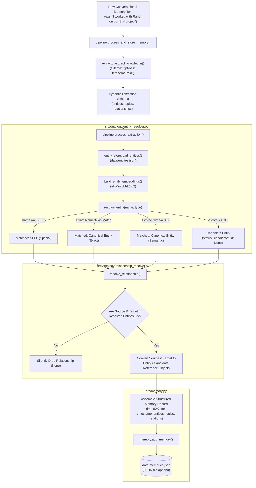
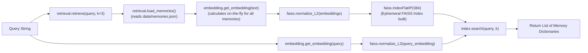
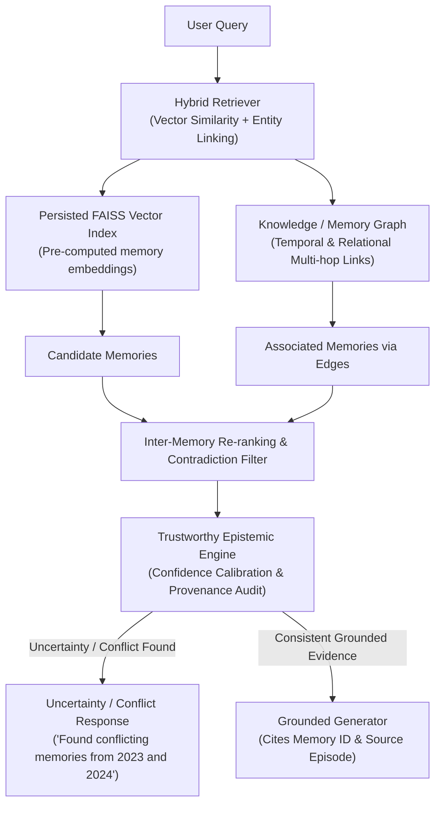

# IVARA — Comprehensive Project Audit and Handover Report

**Project Name:** IVARA (Evidence-Grounded Personal AI Memory System)  
**Audit Date:** October 22, 2026  
**Auditor:** Senior Software Engineer, AI Memory Systems Researcher & Technical Project Auditor  
**Audit Mode:** Read-Only Codebase & Artifact Inspection  

---

# PART 1 — PROJECT IDENTITY AND OBJECTIVE

### 1. What IVARA is Intended to Do
IVARA is an **Evidence-Grounded Personal AI Memory System** designed to capture, structure, and retrieve long-term personal user experiences and facts from natural language conversations. Unlike standard conversation buffers or unstructured semantic search systems, IVARA aims to extract discrete entities, semantic relationships, and topics from natural language input, ground them in an ontology, maintain provenance links back to source episodes, and reason over temporal and associative memory networks to provide trustworthy, hallucination-resistant answers.

### 2. Sanskrit Acronym Derivation & Philosophical Foundation
Documented in the project presentation (`PPT/TAI Mid-Sem Eval IVARA.pptx`, Slide 1), the name **IVARA** is an acronym rooted in five classical Indian epistemology and cognitive philosophy concepts:
- **I — Indriya (इन्द्रिय):** Perception / Sensory intake (the raw conversational memory input).
- **V — Viveka (विवेक):** Discernment / Discrimination (distinguishing entity identity, truth from inference, and signal from noise).
- **A — Anusmriti (अनुस्मृति):** Continuous recollection / Memory continuity over time.
- **Ṛ — Ṛta (ऋत):** Cosmic order / Absolute truth and invariant consistency (preventing hallucinated memories).
- **A — Anubhava (अनुभव):** Direct personal experience (grounding knowledge strictly in lived personal evidence).

### 3. Current Research Motivation and Problem Statement
Standard Large Language Model (LLM) personal assistants suffer from critical memory failure modes:
1. **The Vector Fallacy:** Dense embeddings capture topical affinity rather than factual identity. When a user asks *"What did I use PyTorch for?"*, standard cosine retrieval cannot distinguish between the entity `PyTorch` and semantically close libraries (`Torch`, `TensorFlow`), nor can it determine if `PyTorch` was used in an LSTM project or merely mentioned in a tutorial.
2. **Missing Relational Reasoning:** Vector search cannot perform multi-hop associative retrieval (e.g., *"What led to my LSTM project?"* requires tracing `Python -> Neural Networks -> PyTorch -> LSTM Project`).
3. **Loss of Epistemic Provenance:** Most conversational RAG frameworks discard the distinction between what the user explicitly stated versus what the LLM inferred, and cannot cite the exact episodic conversation where a fact originated.
4. **Failure to Handle Conflicts:** When presented with conflicting memories over time (e.g., *"I started Python in 2023"* vs *"I started Python in 2024"*), conventional models hallucinate a compromise or pick recency blindly without recognizing the contradiction.

### 4. The Intended User Experience
The user converses naturally with an assistant. When the user shares personal updates (e.g., *"I worked with Rahul on our SIH project"*), the system automatically extracts structured entities and relationships, verifies them against an ontology, checks for existing entities, and stores both raw text and semantic graphs. When queried later (*"Who worked with me on the SIH project?"* or *"When was my push-up PB?"*), the assistant responds with an exact, evidence-grounded answer citing the original memory identifier and conversation ID, or explicitly states its uncertainty if conflicting or insufficient evidence exists.

### 5. What Makes This a Trustworthy AI (TAI) Project
As framed in the project's mid-semester evaluation, IVARA is evaluated on four pillars of Trustworthiness:
- **Provenance:** Every retrieved claim is strictly mapped to an underlying raw memory episode ID (`m001`).
- **Confidence Calibration & Origin Tracking:** Relationships explicitly distinguish between `explicit` (directly stated by the user) and `inferred` (deduced by the extractor).
- **Contradiction Awareness:** The system should detect when two memories assert incompatible facts rather than blending them.
- **Uncertainty-Aware Answering ("Knowing When NOT to Answer"):** If evidence is absent or contradictory, the system must communicate uncertainty rather than fabricating confidence.

### 6. Documented Research Question
Explicitly stated in Slide 23 of `PPT/TAI Mid-Sem Eval IVARA.pptx`:
> *"Can ontology-guided, relationship-aware, and temporally structured memory improve the accuracy and trustworthiness of long-term personal AI memory compared with conventional vector-based retrieval?"*

### 7. Evolution: Original Goal vs. Current Direction
- **Original Goal (Day 1 — Commit `3546de5`):** Simple flat JSON memory storage (`data/memories.json`) indexed by a FAISS vector index (`sentence-transformers/all-MiniLM-L6-v2`) with cosine similarity search.
- **Intermediate Goal (Day 2 — Commit `71222c7`):** Adding LLM-based entity/relationship extraction using Ollama (`src/extraction/extractor.py`) and a rule-based ontology validator (`src/ontology/validator.py`).
- **Current Direction (Commit `0e06adc`):** Moving toward hybrid entity resolution (exact matching + embedding cosine similarity with candidate entity buffers) and relationship resolution, preparing for a structured memory graph.
- **Evidence-Supported Claims vs. Hypotheses:**
  - *Supported in Code:* JSON persistence, raw text vector indexing with FAISS, zero-shot structured extraction via local Ollama schema validation, exact/cosine entity resolution into `matched` vs `candidate` states, and explicit/inferred relationship origin tags.
  - *Hypotheses / Planned Only:* Graph traversal, multi-hop reasoning, temporal conflict detection, contradiction resolution, uncertainty-aware answer generation, and "Inter-Memory Attention" (expressly noted in Slide 16 as having no proof or implementation yet).

---

# PART 2 — COMPLETE REPOSITORY STRUCTURE

```
IVARA/
├── .gitignore                      # Git ignore rules (includes .venv, .idea, PPT, assets, caches)
├── main.py                         # Single-memory manual ingestion script using hardcoded entities
├── seed.py                         # Batch memory seeding script (25 synthetic developer memories)
├── data/
│   ├── entities.json               # Canonical persistent entity database (3 pre-seeded entities)
│   └── memories.json               # Persistent memory storage (currently holds 1 processed memory: m001)
├── src/
│   ├── __init__.py                 # (empty/generated)
│   ├── embedding.py                # Wrapper around sentence-transformers 'all-MiniLM-L6-v2'
│   ├── memory.py                   # Storage layer for reading/appending memories in memories.json
│   ├── retrieval.py                # In-memory FAISS IndexFlatIP cosine retrieval engine
│   ├── extraction/
│   │   ├── __init__.py             # Python package marker
│   │   ├── extractor.py            # Ollama LLM semantic extractor with Pydantic JSON schema
│   │   └── pipeline.py             # Ingestion pipeline: extraction -> resolution -> persistence
│   └── ontology/
│       ├── __init__.py             # Python package marker
│       ├── entities.json           # Schema definition for entity records and special entities
│       ├── entity_resolver.py      # Entity resolution (exact match + cosine similarity thresholding)
│       ├── entity_store.py         # Helper to load, save, create entities and return SELF entity
│       ├── loader.py               # JSON loader for ontology schemas (broken imports in validator)
│       ├── relationship_resolver.py# Resolves extraction edges to canonical IDs or candidate mentions
│       ├── relationships.json      # Schema definition for relationship records and predicates
│       ├── rules.json              # Schema validation constraints flags
│       ├── validator.py            # Extraction validator (BROKEN: broken imports and missing symbols)
│       ├── vocabulary.json         # Dynamic vocabulary storage (types & predicates)
│       └── vocabulary.py           # Helper functions to load/save vocabulary dynamically
├── tests/
│   ├── test_entity_resolver.py     # Semantic entity match test (BROKEN path: expects '../data/entities.json')
│   ├── test_extractor.py           # Ollama LLM extraction test over 5 sample sentences
│   ├── test_ontology.py            # Ontology validator test (BROKEN: imports deleted functions)
│   ├── test_pipeline.py            # End-to-end memory ingestion pipeline demonstration
│   ├── test_real_memories.py       # Batch Ollama extraction test over 5 real-world sentences
│   └── test_retrieval.py           # Semantic retrieval test querying FAISS with 10 sample questions
├── research/
│   └── faiss_demo.py               # Standalone experimental FAISS IndexFlatL2 script
├── PPT/                            # (Ignored in git)
│   └── TAI Mid-Sem Eval IVARA.pptx # Project evaluation presentation detailing motivation & architecture
└── assets/                         # (Ignored in git)
    └── logo.png                    # Project logo image
```

*Bulky / Generated Directories Present on Disk (Ignored by Git):*
- `.venv/`: Python 3.14 virtual environment with installed packages (`faiss-cpu`, `sentence-transformers`, `torch`, `pydantic`, `ollama`, `networkx`, etc.).
- `.idea/`: JetBrains PyCharm workspace and IDE project metadata.
- `src/__pycache__/`, `src/extraction/__pycache__/`, `src/ontology/__pycache__/`, `tests/__pycache__/`: Python bytecode caches.

### Detailed File Catalog

| File / Path | Primary Responsibility | Key Classes / Functions | Status |
|---|---|---|---|
| `main.py` | Ingests a single hardcoded memory with pre-structured entities/relations directly via `add_memory`. | Direct script execution | Implemented and verified |
| `seed.py` | Ingests 25 pre-defined synthetic memories into `data/memories.json` without extraction. | `memories` list, loop calling `add_memory` | Implemented; not active in current data file |
| `src/memory.py` | Reads and appends formatted memory records to `data/memories.json` with auto-incrementing ID (`m001`). | `add_memory()` | Implemented and verified |
| `src/embedding.py` | Wraps `SentenceTransformer("all-MiniLM-L6-v2")` to generate dense vector embeddings. | `get_embedding(text)` | Implemented and verified |
| `src/retrieval.py` | Loads memories, normalizes embeddings, builds an in-memory FAISS `IndexFlatIP` index, and retrieves top-k. | `load_memories()`, `build_index()`, `retrieve()` | Implemented and verified (ephemeral index) |
| `src/extraction/extractor.py` | Prompts local Ollama (`gpt-oss`) to extract entities, topics, and relationships matching Pydantic schemas. | `Entity`, `Topic`, `Relationship`, `Extraction`, `extract_knowledge()` | Implemented; requires running Ollama server |
| `src/extraction/pipeline.py` | Orchestrates full pipeline: text extraction -> entity resolution -> relationship resolution -> persistence. | `process_extraction()`, `process_and_store_memory()` | Implemented; unverified due to offline Ollama |
| `src/ontology/entity_store.py` | Loads/saves canonical entities in `data/entities.json`, generates `e00X` IDs, returns special `SELF` entity. | `load_entities()`, `save_entities()`, `create_entity()`, `get_self()` | Implemented and verified |
| `src/ontology/entity_resolver.py` | Resolves entity mentions via exact match, alias match, or cosine similarity against canonical names. | `cosine_similarity()`, `find_exact_match()`, `build_entity_embeddings()`, `find_best_match()`, `resolve_entity()` | Implemented and verified |
| `src/ontology/relationship_resolver.py` | Maps relationship endpoints to canonical entity IDs (if matched) or candidate structures (if unmatched). | `resolve_relationship()`, `build_entity_reference()`, `find_resolved_entity()` | Implemented and verified |
| `src/ontology/vocabulary.py` | Dynamically appends new types and predicates to `src/ontology/vocabulary.json`. | `load_vocabulary()`, `save_vocabulary()`, `add_type()`, `add_predicate()` | Implemented; not integrated into pipeline |
| `src/ontology/loader.py` | Loads ontology JSON schema files (`entities.json`, `relationships.json`, `rules.json`). | `load_json()`, `load_entity_schema()`, `load_relationship_schema()`, `load_rules()` | Partially refactored; broke callers |
| `src/ontology/validator.py` | Basic dictionary validation for extracted entities and relationships. | `validate_entity()`, `validate_relationship()`, `validate_extraction()` | **BROKEN**: Fails on import due to missing symbols in `loader.py` |
| `src/ontology/entities.json` | Declares required fields and properties for entities and the `SELF` entity definition. | JSON schema descriptor | Static schema descriptor |
| `src/ontology/relationships.json` | Declares required fields for relationship and predicate objects. | JSON schema descriptor | Static schema descriptor |
| `src/ontology/rules.json` | Boolean flags specifying ontology integrity rules. | JSON rule descriptor | Static configuration |
| `src/ontology/vocabulary.json` | Holds known entity types (`Person`) and predicates (`{}`). | JSON vocabulary database | Dormant vocabulary file |
| `data/entities.json` | Persistent canonical entity database with 3 records: PyTorch (`e001`), Python (`e002`), Tata Motors (`e003`). | JSON data list | Active persistent entity store |
| `data/memories.json` | Persistent memory store containing 1 fully extracted memory (`m001`). | JSON data list | Active persistent memory store |
| `research/faiss_demo.py` | Standalone prototype testing raw L2 distance search with FAISS over 7 hardcoded memories. | Direct script execution | Experimental script |
| `tests/test_ontology.py` | Unit test intended to verify predicate validity and inverses. | Script test | **BROKEN**: Imports obsolete functions deleted in commit `0e06adc` |
| `tests/test_entity_resolver.py` | Tests cosine matching scores against canonical entities. | Script test | **BROKEN**: Line 9 uses relative path `'../data/entities.json'`, failing from workspace root |
| `tests/test_extractor.py` | Tests Ollama extraction on 5 queries. | Script test | Unverified: Requires running local Ollama instance |
| `tests/test_pipeline.py` | End-to-end integration test of `process_and_store_memory`. | Script test | Mutating test: Appends memories to `memories.json` and calls Ollama |
| `tests/test_real_memories.py` | Tests Ollama extraction on 5 conversational inputs. | Script test | Unverified: Requires running local Ollama instance |
| `tests/test_retrieval.py` | Runs 10 queries against `src.retrieval.retrieve()`. | Script test | Implemented and verified |

---

# PART 3 — ARCHITECTURE AND DATA FLOW

### Current End-to-End Ingestion Flow



### Retrieval Architecture (Current vs. Intended)

#### Current Implemented Retrieval Flow:


#### Intended Future Architecture:


### Trace of Implemented Flow Stages (Step-by-Step)

1. **Ingestion Entry Point:** Calls `pipeline.process_and_store_memory(text, timestamp, source, memory_type, importance)` in `src/extraction/pipeline.py:L65-95`.
2. **ID & Timestamp Handling:** Timestamps are passed explicitly as strings (`"YYYY-MM-DD"`). Memory ID generation occurs in `src/memory.py:L24` by checking `M = len(memos)` and assigning `f"m{M + 1:03d}"`.
3. **Raw Memory Storage:** Raw text is preserved verbatim as the `"text"` field of the dictionary appended to `data/memories.json`.
4. **Embedding Generation:** Generated via `src/embedding.py:L6-7` using `SentenceTransformer("all-MiniLM-L6-v2").encode()`.
5. **FAISS Index Lifecycle:**
   - *Initialization:* Only initialized during retrieval in `src/retrieval.py:L27` as `faiss.IndexFlatIP(dimension)`.
   - *Population:* Every memory's raw text in `data/memories.json` is re-embedded and added on each search call.
   - *Persistence:* **Missing.** The FAISS index is completely ephemeral and discarded after `retrieve()` exits.
   - *Querying:* Query is embedded, L2-normalized, and searched with `index.search()`.
6. **Semantic Extraction:** Executed by `src/extraction/extractor.py:L52-74` calling local `ollama.chat` with model `"gpt-oss"`, temperature 0, and JSON schema constraints.
7. **Entity/Topic/Relationship Parsing:** Ollama returns a JSON response validated into Pydantic models: `Entity(name, type, confidence)`, `Topic(name, confidence)`, and `Relationship(source, relation, target, confidence, origin)`.
8. **Entity Resolution:** Handled by `src/ontology/entity_resolver.py:L67-122`:
   - Special check for `"SELF"` -> returns `{ "id": "self", "canonical_name": "SELF", "types": ["Person"] }`.
   - Exact/Alias match against `data/entities.json` -> returns matched entity (`status: "matched"`, `score: 1.0`, `method: "exact"`).
   - Cosine similarity against pre-computed embeddings of canonical names -> if `score >= 0.80`, returns matched entity (`status: "matched"`, `method: "semantic"`).
   - If below 0.80 -> returns candidate entity (`status: "candidate"`, `method: "new"`, `id: None`).
9. **Relationship Resolution:** Handled by `src/ontology/relationship_resolver.py:L1-25`:
   - Resolves relationship `source` and `target` against the list of resolved entities by comparing `entity["mention"].lower() == name.lower()`.
   - If an endpoint matched a canonical entity, wraps it as `{"type": "entity", "id": entity_id}`.
   - If an endpoint is a candidate, wraps it as `{"type": "candidate", "mention": ..., "types": [...]}`.
   - If either endpoint is not found in the extraction's entity list, drops the relationship (`return None`).
10. **Structured Memory Assembly:** Assembled in `src/extraction/pipeline.py:L81-93` combining resolved entities, dumped topics, resolved relationships, and user metadata.
11. **Persistence:** Written to disk in `src/memory.py:L39-40` by serializing the list to `data/memories.json`. **Notice:** Candidates and new entities are **NOT** persisted to `data/entities.json`.
12. **Query & Return:** Executed in `src/retrieval.py:L33-54` returning top-k matching memory records as raw Python dicts.

---

# PART 4 — MEMORY DATA MODEL AND SCHEMAS

### 1. Concrete Schemas in the Codebase

#### A. Persistent Memory Schema (`data/memories.json`)
Sourced from `src/memory.py:L23-35` and `data/memories.json:L2-146`:
```json
{
  "id": "m001",
  "text": "I worked with Rahul on our SIH project.",
  "timestamp": "2026-09-01",
  "source": "day2_demo",
  "type": "fact",
  "importance": 0.8,
  "confidence": 1.0,
  "entities": [
    {
      "mention": "SELF",
      "entity_id": "self",
      "canonical_name": "SELF",
      "types": ["Person"],
      "confidence": 1.0,
      "resolution_score": 1.0,
      "method": "special",
      "status": "matched"
    },
    {
      "mention": "Rahul",
      "entity_id": null,
      "canonical_name": "Rahul",
      "types": ["person"],
      "confidence": 1.0,
      "resolution_score": 0.25960633158683777,
      "method": "new",
      "status": "candidate"
    }
  ],
  "topics": [
    {
      "name": "collaboration",
      "confidence": 1.0
    }
  ],
  "relationships": [
    {
      "source": {
        "type": "entity",
        "id": "self"
      },
      "predicate": "worked_with",
      "target": {
        "type": "candidate",
        "mention": "Rahul",
        "types": ["person"]
      },
      "confidence": 0.95,
      "origin": "explicit"
    }
  ]
}
```

#### B. Persistent Canonical Entity Schema (`data/entities.json`)
Sourced from `data/entities.json:L1-35` and `src/ontology/entity_store.py:L24-30`:
```json
{
  "id": "e001",
  "canonical_name": "PyTorch",
  "aliases": ["pytorch"],
  "types": ["Technology", "Framework"]
}
```

#### C. Extraction Schemas (Pydantic Intermediate Models)
Defined in `src/extraction/extractor.py:L5-28`:
- `Entity`: `name: str`, `type: str`, `confidence: float`
- `Topic`: `name: str`, `confidence: float`
- `Relationship`: `source: str`, `relation: str`, `target: str`, `confidence: float`, `origin: str`
- `Extraction`: `entities: list[Entity]`, `topics: list[Topic]`, `relationships: list[Relationship]`

---

# PART 5 — ONTOLOGY AND ENTITY RESOLUTION

### 1. Supported Entity Types and Predicates
- **Entity Types in Vocabulary:** `src/ontology/vocabulary.json:L2-11` defines only `Person` (aliases: `person`, `human`, `user`).
- **Entity Types in Active Store:** `data/entities.json:L8-33` uses `Technology`, `Framework`, `ProgrammingLanguage`, `Organization`, `Company`.
- **Entity Types in Prompt:** The extractor system prompt (`src/extraction/extractor.py:L37-38`) does not constrain entity types, allowing open-ended extraction (`person`, `project`, `skill`, etc.).
- **Supported Predicates:** Currently open-ended strings from the extractor (`worked_with`, `worked_on`, `owned_by`, `uses`). `src/ontology/vocabulary.json` has an empty predicate object (`"predicates": {}`).

### 2. Resolution Mechanism & Math
Entity resolution is handled in `src/ontology/entity_resolver.py` across three sequential gates:

1. **Gate 0: Special SELF Entity Check**
   ```python
   if name.strip().upper() == "SELF":
       return {"status": "matched", "entity": get_self(), "score": 1.0, "method": "special"}
   ```
2. **Gate 1: Exact Name and Alias Matching**
   Matches `name.lower().strip()` against canonical names and aliases in `entities.json`.
3. **Gate 2: Cosine Similarity Matching**
   Calculates cosine similarity between the query embedding and the pre-computed embeddings of `entity["canonical_name"]`:
   $$\text{cosine\_similarity}(a, b) = \frac{a \cdot b}{\|a\| \|b\|}$$
   - **Threshold:** Set to $0.80$ (`threshold=0.80`).
   - If $\max(\text{score}) \ge 0.80$, resolves to that entity with `status: "matched"`, `method: "semantic"`.
   - If $\max(\text{score}) < 0.80$, assigns `status: "candidate"`, `method: "new"`, `entity_id: None`.

### 3. Trace of Actual Execution on Entity Matching
We executed a non-destructive verification of `find_best_match` using the project's embedding model (`all-MiniLM-L6-v2`) against the active entity store (`data/entities.json`):

| Test Mention | Best Canonical Match | Cosine Score | Resolution at Threshold 0.80 | Analysis |
|---|---|---|---|---|
| `"torch"` | `PyTorch` | **0.444** | **FAILED** (Becomes Candidate) | **Critical Limitation:** Despite being a universal abbreviation for PyTorch, cosine similarity is only 0.444. Because `"torch"` is missing from `aliases` in `entities.json`, it is treated as an unknown entity! |
| `"pytorch framework"` | `PyTorch` | **0.809** | **MATCHED** (Semantic) | Successfully matches because score exceeds 0.80. |
| `"python programming"`| `Python` | **0.907** | **MATCHED** (Semantic) | Successfully matches canonical Python. |
| `"Tata Motors company"`| `Tata Motors` | **0.937** | **MATCHED** (Semantic) | High semantic overlap. |
| `"Flutter"` | `PyTorch` | **0.258** | **CANDIDATE** (Correctly Rejected) | Below threshold, avoids false match. |

---

# PART 6 — RELATIONSHIP EXTRACTION AND RESOLUTION

### 1. Extraction Mechanism and Output Schema
Relationships are extracted by prompting Ollama using the schema defined in `src/extraction/extractor.py:L16-22`:
- `source`: String identifier (e.g., `"SELF"`, `"Rahul"`).
- `relation`: Predicate string (e.g., `"worked_with"`, `"uses"`).
- `target`: String identifier (e.g., `"PyTorch"`, `"SIH project"`).
- `confidence`: Float between 0.0 and 1.0.
- `origin`: Restrained by system prompt rule 5 to `"explicit"` or `"inferred"`.

### 2. Resolution to Grounded Endpoints
`src/ontology/relationship_resolver.py` resolves raw string endpoints against the list of entities resolved in the previous stage:
```python
def build_entity_reference(entity):
    if entity["status"] == "matched":
        return {"type": "entity", "id": entity["entity_id"]}
    return {"type": "candidate", "mention": entity["mention"], "types": entity["types"]}
```

### 3. Critical Flaws in Relationship Resolution
1. **Silent Dropping of Triples:** `src/ontology/relationship_resolver.py:L16-17`:
   ```python
   if source is None or target is None:
       return None
   ```
   If the LLM extracts a relationship referencing an entity by its pronoun or a synonym that does not match `entity["mention"].lower()` verbatim, the relationship is silently dropped with zero error or warning logged.
2. **No Predicate Canonicalization:** Predicates such as `worked_with`, `collaborated_with`, `teamed_with` are preserved as distinct, unmapped strings.
3. **Absence of Graph Traversal / Graph Index:** Relationships are stored solely as embedded lists inside `data/memories.json`. There is no adjacency index, inverted index, or graph database allowing graph queries.

---

# PART 7 — VECTOR SEARCH AND RETRIEVAL

### 1. Vector Configuration

| Parameter | Specification in Code | Source File & Line |
|---|---|---|
| **Embedding Model** | `all-MiniLM-L6-v2` | `src/embedding.py:L3` |
| **Output Dimension** | 384 dimensions (`float32`) | Auto-inferred from model |
| **Vector Normalization** | $L_2$ Normalization via `faiss.normalize_L2()` | `src/retrieval.py:L24, 46` |
| **FAISS Index Type** | `IndexFlatIP` (Inner Product on normalized vectors = Cosine Similarity) | `src/retrieval.py:L27` |
| **Index Persistence** | None (Index is ephemeral in-memory object) | `src/retrieval.py:L39` |
| **Distance Metric** | Inner Product / Cosine Similarity | `faiss.IndexFlatIP` |
| **Top-$k$** | Default $k = 3$ | `src/retrieval.py:L33` |

### 2. Retrieval Execution Test Results
We verified the retrieval pipeline by running `tests/test_retrieval.py` against the active `data/memories.json` file (which contains only `m001`: *"I worked with Rahul on our SIH project."*).

**Execution Output:**
```
QUERY: What ML projects have I built?
1. I worked with Rahul on our SIH project.

QUERY: What hobbies do I have?
1. I worked with Rahul on our SIH project.

QUERY: What games do I play?
1. I worked with Rahul on our SIH project.
```
**Empirical Finding:**
Because `retrieve()` lacks any minimum similarity score cutoff or threshold, FAISS unconditionally returns top-$k$ indices regardless of relevance. Querying for games or hobbies returns the SIH project memory with a low but non-zero inner product. This directly exemplifies the core research motivation articulated in Slide 7 of the presentation: *semantic similarity alone cannot guarantee relevance or truth*.

---

# PART 8 — LLM, MODELS, AND DEPENDENCIES

### 1. Model and LLM Configuration

| Component | Technology | Configuration Details | Source Code Reference |
|---|---|---|---|
| **Extractor LLM** | Ollama Local Inference | Model: `"gpt-oss"`, `temperature: 0` | `src/extraction/extractor.py:L54-70` |
| **Structured Output** | Pydantic JSON Schema | `format=Extraction.model_json_schema()` | `src/extraction/extractor.py:L66` |
| **Embedding Engine** | HuggingFace / PyTorch | `sentence-transformers/all-MiniLM-L6-v2` | `src/embedding.py:L3` |
| **Vector Engine** | FAISS CPU | `faiss-cpu==1.15.0` (`IndexFlatIP`) | `src/retrieval.py:L4, 27` |

### 2. LLM Operational State and Network Audit
- **Deterministic vs. LLM:**
  - *Deterministic:* Entity resolution (exact & cosine matching), relationship reference resolution, memory persistence, FAISS retrieval.
  - *Stochastic / LLM:* Semantic extraction of entities, topics, relationships, and origin tags.
- **Port Audit (Non-destructive Check):**
  We checked TCP port `11434` (Ollama default port) via PowerShell: `TcpTestSucceeded : False`.
  **Finding:** The local Ollama daemon is currently **offline**. Any invocation of `extract_knowledge()` will fail with `httpx.ConnectError`.

### 3. Core Dependencies and Manifests
- **Absence of Dependency Manifest:** There is **NO** `requirements.txt`, `pyproject.toml`, or `Pipfile` in the repository root.
- **Audited Environment (`.venv` on disk):**
  - Python: `3.14.0`
  - `faiss-cpu`: `1.15.0`
  - `sentence-transformers`: `5.7.0`
  - `torch`: `2.13.0`
  - `transformers`: `5.15.0`
  - `pydantic`: `2.13.4`
  - `ollama`: `0.6.2`
  - `numpy`: `2.5.2`
  - `networkx`: `3.6.1`
  - `scikit-learn`: `1.9.0`

---

# PART 9 — CURRENT IMPLEMENTATION STATUS

| Feature | Status | Evidence in Code | Verification Performed | Remaining Work |
|---|---|---|---|---|
| **JSON Memory Storage** | Implemented and verified | `src/memory.py:L18-42` | Tested file reading & appending | Add transaction safety, locking, atomic write |
| **Memory Schema** | Implemented and verified | `src/memory.py:L23-35` | Inspected schema in `data/memories.json` | Migrate to strict Pydantic model for persistence |
| **Dense Embeddings** | Implemented and verified | `src/embedding.py:L1-7` | Ran `get_embedding` in test script | Add batch embedding support and caching |
| **FAISS Retrieval** | Implemented and verified | `src/retrieval.py:L18-54` | Executed `tests/test_retrieval.py` | Persist index to disk; implement score thresholds |
| **Semantic Extraction** | Implemented but not verified | `src/extraction/extractor.py:L52-74` | Port 11434 audited; Ollama server offline | Run integration tests with live Ollama model |
| **Entity Extraction** | Implemented but not verified | `src/extraction/extractor.py:L5-9` | Verified Pydantic model in code | Validate against predefined ontology types |
| **Topic Extraction** | Implemented but not verified | `src/extraction/extractor.py:L11-13` | Verified Pydantic model in code | Group topics into hierarchical taxonomy |
| **Relationship Extraction** | Implemented but not verified | `src/extraction/extractor.py:L16-22` | Verified Pydantic model in code | Enforce allowed predicate vocabulary |
| **Entity Resolution (Exact)** | Implemented and verified | `src/ontology/entity_resolver.py:L19-30` | Verified in unit evaluation | Case-fold alias lookups and punctuation removal |
| **Entity Resolution (Cosine)**| Implemented and verified | `src/ontology/entity_resolver.py:L41-65` | Executed cosine matching test | Include aliases in vector matching; type filtering |
| **Candidate Handling** | Partially implemented | `src/ontology/entity_resolver.py:L113-122` | Code inspection | Candidate persistence and promotion logic |
| **SELF Entity Handling** | Implemented and verified | `src/ontology/entity_store.py:L36-42` | Verified in code & memory record `m001` | Map first-person pronouns ("me", "my", "I") |
| **Relationship Resolution** | Implemented and verified | `src/ontology/relationship_resolver.py:L1-25` | Verified structure in `m001` | Handle pronoun resolution and fallback matching |
| **Provenance Tracking** | Partially implemented | Origin tag in `src/extraction/extractor.py:L21` | Code verified | Link relationships to exact token span offsets |
| **Confidence Tracking** | Partially implemented | Fields in Pydantic models | Code verified | Calibrate confidence scores mathematically |
| **Ontology Validation** | **Broken / Failing** | `src/ontology/validator.py` | **ImportError on execution** | Reconcile `loader.py` and `validator.py` symbols |
| **Memory Deduplication** | Planned but not implemented | None | Code inspection confirms absence | Vector/exact hash duplicate rejection |
| **Entity Consolidation** | Planned but not implemented | None | Code inspection confirms absence | Evidence accumulation to promote candidates |
| **Knowledge Graph Index** | Planned but not implemented | `networkx` in `.venv` but unimported | Inspected imports across `src/` | Build in-memory NetworkX MultiDiGraph |
| **Graph Traversal / Reasoning**| Planned but not implemented | None | Code inspection confirms absence | Implement multi-hop path search |
| **Temporal Reasoning** | Planned but not implemented | `timestamp` field exists as raw string | No temporal comparison code | Add interval logic, before/after timeline ordering |
| **Contradiction Detection** | Planned but not implemented | Conceptual slide in PPT | No contradiction code | Detect conflicting predicates/values |
| **Grounded Answer Gen** | Planned but not implemented | None | Code inspection confirms absence | Prompt LLM with retrieved evidence & citations |
| **Uncertainty Answering** | Planned but not implemented | Conceptual slide in PPT | No answering logic | Refusal policy when confidence is low |
| **User Memory Deletion/Edit**| Planned but not implemented | None | Code inspection confirms absence | CRUD endpoints for memories |
| **Benchmark / Evaluation** | Planned but not implemented | None | Code inspection confirms absence | Evaluation harness vs. Mem0 / vanilla RAG |

---

# PART 10 — TESTS, EXECUTION, AND REPRODUCIBILITY

### 1. Test Suite Audit

| Test File | Intended Functionality | Test Type | Execution Result | Root Cause of Failure (if applicable) |
|---|---|---|---|---|
| `tests/test_retrieval.py` | Executes 10 queries against `src.retrieval.retrieve` | Automated script | **PASSED** (Exit Code 0) | Successfully ran; highlights that top-$k$ returns irrelevant memories when corpus is small |
| `tests/test_ontology.py` | Tests type validation and predicate rules | Automated script | **FAILED** (Exit Code 1) | `ImportError: cannot import name 'load_entity_types' from 'src.ontology.loader'` |
| `tests/test_entity_resolver.py` | Tests cosine matching scores against entities | Automated script | **FAILED** (Exit Code 1) | `FileNotFoundError: [Errno 2] No such file or directory: '../data/entities.json'` |
| `tests/test_extractor.py` | Tests Ollama extraction on 5 queries | Semi-automated | **BLOCKED** | Requires running local Ollama service with model `"gpt-oss"` |
| `tests/test_real_memories.py` | Tests Ollama extraction on 5 sentences | Semi-automated | **BLOCKED** | Requires running local Ollama service with model `"gpt-oss"` |
| `tests/test_pipeline.py` | Ingestion pipeline demonstration | Mutating script | **RISK / BLOCKED** | Requires Ollama AND mutates `data/memories.json` on execution |

---

# PART 11 — BUGS, TECHNICAL DEBT, AND RISKS

### Critical Severity

1. **Broken Module: `src/ontology/validator.py` Cannot Be Imported**
   - **Location:** `src/ontology/validator.py:L1-5`
   - **Explanation:** Attempts `from .loader import load_entity_types, load_relationships, load_rules`. None of these three functions exist in `loader.py`. Any code importing `validator.py` crashes instantly with `ImportError`.
   - **Classification:** Confirmed Bug.
2. **Broken Test Suite: `tests/test_ontology.py` and `tests/test_entity_resolver.py`**
   - **Locations:** `tests/test_ontology.py:L1-6` and `tests/test_entity_resolver.py:L9`
   - **Explanation:** `test_ontology.py` imports deleted symbols. `test_entity_resolver.py` uses hardcoded relative path `'../data/entities.json'`, which fails when invoked from project root.
   - **Classification:** Confirmed Bug.

### High Severity

3. **Candidate Entity Evaporation & Disconnected Graph Nodes**
   - **Location:** `src/ontology/entity_resolver.py:L114-122` and `src/extraction/pipeline.py:L80-93`
   - **Explanation:** Unmatched entities are given `entity_id: null` and stored as candidates inside `data/memories.json`. `create_entity()` in `entity_store.py` is never called. Candidates are never persisted to `data/entities.json`, preventing entity consolidation across different memories.
   - **Classification:** Confirmed Architectural Flaw.
4. **Vocabulary Disconnect & Open-Ended Predicate Hallucination**
   - **Location:** `src/extraction/extractor.py:L16-22`
   - **Explanation:** The extractor has no constrained list of predicates. The LLM hallucinates arbitrary verbs (`owned_by`, `worked_on`, `worked_with`, `uses`). None are canonicalized against `vocabulary.json` or ontology rules.
   - **Classification:** Confirmed Technical Debt.
5. **Silent Relationship Dropping**
   - **Location:** `src/ontology/relationship_resolver.py:L16-17`
   - **Explanation:** If an extracted relationship's subject or object does not match an entity's verbatim mention string, the relationship is returned as `None` and discarded without notification.
   - **Classification:** Confirmed Bug.

### Medium Severity

6. **Ephemeral Vector Indexing and $O(N)$ Retrieval Scaling**
   - **Location:** `src/retrieval.py:L18-30, 39`
   - **Explanation:** `retrieve()` re-embeds all memories and constructs a new FAISS index on every query. As memories grow, query latency scales linearly with $N \times \text{inference\_cost}$.
   - **Classification:** Confirmed Technical Debt.
7. **Similarity Threshold Permissiveness vs. Strictness**
   - **Location:** `src/ontology/entity_resolver.py:L72`
   - **Explanation:** At threshold 0.80, `"torch"` fails to resolve to `"PyTorch"` (score 0.444). Conversely, semantically adjacent technologies (e.g. `GPT-3` vs `GPT-4` or `Python` vs `Cython`) risk false positive merging.
   - **Classification:** Confirmed Risk.
8. **Missing Dependency Manifest**
   - **Location:** Workspace root
   - **Explanation:** Missing `requirements.txt` or `pyproject.toml` makes environment reproduction brittle across machines.
   - **Classification:** Technical Debt.

### Low Severity

9. **Data Mutation in Pipeline Test**
   - **Location:** `tests/test_pipeline.py:L25-31`
   - **Explanation:** Running `test_pipeline.py` permanently writes new records to `data/memories.json`.
   - **Classification:** Technical Debt.
10. **Unchecked Schema Fields**
    - **Location:** `src/memory.py:L28-30`
    - **Explanation:** Fields like `importance`, `type`, and `timestamp` are unvalidated strings/floats.
    - **Classification:** Technical Debt.

---

# PART 12 — GIT AND DEVELOPMENT STATE

- **Current Branch:** `main`
- **Working Tree:** Clean (no uncommitted or staged changes).
- **Latest Commit:** `0e06adcf68f76843b080550cd5b878e1d9bca43e`
- **Commit Message:** `mid-term evaluation and ontology basics done`
- **Author:** `Krish1022sona <shivanshgupta1.india@gmail.com>`
- **Date:** `Wed Sep 2 00:08:56 2026 +0530`
- **Remote:** No remote configured (`git remote -v` is empty).
- **Commit History Summary:**
  1. `196387d`: Added `.gitignore`
  2. `3546de5`: `Day-1 Basics Done` (Memory JSON storage, initial FAISS retrieval, seed script)
  3. `71222c7`: `day-2 v0.1` (Added Ollama extractor, initial ontology JSON schemas, and validator)
  4. `0609e1c`: `edited .gitignore` (Ignored `PPT/` and `assets/`)
  5. `0e06adc`: `mid-term evaluation and ontology basics done` (Refactored entity/relationship resolver, introduced candidate states, added `faiss_demo.py`, but inadvertently broke `validator.py` and `test_ontology.py`).

---

# PART 13 — RESEARCH POSITIONING AND TRUSTWORTHY AI

| Concept | Status in Repository | Evidence / Justification | Required Future Experiments |
|---|---|---|---|
| **Evidence-Grounded Personal Memory** | Partially implemented | Memories preserve raw text and are assigned IDs (`m001`). However, answer generation citing memory IDs is not yet built. | Grounded QA benchmark comparing citations against ground truth facts. |
| **Provenance-Aware Answers** | Partially implemented | Relationships record `origin: "explicit" \| "inferred"`. No generation module exists to leverage this tag. | Contrast answers generated with provenance filters vs. unconstrained LLM generation. |
| **Explicit vs. Inferred Facts** | Implemented in extraction schema | Extractor prompt separates explicitly stated facts from logical deductions. | Evaluate extraction precision/recall across explicit vs. implicit conversational facts. |
| **Confidence Calibration** | Partially implemented | Confidence fields exist on entities and relationships, but are raw model outputs without calibration. | ECE (Expected Calibration Error) analysis of LLM confidence scores. |
| **Contradiction Awareness** | Planned only | Motivated in mid-semester presentation (Slide 19); completely absent in codebase. | Benchmark on synthesized contradictory memory pairs (e.g., date conflicts, job role changes). |
| **Temporal Consistency** | Planned only | Dates are stored as raw strings; no timeline or ordering logic implemented. | Temporal ordering QA evaluations (e.g. "What did I do before X?"). |
| **Uncertainty-Aware Answering** | Planned only | Conceptualized as a core pillar; no generation or refusal policy exists. | Test refusal accuracy when asked questions about unknown or ambiguous entities. |
| **Ontology-Guided Reasoning** | Partially implemented | Schema definitions exist, but validator is broken and vocabulary is not enforced. | Compare retrieval accuracy with vs. without ontology constraint validation. |
| **Multi-Hop Memory Retrieval** | Planned only | Stated as primary research motivation; no graph traversal code exists. | Multi-hop graph query evaluation against Mem0 and standard FAISS vector search. |

---

# PART 14 — NEXT DEVELOPMENT MILESTONE

### Recommended Milestone: Milestone 3 — "Stabilization, Entity Disambiguation & Candidate Promotion"

#### 1. Objective
Repair the broken ontology validator and test suite, add a dependency manifest, persist the FAISS index, and implement an evidence-based candidate entity accumulation and promotion mechanism.

#### 2. Detailed Implementation Steps
1. **Dependency Pinning:** Generate `requirements.txt` from the active environment.
2. **Restore Validator Integrity:**
   - Update `src/ontology/loader.py` and `validator.py` so that entity schemas, relationship schemas, and rule constraints load correctly without `ImportError`.
   - Update `tests/test_ontology.py` to assert entity/relationship structure against `rules.json`.
3. **Fix Test Pathing:** Update `tests/test_entity_resolver.py` to resolve paths relative to `Path(__file__).parent.parent / "data" / "entities.json"`.
4. **Enhanced Alias Matching:**
   - Update `build_entity_embeddings()` in `entity_resolver.py` to embed both canonical names and aliases.
   - Add `"torch"` to `aliases` of `PyTorch` in `data/entities.json`.
5. **Candidate Store & Promotion Engine:**
   - Introduce `data/candidates.json` (or a dedicated candidate section in `entity_store.py`).
   - Track mention counts and memory references for each candidate.
   - When a candidate reaches a frequency threshold (e.g., mentioned $\ge 2$ times across memories), provide an automated promotion function to assign a canonical `e00X` ID and move it into `data/entities.json`.
6. **Vector Index Persistence:**
   - Modify `src/retrieval.py` to save the FAISS index to `data/memories.index` via `faiss.write_index` and reload it with `faiss.read_index`. Only rebuild when new memories are added.
   - Add a `min_similarity` cutoff (e.g., 0.40) to `retrieve()`.

---

# PART 15 — FINAL HANDOVER DOCUMENT

### A. Project Snapshot
- **Project:** IVARA — Evidence-Grounded Personal AI Memory System
- **Current Architecture:** Hybrid pipeline featuring Ollama (`gpt-oss`) zero-shot extraction, Pydantic validation, multi-stage entity resolution (exact, alias, cosine thresholding at 0.80), relationship reference resolution (`entity` vs `candidate`), JSON memory append storage, and on-the-fly FAISS vector retrieval (`all-MiniLM-L6-v2`).
- **Stage:** Mid-development prototype (Phase 2 completed; entering stabilization and graph linking).

### B. Critical File Map

| File Path | Role | Key Functions / Classes |
|---|---|---|
| `src/extraction/pipeline.py` | Ingestion orchestrator | `process_and_store_memory()`, `process_extraction()` |
| `src/extraction/extractor.py` | Ollama LLM extraction | `extract_knowledge()`, Pydantic models (`Entity`, `Relationship`) |
| `src/ontology/entity_resolver.py` | Entity resolution engine | `resolve_entity()`, `find_best_match()`, `find_exact_match()` |
| `src/ontology/relationship_resolver.py` | Relationship linker | `resolve_relationship()`, `build_entity_reference()` |
| `src/ontology/validator.py` | Schema validator (**BROKEN**) | `validate_extraction()`, `validate_entity()`, `validate_relationship()` |
| `src/retrieval.py` | Vector retrieval | `retrieve()`, `build_index()`, `load_memories()` |
| `src/memory.py` | Persistent memory store | `add_memory()` |
| `src/ontology/entity_store.py` | Entity store accessor | `load_entities()`, `save_entities()`, `get_self()` |

### C. Commands to Resume Development
```powershell
# 1. Activate Python 3.14 virtual environment
.\.venv\Scripts\Activate.ps1

# 2. Check Git status (Read-only)
git status

# 3. Start local Ollama daemon (in separate terminal)
ollama serve
# Ensure model is pulled:
ollama pull gpt-oss

# 4. Run existing working retrieval test
python -m tests.test_retrieval
```

### D. Open Questions for the Project Owner
1. **Ollama Model Choice:** The code references model `"gpt-oss"`. Is this an alias for a specific model (e.g. `llama3`, `mistral`, `qwen2.5`), or a custom fine-tuned Modelfile?
2. **Candidate Promotion Policy:** What specific criteria should promote a candidate entity to canonical status? (e.g., frequency threshold $\ge 2$, user confirmation, or confidence score $\ge 0.95$?)
3. **Graph Storage Destination:** Should the memory graph remain in a persistent JSON graph format (e.g., NetworkX JSON / adjacency list), or is an external graph database (e.g., Neo4j, Kùzu, SQLite-VSS) planned?

### E. Mandatory Instructions for the Next AI Assistant
- **Inspect Before Editing:** Read the target file completely before making modifications.
- **Do Not Redesign Architectural Patterns:** Preserve the distinction between `candidate` and `canonical` entities, `explicit` and `inferred` origin tags, and `SELF` entity resolution.
- **Make Small, Testable Changes:** Address one bug or file at a time; verify imports and unit tests before moving to the next.
- **Never Fabricate Unimplemented Features:** Do not claim graph traversal, temporal contradiction detection, or grounded answering exist until the concrete code and tests are committed.
- **Preserve Provenance and Calibrated Confidence:** Never strip the `origin`, `confidence`, or `source` fields during serialization.

---

# WHAT I SHOULD SEND TO THE NEXT ASSISTANT

If sharing this entire comprehensive audit exceeds token limits or context constraints in your next chat session, you only need to provide:

1. **Part 15 (Final Handover Document)** in its entirety (Sections A through E).
2. **Part 11 (Bugs, Technical Debt, and Risks)** for the prioritized list of exact failure points.
3. **The file contents of:**
   - `src/ontology/validator.py` and `src/ontology/loader.py` (to fix the immediate `ImportError`).
   - `src/ontology/entity_resolver.py` (to implement alias vectorization and candidate promotion).
   - `data/memories.json` and `data/entities.json` (as reference data schemas).
