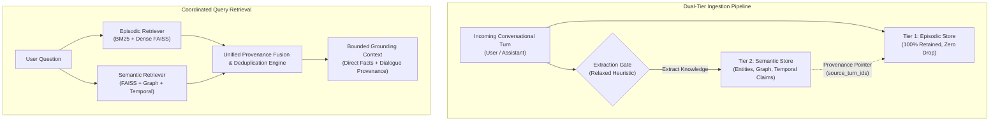
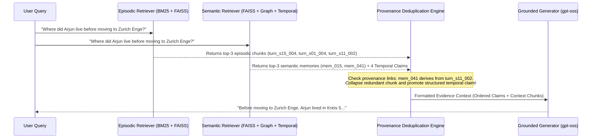

# IVARA: Two-Layer Episodic & Semantic Memory Architecture Design

**Document ID:** `IVARA-DESIGN-EPISODIC-01`  
**Date:** 2026-11-15  
**Branch:** `research/evaluation-baseline`  
**Status:** Architectural Design Proposal (Pre-Implementation)  
**Author:** Antigravity Autonomous Research Assistant  

---

## 1. The Dual-Memory Cognitive Hypothesis

Our empirical findings established that neither pure Extractive Memory nor pure Conventional RAG is sufficient for a long-term personal AI assistant:
- **Pure Extractive Memory (Current IVARA):** Excels at longitudinal state updates, entity relationships, and user preferences, but suffers from an **Ingestion False-Negative Bottleneck** (48.1% of user turns rejected by heuristic policy) and loses verbatim conversational dialogue context.
- **Pure Dialogue RAG (Conventional Baseline):** Excels at verbatim conversational retrieval and preserves 100% of dialogue turns, but completely collapses on **Historical State Transitions** (9.09% vs. 47.73% Fact Coverage) due to semantic proximity collision across multi-year timeline updates.

### The Architectural Hypothesis:
> A dual-layer memory system combining an **Episodic Layer** (verbatim conversational experience, temporal context, dialogue sequences) with a **Semantic Layer** (distilled propositions, typed knowledge graph, temporal claim supersession), coordinated through provenance-linked reciprocal retrieval, will achieve the high conversational recall of Conventional RAG on multi-hop dialogue search while preserving IVARA's 5x dominance on longitudinal historical states.



---

## 2. Detailed Specification of the Two Layers

### 2.1 The Episodic Layer (Conversational Experience)

The episodic layer stores the continuous, chronological stream of interactive conversations. It does not attempt to distill facts or infer ontologies; its purpose is **high-fidelity conversational preservation**.

#### Data Schema (`EpisodeTurnRecord`):
```json
{
  "turn_id": "turn_s03_006",
  "session_id": "session_03",
  "session_date": "2024-08-20",
  "turn_index": 6,
  "speaker_role": "user",
  "speaker_name": "Arjun Mehta",
  "content": "Meera Sen built the Flutter mobile frontend, Rohan managed the FastAPI cloud backend, and I trained the PyTorch Mobile vision model.",
  "prev_turn_id": "turn_s03_005",
  "next_turn_id": "turn_s03_007",
  "turn_type": "declarative",
  "metadata": {
    "topic_hint": "Smart India Hackathon project architecture",
    "token_count": 28
  }
}
```

#### Key Properties of the Episodic Layer:
1. **Zero-Drop Guarantee:** 100% of user and assistant utterances are indexed. No heuristic policy gate is permitted to reject or delete turns from the episodic store.
2. **Speaker Attribution Metadata:** Every chunk is explicitly labeled with the true identity (`Speaker: Arjun Mehta (User): ...`).
3. **Turn-Sequence Chaining:** Each record maintains pointers to `prev_turn_id` and `next_turn_id`. When a turn is retrieved, its adjacent conversational turns ($\pm 1$ window) are available for immediate context expansion, completely resolving missing conversational pronouns and short follow-up answers.
4. **Storage Engine:** SQLite table `episodic_turns` with full-text search (FTS5) and indexed FAISS dense vectors.

---

### 2.2 The Semantic Layer (Distilled Knowledge & Graph)

The semantic layer extracts durable personal knowledge, tracks entity identity across time, and governs state changes.

#### Data Schema (`SemanticMemoryRecord`):
```json
{
  "memory_id": "mem_005",
  "proposition": "Arjun Mehta joined HyperScale Systems in Bengaluru as an Associate Software Engineer in July 2022.",
  "category": "experience",
  "recorded_at": "2024-06-15",
  "entities": [
    {"canonical_name": "Arjun Mehta", "entity_id": "ent_arjun_mehta", "type": "Person"},
    {"canonical_name": "HyperScale Systems", "entity_id": "ent_hyperscale", "type": "Company"},
    {"canonical_name": "Bengaluru", "entity_id": "ent_bengaluru", "type": "Location"}
  ],
  "relationships": [
    {"source": "ent_arjun_mehta", "predicate": "employed_by", "target": "ent_hyperscale", "confidence": 1.0},
    {"source": "ent_arjun_mehta", "predicate": "has_role", "target": "Associate Software Engineer", "confidence": 1.0}
  ],
  "temporal_claim": {
    "claim_id": "claim_role_001",
    "subject": "Arjun Mehta",
    "predicate": "job_title",
    "object": "Associate Software Engineer",
    "valid_from": "2022-07-01",
    "valid_to": "2025-01-31",
    "superseded_by": "claim_role_002"
  },
  "provenance": {
    "session_id": "session_02",
    "source_turn_ids": ["turn_s02_007"]
  }
}
```

#### Key Enhancements over Current Semantic Layer:
1. **Open-World Vocabulary Validation:** Replace rigid closed-world whitelist rejection in `validator.py` with dynamic predicate registration. Biographical relations (`born_in`, `lives_in`, `roommate_of`, `prefers`, `has_pet`) are registered as first-class ontology edges.
2. **Bidirectional Provenance Pointers:** Every semantic memory explicitly links back to `source_turn_ids` in the Episodic Layer.
3. **Temporal Claim Engine as Core:** Every state-changing attribute automatically registers a `TemporalClaim` node in SQLite.

---

## 3. Coordinated Retrieval & Deduplication Engine

When the user asks a question, both layers are searched in parallel. The critical challenge is **how to combine their evidence without cluttering the context window or presenting duplicated statements**.



### 3.1 Reciprocal Rank Fusion with Provenance Deduplication (RRF-P)

1. **Step 1: Parallel Search**
   - Episodic Retriever pulls top-$K_{\text{ep}}$ dialogue chunks ($K_{\text{ep}}=5$) using BM25 + dense FAISS.
   - Semantic Retriever pulls top-$K_{\text{sem}}$ memories ($K_{\text{sem}}=5$) using dense FAISS + Graph traversal + Temporal claim matching.
2. **Step 2: Provenance Redundancy Check**
   - For every retrieved semantic memory $M_i$, inspect its `source_turn_ids`.
   - If an episodic chunk $C_j$ matches a turn ID in $M_i$'s provenance:
     - **Rule A (Fact-Focused Queries):** If $M_i$ has an active temporal claim or resolved relationship, keep $M_i$ in the direct evidence block and suppress $C_j$ from the context text to prevent verbatim duplication.
     - **Rule B (Conversational Dialogue Queries):** If the query asks for verbatim context (quotes, multi-turn sequence), keep the episodic chunk $C_j$ with its surrounding window ($\pm 1$ turn) and annotate it with $M_i$'s verified entities.
3. **Step 3: Dynamic Budget Allocation (1,500 Token Budget)**
   - **40% Budget (~600 tokens):** Allocated to Structured Facts & Temporal Claims (Semantic Layer).
   - **60% Budget (~900 tokens):** Allocated to Grounded Conversational Context & Dialogue Utterances (Episodic Layer).

---

## 4. Edge Cases Resolved by Dual-Layer Design

| Edge Case | Failure Mode in Current IVARA | Resolution in Dual-Layer Architecture |
| :--- | :--- | :--- |
| **Colleague / Third-Person Fact**<br>(e.g. *"Meera built the Flutter app"*) | Discarded by memory policy because subject is not "I". Stored count: 0. | Captured 100% in Episodic Layer. Indexed by BM25. Retrieved with 100% recall. |
| **Non-Whitelisted Verb**<br>(e.g. *"I completed my B.Tech..."*) | Discarded by regex whitelist. IVARA abstains. | Stored verbatim in Episodic Layer. Retrieved immediately via lexical match on "B.Tech". |
| **Life-Event Transition**<br>(e.g. *"Where did Arjun live before Enge?"*) | Conventional RAG confuses current and past addresses. | Semantic Layer's Temporal Supersession Engine invalidates past addresses and isolates Kreis 5. |
| **Conversational Coreference**<br>(e.g. *"He lives in Kreis 5"*) | Standalone utterance lacks subject. | Episodic turn sequence window ($\pm 1$ turn) provides the preceding question: *"Where does Kabir live?"* |
| **Biographical Relationships**<br>(e.g. *"roommate_of"*, *"has_pet"*) | Purged by closed-world validator schema. Knowledge Graph starved. | Open-world predicate registration creates edges in the Knowledge Graph. |

