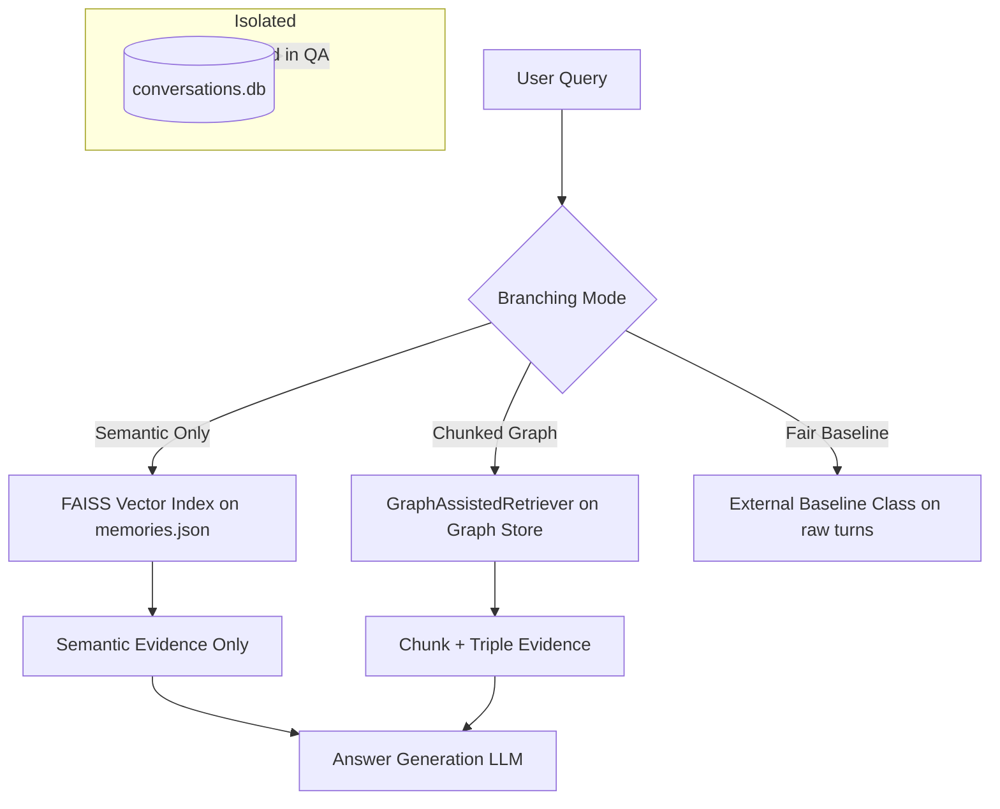
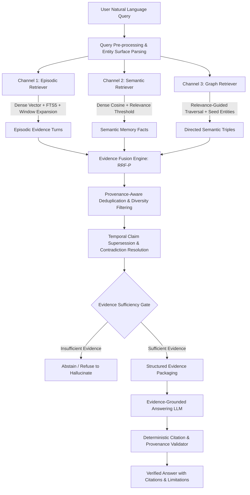

# IVARA Milestone 3: Unified Episodic, Semantic & Graph Retrieval System Design

**Document ID:** `IVARA-DES-M3-01`  
**Date:** 2026-11-15  
**Branch:** `research/evaluation-baseline`  
**Target Milestone:** Milestone 3 (Unified Multi-Source Evidence Retrieval)  
**Status:** Approved Design Document  

---

## 1. Executive Summary & Problem Formulation

### 1.1 The Tri-Source Retrieval Gap
In our previous validation sprints, IVARA demonstrated state-of-the-art capability in historical state tracking, temporal claim supersession, and entity-relationship extraction. However, our deep-dive failure analysis revealed a fundamental trade-off against conventional RAG:

1. **Selective Extraction Recall Loss:** Heuristic semantic extraction discarded conversational context (e.g., degree details, third-party biographical background), leaving holes in `memories.json`.
2. **Siloed Retrieval Paths:**
   - Semantic retrieval (`src/retrieval.py`) only searched extracted atomic memories.
   - Graph retrieval (`src/graph/retrieval.py`) operated over pre-built graph nodes, isolated from the conversational store.
   - Episodic memory (`src/conversations/store.py`), while persistently recorded with double-linked sequence chaining in Milestone 1, was not searchable via dense semantic embeddings or integrated into the answering engine.
3. **Multi-Hop Relational Disconnect:** Conventional RAG excelled at multi-hop queries when facts spanned multiple raw conversational turns through pure lexical/vector chunk co-occurrence, whereas IVARA failed when intermediate facts lacked extracted semantic memories or when entity links were unindexed.

### 1.2 Core Objective of Milestone 3
Build a unified, modular, and principled retrieval engine that extracts, ranks, and fuses evidence across three complementary memory layers:
- **Layer 1: Episodic Memory:** Original conversation turns preserving verbatim conversational context, speaker roles, timestamps, turn IDs, and neighboring turns via chronological context-window expansion.
- **Layer 2: Semantic Memory:** High-precision atomic memories, claims, and structured topics extracted from turns, complete with memory IDs, timestamps, and confidence scores.
- **Layer 3: Knowledge Graph:** Resolved entity nodes, directed domain relationships (canonical and open-world), and temporal supersession edges, retrieved via bounded relevance-guided traversal.

Evidence is combined through **Reciprocal Rank Fusion with Provenance (RRF-P)**, preventing duplicate dominance, maintaining temporal distinctions, and providing the answering engine with an isolated, verifiable evidence context.

---

## 2. Current Query Lifecycle vs. Unified Query Lifecycle

### 2.1 Current Siloed Lifecycle


### 2.2 Proposed Unified Retrieval Lifecycle


---

## 3. Component-by-Component Architectural Audit & Reuse Strategy

| Component | Existing Implementation | Reusability in M3 | Architectural Extension Needed in M3 |
|---|---|---|---|
| **Episodic Store** | `src/conversations/store.py` (`ConversationStore`, `episodic_turns`, FTS5, `get_context_window`) | **100% Reusable** | Add dense vector semantic search, speaker-aware formatting, and turn candidate scoring. |
| **Semantic Store** | `src/retrieval.py` (`load_memories`, `build_index`, `retrieve`) | **100% Reusable** | Standardize candidate interface (`UnifiedEvidenceItem`) with turn IDs, timestamps, and scores. |
| **Knowledge Graph** | `src/graph/store.py`, `src/graph/traversal.py` | **100% Reusable** | Reusable entity seeding, bounded 1-hop and 2-hop traversal, and direction-preserving triple formatting. |
| **Vector Embedding** | `src/embedding.py` (`get_embedding`, `all-MiniLM-L6-v2`) | **100% Reusable** | Singleton local cache used uniformly across episodic, semantic, and graph vector passes. |
| **Entity Resolution** | `src/ontology/entity_resolver.py`, `entity_store.py` | **100% Reusable** | Surface mention matching to identify entity seeds for graph exploration. |
| **Temporal Reasoning** | `src/temporal/claims.py`, `supersession.py`, `resolution.py` | **100% Reusable** | Apply temporal supersession engine to active claims derived from fused evidence. |
| **Reasoning & Gating** | `src/reasoning/` (`EvidenceGate`, `ContradictionAnalyzer`) | **100% Reusable** | Evaluate fused evidence items before calling LLM. |
| **Answer Generation** | `src/answering.py` (`answer_question`, `format_user_prompt`) | **Modified** | Support `UnifiedEvidenceContext`, multi-source citations (`m001`, `turn_...`, triples). |

---

## 4. Phase-by-Phase Technical Blueprint

### Phase 1: Episodic Retrieval (`EpisodicRetriever`)
- **Indexing:**
  - Build an in-memory FAISS IndexFlatIP index over L2-normalized embeddings of all turns in `ConversationStore` (or filtered by `conversation_id`/`session_id`).
  - Text representation for indexing:
    `"[{timestamp}] Speaker: {speaker} ({role}): {content}"`
    This matches the speaker-attribution structure that eliminated the 3rd-person vs. 1st-person perspective gap.
- **Search Strategy:**
  - Hybrid search: Combines FAISS cosine similarity ($S_{vec}$) with FTS5 lexical matching ($S_{lex}$).
  - Bounded retrieval: Top-$k_{epi}$ candidates (default $k=5$, $\min\_score=0.30$).
- **Context-Window Expansion:**
  - For each top turn hit, fetch $\pm w$ adjacent turns (default $w=1$) using `store.get_context_window(turn_id, window_size=w)`.
  - Window turns are labeled with their relation (`"preceding"`, `"target"`, `"succeeding"`) and share the target turn's provenance, providing complete conversational coherence without pulling unrelated history.

### Phase 2: Semantic Memory Retrieval (`SemanticRetriever`)
- **Interface:**
  - Wraps `src/retrieval.py` without modifying its core tested behavior.
  - Queries `memories.json` (or memory list) using FAISS cosine similarity.
- **Metadata Standardization:**
  - Exposes: `memory_id`, `text`, `timestamp`, `source` (linking to original episodic turn/message ID), `entities`, `relationships` (including canonical & open-world), `score`.
  - Filters using calibrated relevance threshold ($\tau_{sem} = 0.35$).

### Phase 3: Graph Retrieval (`GraphRetriever`)
- **Seed Discovery:**
  - Scans query tokens against canonical entities and aliases in `SQLiteGraphStore` (`store.get_nodes_by_type("entity")`).
  - Also incorporates entity mentions discovered in top episodic and semantic hits.
- **Bounded Traversal:**
  - Calls `traverse_relevance_guided(store, query, seed_node_ids, max_depth=2, max_nodes=15)`.
  - Preserves edge direction: Outgoing ($S \xrightarrow{P} O$) vs. Incoming ($O \xleftarrow{P} S$).
  - Prevents cycles using `visited_nodes` tracking.
- **Triple Extraction:**
  - Reconstructs semantic relationships $(S, P, O)$ filtered to true entity-to-entity domain edges (omitting structural `contains_chunk` and `mentions_entity` edges).
  - Preserves edge provenance: `source_memory_id`, `evidence`, `confidence`, `predicate_status` (`"canonical"` vs. `"open_world"`).

### Phase 4: Evidence Fusion & RRF-P (`UnifiedEvidenceFuser`)
- **Reciprocal Rank Fusion with Provenance (RRF-P):**
  Given ranked lists from Episodic ($R_{epi}$), Semantic ($R_{sem}$), and Graph ($R_{graph}$):
  $$\text{RRF}(d) = \sum_{c \in \{epi, sem, graph\}} \frac{w_c}{k_{rrf} + \text{rank}_c(d)}$$
  Where $k_{rrf} = 60$, $w_{epi} = 1.0$, $w_{sem} = 1.2$, $w_{graph} = 0.8$.
- **Provenance-Aware Deduplication:**
  - An episodic turn and a semantic memory often convey the same fact (e.g., Turn: *"I was born in Chandigarh on August 14, 1999"*; Memory: *"Born in Chandigarh on August 14, 1999"* with `source=turn_xxx`).
  - When a semantic memory references a retrieved turn ID via `source`, the fuser links them into a single consolidated evidence cluster rather than double-counting them.
  - Semantic fact carries semantic boost, but turn text grounds raw verbatim evidence.
- **Temporal State Separation:**
  - When two items assert conflicting states across different timestamps (e.g., *"Lives in Indiranagar"* in 2024 vs. *"Relocated to Zurich"* in 2026), RRF-P does NOT merge them. They are preserved as distinct historical states and fed to `TemporalSupersessionEngine`.

### Phase 5: Answer Generation & Citations (`src/answering.py`)
- **Structured Unified Evidence Context:**
  ```text
  <evidence_context>
  --- EPISODIC CONVERSATION TURNS ---
  [turn_01] [2024-03-10] Speaker: Arjun Mehta (User): "I completed my B.Tech from ABV IIITM Gwalior."
  
  --- SEMANTIC MEMORIES & FACTS ---
  [m001] (2024-03-10): "I was born in Chandigarh on August 14, 1999."
    * Fact: SELF born_in Chandigarh
  
  --- KNOWLEDGE GRAPH RELATIONSHIPS ---
  * Triple: [m003] SELF lives_in Indiranagar (status: canonical, evidence: "live in Indiranagar")
  
  --- TEMPORAL RESOLUTION ---
  * Active State: SELF lives_in Zurich Enge (supersedes: lives_in Indiranagar)
  </evidence_context>
  ```
- **Prompt Isolation:**
  - Strict boundary framing prevents instruction injection.
  - Multi-source citation tracking accepts `['m001', 'turn_01']`.

---

## 5. Controlled Experimental Comparison Protocol (Phase 6)

We will evaluate 5 comparative arms on the held-out narrative test questions:
- **Arm A:** Current Semantic/Hybrid IVARA (baseline).
- **Arm B:** Episodic Retrieval Only (pure conversational turns with context window).
- **Arm C:** Semantic Retrieval Only (pure extracted `memories.json`).
- **Arm D:** Episodic + Semantic Retrieval (fused conversation turns + extracted memories).
- **Arm E:** Unified Tri-Source Retrieval (Episodic + Semantic + Knowledge Graph).

### Key Metrics to Measure:
1. **Fact Coverage** (mean factual recall against ground-truth items).
2. **Binary Accuracy** (percentage of questions with $\ge 90\%$ fact coverage).
3. **Exact Match Rate**.
4. **Recall@5** (presence of target evidence in top-5 retrieved items).
5. **Historical-State Accuracy** (success on state transition queries).
6. **Multi-Hop Conversational Accuracy** (success on queries spanning multiple sessions).
7. **Relationship Retrieval Accuracy** (precision and recall on relational queries).
8. **Abstention Accuracy** (correct refusal on unrecorded facts).
9. **Latency** (mean, median, p95 in ms).

---

## 6. Testing Strategy & Safety Invariants

1. **Unit & Integration Suite (`tests/test_unified_retrieval.py`):**
   - Episodic search, speaker-aware formatting, and context-window expansion.
   - Semantic retrieval with provenance link to episodic turn ID.
   - Graph traversal with cycle prevention and direction preservation.
   - Evidence fusion (RRF-P), deduplication, and diversity filtering.
   - Temporal conflict resolution in fused context.
   - Gating and abstention on missing evidence.
   - Multi-hop query resolution.
2. **Regression Suite:**
   - Full repository test suite must continue to pass 353 / 353 tests.
3. **Data Integrity:**
   - Production SHA-256 hashes of `memories.json`, `entities.json`, `memory_graph.db`, `conversations.db` must remain byte-exact.
   - All experimental data written to isolated evaluation paths.

