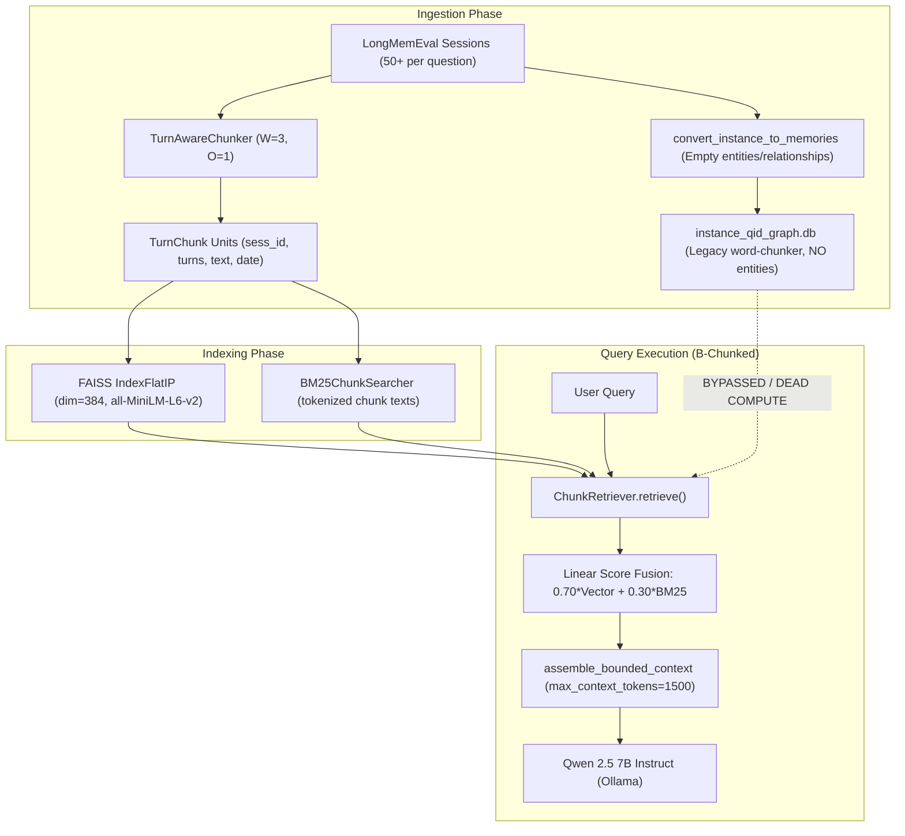

# IVARA Research: Graph and Ontology Ablation Protocol

**Branch:** `research/evaluation-baseline`  
**Date:** October 27, 2026  
**Status:** Protocol & Experimental Design Specification  
**Objective:** Determine whether IVARA's ontology and knowledge graph provide measurable retrieval and answering gains beyond the Turn-Aware Conversational Chunking (`B-Chunked`) baseline on LongMemEval-S.

---

## 1. Execution-Path Audit: B-Chunked Baseline

Before designing the ablation, we traced the exact end-to-end execution path of `B-Chunked` on LongMemEval-S to distinguish components that are constructed/stored from those that actually influence retrieval and generation.

### 1.1 Detailed Component-by-Component Trace

1. **Chunk Creation and Metadata:**
   - Input: Chronologically sorted conversation sessions from `LongMemEvalInstance.sessions`.
   - Engine: `src/chunking/turn_chunker.py` (`TurnAwareChunker(window_size=3, overlap=1)`).
   - Chunk Properties: `chunk_id` (`sess_{session_id}_c{idx:03d}`), `memory_id` (`sess_{session_id}`), `session_id`, `session_date`, `turn_start_idx`, `turn_end_idx`, `roles`, `timestamps`, `text`, `token_estimate`.
   - Handling: Lossless preservation of conversation text; short sessions ($\le 3$ turns) preserved as single chunks; empty turns sanitized without index corruption.

2. **Entity Extraction and Canonicalization:**
   - **Current State in B-Chunked: 100% Bypassed.**
   - In `longmemeval_adapter.py` (`convert_instance_to_memories`), `memo["entities"]` is explicitly `[]` and `memo["relationships"]` is explicitly `[]`.
   - The neural extraction pipeline (`src/extraction/extractor.py` and `src/extraction/pipeline.py`) was not invoked during LongMemEval ingestion because running LLM extraction over 50 sessions $\times$ 10 chunks = 500 chunks per question $\times$ 30 questions = 15,000 LLM calls is computationally prohibitive.
   - Consequently, zero canonical entities were resolved into the per-instance session records.

3. **Ontology and Graph Construction:**
   - In `run_longmemeval.py`, a per-question SQLite database `instance_{qid}_graph.db` was opened via `SQLiteGraphStore(db_path)`.
   - `MemoryGraphBuilder(store).build_from_records(memories)` was executed.
   - **Critical Finding (Dead Compute):** Because `memories` contained empty entities and relationships, and because the legacy builder called `chunk_memory(memo, target_words=120)` instead of `TurnAwareChunker`, the SQLite database contained:
     - Arbitrary word-based sentence chunks (disconnected from the actual TACC chunks).
     - Structural edges (`contains_memory`, `adjacent_to`).
     - **Zero entity nodes** and **zero semantic relationship edges**.
   - Furthermore, `answer_question` in B-Chunked mode passed `use_chunking=True` and `chunks=chunks`, completely bypassing the SQLite store during retrieval. The SQLite database was closed and deleted at the end of the query without ever contributing a single bit of information.

4. **FAISS and BM25 Retrieval:**
   - `ChunkRetriever` builds an in-memory `faiss.IndexFlatIP` (384 dimensions, normalized L2 vectors from `all-MiniLM-L6-v2`) and a `BM25ChunkSearcher` directly over the `TurnChunk` instances.
   - Search: top $k \times 3$ candidates from vector and BM25 are fused via linear normalization:
     $$\text{Score} = 0.70 \times \text{NormVector} + 0.30 \times \text{NormBM25}$$
   - Returns top $k$ chunks (default $k=5$).

5. **Graph Edge Consultation:**
   - **Zero graph edges were consulted.** `traverse_relevance_guided` was never invoked.
   - Intra-session chunk adjacency, entity mention links, and cross-session entity co-references had zero influence on chunk ranking.

6. **Context Assembly and Answering:**
   - `assemble_bounded_context` enforces `max_context_tokens = 1500`.
   - Chunks are grouped by `session_id`, sorted chronologically, and formatted into clean session dialogue snippets.
   - The assembled prompt enforces strict personal-memory grounding: if insufficient evidence exists, the model abstains; otherwise, it answers using only stated facts.

### 1.2 Summary of Bypassed vs Influencing Components in B-Chunked

| Component | Stored / Constructed? | Influences B-Chunked Retrieval/Generation? | Notes |
| :--- | :--- | :--- | :--- |
| **TurnAwareChunker ($W=3, O=1$)** | Yes (in memory) | **Yes (Direct Primary Input)** | Lossless turn representation |
| **FAISS Dense Vector Index** | Yes (in memory) | **Yes (70% Retrieval Weight)** | Cosine similarity on chunk text |
| **BM25 Lexical Index** | Yes (in memory) | **Yes (30% Retrieval Weight)** | Keyword matching on chunk text |
| **Bounded Context Assembly** | Yes | **Yes (Tokens strictly $\le 1500$)** | Enforces compactness & eliminates bloat |
| **SQLite Graph Store** | Yes (on disk, per-qid) | **NO (100% Bypassed)** | Constructed legacy word chunks; unused |
| **Ontology Vocabulary (`vocabulary.json`)**| Stored in repo | **NO (100% Bypassed)** | Not consulted by B-Chunked |
| **Entity Resolver (`entity_resolver.py`)** | Implemented | **NO (100% Bypassed)** | Not invoked during chunking or search |
| **Relevance-Guided Traversal** | Implemented | **NO (100% Bypassed)** | `traverse_relevance_guided` never called |

---

## 2. Controlled Graph Ablation Design

To isolate the individual contributions of ontology guidance and graph structure, we define three cleanly separated configurations.

### 2.1 Configuration Specifications

#### Configuration A: `B-Chunked` (Baseline)
- **Ingestion:** Turn-Aware Conversational Chunking ($W=3, O=1$).
- **Retrieval:** Hybrid Dense FAISS (70%) + Lexical BM25 (30%) on `TurnChunk` texts.
- **Ontology Operations:** None.
- **Graph Traversal:** None.
- **Context Assembly:** `assemble_bounded_context` with 1,500 token budget.

#### Configuration B: `B-Chunked + Ontology` (Isolated Ontology Guidance)
- **Ingestion:** Identical `TurnChunk`s.
- **Ontology Operations (No Graph):**
  1. **Entity & Concept Identification:** Detect candidate entity mentions, proper nouns, and ontology keywords in the user query $Q$ using IVARA's ontology vocabulary (`src/ontology/vocabulary.py`, `vocabulary.json`).
  2. **Entity Canonicalization & Alias Expansion:** For recognized entities and predicates, map to canonical names and expand lexical query terms with known aliases and predicate variants (e.g. "Target" $\to$ aliases; "graduated" $\to$ "degree", "college", "major"; "uses" $\to$ "programming language", "framework").
  3. **Ontology Entity Re-ranking:** Re-score initial candidates by boosting chunks that contain matching canonical entity mentions or compatible entity types.
- **Graph Traversal:** **STRICTLY ZERO**. No graph nodes, edges, or traversal algorithms are invoked.
- **Context Assembly:** Identical `assemble_bounded_context` with 1,500 token budget.

#### Configuration C: `B-Chunked + Graph` (Verified Graph Traversal)
- **Ingestion:** Identical `TurnChunk`s, PLUS an isolated per-question graph built in `SQLiteGraphStore` directly from the `TurnChunk` units:
  - **`ChunkNode`s:** Every `TurnChunk` is a first-class graph node.
  - **`SessionNode`s:** Group parent sessions.
  - **`contains_chunk` Edges:** Connect `SessionNode` $\to$ `ChunkNode`.
  - **`adjacent_to` Edges:** Connect sequential `Chunk_i` $\to$ `Chunk_{i+1}` within the same session.
  - **`EntityNode`s:** Canonical entity nodes detected within chunks.
  - **`mentions_entity` Edges:** Connect `ChunkNode` $\to$ `EntityNode`.
  - **Semantic / Co-occurrence Edges:** Connect entities that co-occur or have predicate relationships across turns and sessions.
- **Graph Traversal:**
  1. Retrieve direct candidates via hybrid search + entity seed identification.
  2. Execute `traverse_relevance_guided` up to depth 2 (max 15 nodes).
  3. Calculate hop-decayed graph candidate scores ($0.5^{\text{depth}}$) to rescue connected chunks (such as adjacent turn chunks in the same session, or cross-session entity connections).
  4. Extract traversed relational triples $(S, P, O)$ and append verified facts to the evidence context.
- **Context Assembly:** Identical `assemble_bounded_context` with 1,500 token budget (chunk text + verified graph triples).

### 2.2 Architectural Separation Verification

| Feature | Config A (B-Chunked) | Config B (B-Chunked + Ontology) | Config C (B-Chunked + Graph) |
| :--- | :--- | :--- | :--- |
| Chunk Representation | `TurnChunk` ($W=3, O=1$) | `TurnChunk` ($W=3, O=1$) | `TurnChunk` ($W=3, O=1$) |
| Dense FAISS Search | Yes (70%) | Yes (70%) | Yes (70%) |
| Lexical BM25 Search | Yes (30%) | Yes (30%) | Yes (30%) |
| Query Entity Expansion | No | **Yes (Vocabulary/Aliases)** | **Yes (Vocabulary/Aliases)** |
| Entity Mention Re-ranking | No | **Yes (Ontology match)** | **Yes (Ontology match)** |
| Turn Adjacency Edges | No | No | **Yes (`adjacent_to`)** |
| Entity Mention Edges | No | No | **Yes (`mentions_entity`)** |
| Relevance Graph Traversal | No | No | **Yes (`traverse_relevance_guided`)** |
| Relational Triples Context | No | No | **Yes (Subject-Predicate-Object)**|
| Context Token Budget | 1,500 tokens | 1,500 tokens | 1,500 tokens |
| Answering LLM & Prompts | Identical (Qwen 2.5 7B) | Identical (Qwen 2.5 7B) | Identical (Qwen 2.5 7B) |

---

## 3. Evaluation Protocol

### 3.1 Dataset Splits and Overfitting Safeguards

1. **Diagnostic Development Sample (N=30):**
   - The established 30-question diagnostic sample from `ablation_sample_config_b_chunked`.
   - Used for development, execution verification, parameter tuning ($W=3, O=1$, traversal depth 2), and debugging.
2. **Held-Out Evaluation Sample (N=30):**
   - Strictly disjoint 30-question set defined in `held_out_sample_manifest.json`.
   - **Audit Confirmation:** Set intersection check confirms `set(diagnostic_qids) & set(held_out_qids) == set()`.
   - **Frozen Policy:** The held-out sample will only be executed after all configurations, code paths, and scoring routines are completely frozen. No parameter adjustments will be made based on held-out results.

### 3.2 Evaluation Metrics & Observables

For every question across all configurations, we record:
1. **Answer Accuracy:** Heuristic exact match against gold answers (clearly labeled non-official smoke test).
2. **Abstention Accuracy:** Correct abstention on unanswerable `_abs` queries vs false abstentions.
3. **Retrieval Recall@5:** Evidence session recall and evidence chunk recall.
4. **Context Prompt Tokens:** Measured tokenizer token count of assembled context (target $\le 1,500$).
5. **Graph Traversal Diagnostics:** Nodes expanded, edges traversed, traversal latency, and hop decay contributions.
6. **Error Analysis:** Categorization of errors into retrieval failure, coreference gap, graph distraction, or generation error.

### 3.3 Security & Evaluation Integrity
- **Gold Label Isolation:** Zero gold answers, `answer_session_ids`, or `has_answer` flags are accessible to the chunker, graph builder, retriever, or generator.
- **Index Isolation:** Each instance is processed with a fresh, isolated in-memory or on-disk index.
- **Production Store Protection:** `data/memories.json` and `data/entities.json` remain pristine with 0 diffs.
