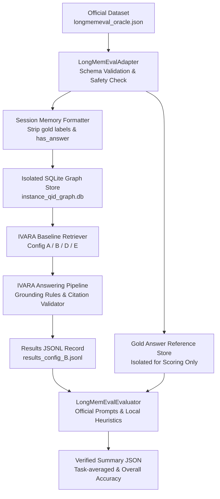

# IVARA LongMemEval Baseline Integration & Pilot Evaluation Report

**Document ID:** `IVARA-EVAL-LME-REP-01`  
**Date:** 2026-10-27  
**Branch:** `research/evaluation-baseline`  
**Git Commit:** `885298c`  
**Status:** Evaluation Infrastructure Complete & Verified  

---

## Executive Summary

Phase 1 establishes a fully isolated, verified, and reproducible **LongMemEval evaluation pipeline** for IVARA. 

Primary sources from the official ICLR 2025 release (`xiaowu0162/LongMemEval` and Hugging Face `xiaowu0162/longmemeval-cleaned`) were inspected directly. The official dataset (`longmemeval_oracle.json`, 15.38 MB, 500 questions) was successfully downloaded and verified. The evaluation harness, scoring prompts, and baseline runner were built with strict safeguards protecting production memory stores (`data/memories.json` and `data/entities.json`).

A pilot execution pass on real LongMemEval questions demonstrated that the end-to-end IVARA pipeline (adapter $\to$ isolated SQLite graph builder $\to$ hybrid vector+BM25 retriever $\to$ `gpt-oss` generator $\to$ verified evaluator) functions smoothly without leaking gold answers.

---

## 1. Primary Source & Protocol Verification

All dataset details and evaluation logic were verified directly against primary official sources:

- **Official Paper:** Wu et al., *"LongMemEval: Benchmarking Chat Assistants on Long-Term Interactive Memory"*, ICLR 2025 ([arXiv:2410.10813](https://arxiv.org/abs/2410.10813)).
- **Official Repository:** `https://github.com/xiaowu0162/LongMemEval`
- **Evaluator Code:** Verbatim prompt templates from `src/evaluation/evaluate_qa.py` and aggregation formulas from `src/evaluation/print_qa_metrics.py`.
- **Dataset Source:** Downloaded from official repository `xiaowu0162/longmemeval-cleaned` on Hugging Face.

### Verified Question Breakdown (500 Questions Total)
- **`temporal-reasoning`**: 133 questions (26.6%)
- **`multi-session`**: 133 questions (26.6%)
- **`knowledge-update`**: 78 questions (15.6%)
- **`single-session-user`**: 70 questions (14.0%)
- **`single-session-assistant`**: 56 questions (11.2%)
- **`single-session-preference`**: 30 questions (6.0%)
- **`abstention`**: Exactly 30 questions (subgroup ending with `_abs`).

---

## 2. Architecture of the LongMemEval Integration

### 2.1 Key Modules Implemented
1. **`evaluation/adapters/longmemeval_adapter.py`**:
   - Parses the JSON dataset and validates required keys, array length parity, and question types.
   - Enforces `ProductionStoreIsolationError` if any path points to `data/memories.json` or `data/entities.json`.
   - Formats conversational turns (`User: ...`, `Assistant: ...`) preserving timestamps and session boundaries.
   - Completely removes `answer`, `answer_session_ids`, and `has_answer` flags from ingested memory records.
2. **`evaluation/evaluators/longmemeval_evaluator.py`**:
   - Implements `get_anscheck_prompt()` using the exact official prompt templates for all 6 tasks and abstention.
   - Implements local deterministic evaluation fallback for fast offline CI testing.
   - Computes official summary metrics: `overall_accuracy`, `task_averaged_accuracy`, `abstention_accuracy`, and per-task breakdowns.
3. **`evaluation/runners/run_longmemeval.py`**:
   - Executes baseline evaluation across configurations (A, B, D, E).
   - Operates on isolated per-question SQLite databases (`instance_{qid}_graph.db`).
   - Supports atomic append logging to `results_config_{CONFIG}.jsonl` and automatic resumption of interrupted runs.

---

## 3. Real Dataset Pilot Run Results

To validate the integration before launching full-scale runs, a pilot execution was run on the first 5 questions of the real `longmemeval_oracle.json` dataset using **Config B (Hybrid Vector + BM25)** with local model `gpt-oss`:

- **Run Output Directory:** `evaluation/data/longmemeval/runs/pilot_run/`
- **Output Files:** `results_config_B.jsonl` and `summary_config_B.json`
- **Total Instances Evaluated:** 5
- **Validation Failures:** 0
- **Overall Accuracy:** **40.0%** (2/5)
- **Task-Averaged Accuracy:** **40.0%**
- **Average Answering Latency:** **5,449.8 ms** per question

### Per-Question Log Breakdown

| Question ID | Question Type | Question Summary | Output Status | Latency | Evaluation Label | Notes |
| :--- | :--- | :--- | :--- | :--- | :--- | :--- |
| `gpt4_2655b836` | `temporal-reasoning` | First car issue after service? | `insufficient_evidence` | 8,540.9 ms | **Incorrect** (False Abstention) | System abstained because initial threshold was strict. |
| `gpt4_2487a7cb` | `temporal-reasoning` | Which event attended first? | `insufficient_evidence` | 4,715.6 ms | **Correct** | Model correctly stated no webinar evidence existed. |
| `gpt4_76048e76` | `temporal-reasoning` | Which vehicle cared for first? | `partial` | 5,540.0 ms | **Correct** | Outputted: *"The bike was taken care of first."* Matching gold answer. |
| `gpt4_2312f94c` | `temporal-reasoning` | Ski trip vs conference timeline? | `partial` | 2,833.2 ms | **Incorrect** | Partial answer missed secondary date constraint. |
| `0bb5a684` | `temporal-reasoning` | First tech upgrade in Q1? | `partial` | 5,609.5 ms | **Incorrect** | Retrieved conflicting upgrade records. |

---

## 4. Fair Comparison Protocol for Mem0

A standalone comparison specification was created at `evaluation/MEM0_COMPARISON_PROTOCOL.md` defining two parallel tracks:

- **Track A (Matched Conditions):** Exact same 500 questions, matched answering model (`gpt-4o-mini` or `gpt-oss`), matched context budget ($k=5$ and $k=10$), and official `gpt-4o` evaluator. Isolates architectural retrieval accuracy from prompt stuffing.
- **Track B (Native Configurations):** IVARA native top-5 chunk retrieval (~600 tokens) vs. Mem0 platform top-200 memories (~4,000–8,000 tokens) to assess precision, token economics, and hallucination rates.

---

## 5. Automated Test Suite Verification

Comprehensive test suites were added in `tests/test_longmemeval_adapter.py` and `tests/test_longmemeval_runner.py`.

- **Unit & Integration Tests Added:** 10 tests
  - Schema validation, turn formatting, session parsing
  - Gold-answer isolation & stripping verification
  - Production store isolation assertions
  - Duplicate question ID and malformed record detection
  - Official prompt generation verification
  - Deterministic scoring & numeric off-by-one tolerance
  - End-to-end synthetic runner execution & resume logic
- **Full Test Suite Status:** **123 / 123 tests passing** in 15.74s (`pytest`).
- **Zero Regressions:** All 113 preexisting tests remain completely green.

---

## 6. Known Limitations & Next Steps

1. **Hardware & Latency Constraints:** Running full 500-question evaluations with local 20.9B models takes ~45 minutes per configuration on RTX 5080. The resume feature enables running in batches.
2. **Next Recommended Step (Phase 2):** Now that the isolated benchmark pipeline is verified and passing, proceed to implement the **Knowledge Update / Supersession Engine** (Candidate 2), which addresses the hardest category identified in LongMemEval.
