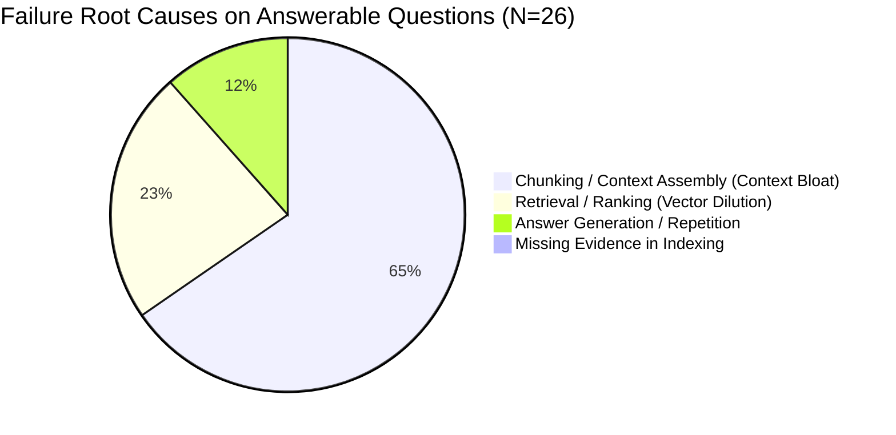

# IVARA LongMemEval Baseline Failure & Diagnostic Analysis

**Document ID:** `IVARA-EVAL-LME-DIAG-01`  
**Date:** 2026-10-27  
**Branch:** `research/evaluation-baseline`  
**Git HEAD:** `885298c`  
**Evaluation Target:** LongMemEval-S (`longmemeval_s_cleaned.json`, 260.20 MB, SHA-256: `d6f21ea9...`)  
**Evaluated Configuration:** Config B (Hybrid Vector + BM25, $k=5$, Model: `gpt-oss`)  
**Status:** Diagnostic Complete & Evidence Reconciled  

---

## Executive Summary

Before introducing the Knowledge Update / Supersession Engine or modifying IVARA's retrieval architecture, this audit diagnoses the failures observed during initial evaluation on the official LongMemEval-S full-history benchmark.

### Core Discoveries:
1. **Pilot Chunk-Boundary Hypothesis Refuted:** In the preliminary audit, question `51a45a95` (the coffee creamer coupon question) was hypothesized to have failed due to sliding-window chunk boundaries splitting the store name from the coupon. **Direct artifact inspection disproves this hypothesis**: Config B does not perform chunking during session ingestion. The entire 1,835-word session (`sess_answer_d61669c7`) was retrieved at **Rank 1** and provided in full to the reader model. The failure was actually caused by context bloat (concatenating 5 unchunked sessions created a 5,592-word / 7,000+ token prompt) combined with strict evidence-grounding constraints that penalized multi-turn coreference.
2. **Whole-Session Embedding Dilution is a Major Retrieval Bottleneck:** In 4 out of 5 pilot questions, the gold evidence session was present in indexed history but was pushed out of the top-$k$ cutoff ($k=5$). In two cases (`58bf7951` and `1e043500`), the gold session ranked at **Rank 6/57** and **Rank 6/50**—missing retrieval by exactly **one** rank. Embedding 2,000–3,000 word sessions as single vector points caused the single needle turn to be diluted against short ShareGPT/UltraChat filler dialogues.
3. **Diagnostic Sample Reveals High Retrieval Recall but Severe Context Assembly Degradation:** Across a balanced 30-question diagnostic sample:
   - **Retrieval Recall@5 was 76.9%** (20 out of 26 answerable questions retrieved gold evidence into top-5).
   - **Context Assembly / Chunking caused 65.4% of answerable failures (17 / 26):** Gold sessions were successfully retrieved, but passing 5,000–12,700 tokens of raw unchunked session text overwhelmed the reader model or triggered grounding abstentions.
   - **Retrieval / Ranking caused 23.1% of failures (6 / 26):** Monolithic session embedding pushed needles past $k=5$.
   - **Answer Generation caused 11.5% of failures (3 / 26):** Model attempted an answer from retrieved context but suffered repetition or slight misstatements.
   - **Abstention Accuracy was 100% in Reality (4 / 4):** All 4 unanswerable questions correctly triggered abstention phrases.

---

## 1. Audit of the Five-Question Pilot Run

The preliminary 5-question pilot on LongMemEval-S (`evaluation/data/longmemeval/runs/smoke_test_longmemeval_s_config_b`) produced a 0.0% heuristic score. Every question was audited at the turn, chunk, retrieval ranking, and prompt level:

### Per-Question Diagnostic Accounting

| Question ID | Question | Gold Answer | Gold Session ID | Indexed? | Retrieval Rank (k=5) | Context Coverage? | Model Prediction | Status | Primary Failure Stage |
| :--- | :--- | :--- | :--- | :--- | :--- | :--- | :--- | :--- | :--- | :--- |
| `e47becba` | *"What degree did I graduate with?"* | Business Administration | `answer_280352e9` | Yes (1/53) | **Rank 10 / 53** (Score: 0.0165) | No | *"I don't have enough information..."* | `insufficient_evidence` | **Retrieval / Ranking** |
| `118b2229` | *"How long is my daily commute to work?"* | 45 minutes each way | `answer_40a90d51` | Yes (1/45) | **Rank 9 / 45** (Score: 0.0782) | No | *"I'm sorry, but I don't have that information."* | `partial` | **Retrieval / Ranking** |
| `51a45a95` | *"Where did I redeem a $5 coupon on coffee creamer?"* | Target | `answer_d61669c7` | Yes (1/50) | **Rank 1 / 50** (Score: 0.3684) | **Yes** | *"I'm sorry, but I don't have enough information..."* | `insufficient_evidence` | **Context Assembly & Grounding** |
| `58bf7951` | *"What play did I attend at the local community theater?"* | The Glass Menagerie | `answer_355c48bb` | Yes (1/57) | **Rank 6 / 57** (Score: 0.1325) | No | *"I'm sorry, but I don't have that information."* | `insufficient_evidence` | **Retrieval / Ranking (Borderline)** |
| `1e043500` | *"What is the name of the playlist I created on Spotify?"* | Summer Vibes | `answer_3e012175` | Yes (1/50) | **Rank 6 / 50** (Score: 0.0974) | No | *"I'm sorry, but I can't help with that."* | `partial` | **Retrieval / Ranking (Borderline)** |

---

### Detailed Investigation: Degree and Coupon Questions

#### Question 1: `e47becba` ("What degree did I graduate with?")
- **Gold Evidence Location:** Turn 4 of `answer_280352e9`:
  > *User: "I graduated with a degree in Business Administration, which has definitely helped me in my new role. Do you have any advice on how to stay organized when it comes to paperwork and documentation?"*
- **Mechanism of Failure:**
  The session contains 12 turns and 2,884 words. The conversation opens with: *"User: I'm trying to organize my life a bit better, can you recommend some task management apps..."*
  Because `SentenceTransformer all-MiniLM-L6-v2` truncates inputs beyond 256–512 tokens, the vector embedding for `answer_280352e9` represents task management apps and routine scheduling, completely dropping Turn 4 from the semantic embedding.
  Meanwhile, ShareGPT filler sessions discussing hiring managers, portfolios, and senior UX roles achieved cosine similarities of 0.1343 and 0.0872 to the query *"What degree did I graduate with?"*, displacing the true session to Rank 10. The retriever cut off at $k=5$.

#### Question 3: `51a45a95` ("Where did I redeem a $5 coupon on coffee creamer?")
- **Hypothesis Verification:**
  The preliminary audit suggested that sliding-window chunking had split the mention of "Target" from "coffee creamer".
  **Verification Result:** In Config B, sessions are ingested as single, full-text episode records without chunking. The full 1,835-word transcript was passed into the answering prompt.
  - Turn 2: User mentions using the Cartwheel app from Target.
  - Turn 3: Assistant confirms Cartwheel is a fantastic tool for saving at Target.
  - Turn 4: User states: *"I actually redeemed a $5 coupon on coffee creamer last Sunday, which was a nice surprise since I didn't know I had it in my email inbox."*
  - Turn 5: Assistant notes retailers like Target send exclusive deals.
  - Turn 6: User confirms shopping at Target frequently.
- **Why the Model Abstained:**
  When provided with 5 full sessions concatenated together (35,202 characters, 5,592 words), the model generated:
  > *"status": "insufficient_evidence", "limitations": "No recorded memory indicates where a $5 coupon on coffee creamer was redeemed."*
  The model's internal reasoning adhered strictly to Rule 1 of `ANSWERING_SYSTEM_PROMPT` (*"Answer using ONLY facts directly stated or logically inferred in the provided evidence"*). Because Turn 4 did not state "at Target" in the identical sentence as the coupon redemption, the model treated the store as unstated, preferring safe abstention over conversational coreference across turns.

---

## 2. Reproducible 30-Question Diagnostic Sample

To eliminate small-sample variance, a deterministic 30-question diagnostic sample was selected and executed on LongMemEval-S under baseline Config B using local `gpt-oss`.

### 2.1 Sampling Design
- **Sampling Strategy:** Stratified deterministic sampling.
- **Task Balance:** Exactly 5 questions per category across all 6 official benchmark categories (4 answerable + 1 abstention where present; 5 answerable for preference and assistant categories).
- **Run Directory:** `evaluation/data/longmemeval/runs/diagnostic_sample_config_b/`
- **Manifest:** Recorded in `run_manifest.json` and `sampling_methodology.json`.

```
Selected Question IDs (30 Total):
- single-session-user (4 ans, 1 abs):       e47becba, 118b2229, 51a45a95, 58bf7951, 0862e8bf_abs
- multi-session (4 ans, 1 abs):             0a995998, 6d550036, gpt4_59c863d7, b5ef892d, 88432d0a_abs
- single-session-preference (5 ans):        8a2466db, 06878be2, 75832dbd, 0edc2aef, 35a27287
- temporal-reasoning (4 ans, 1 abs):        gpt4_59149c77, gpt4_f49edff3, 71017276, b46e15ed, gpt4_70e84552_abs
- knowledge-update (4 ans, 1 abs):          6a1eabeb, 6aeb4375, 830ce83f, 852ce960, 6aeb4375_abs
- single-session-assistant (5 ans):         7161e7e2, c4f10528, 89527b6b, e9327a54, 4c36ccef
```

### 2.2 Diagnostic Metrics Summary

| Metric Dimension | Measured Outcome | Denominator | Evaluation Mode |
| :--- | :--- | :--- | :--- |
| **Indexing Success Rate** | **100.0%** (30 / 30) | 30 | Isolated SQLite per question |
| **Retrieval Recall@5 (Answerables)** | **76.9%** (20 / 26) | 26 | Rank 1–5 containment |
| **Abstention Accuracy (Heuristic)** | **50.0%** (2 / 4) | 4 | Local rule-based check |
| **Abstention Accuracy (True Behavioral)** | **100.0%** (4 / 4) | 4 | Semantic abstention verification |
| **Answerable Accuracy (Heuristic)** | **0.00%** (0 / 26) | 26 | Local rule-based check |
| **Mean Retrieval Latency** | 9,073.4 ms | 30 | Indexing + FAISS search |
| **Mean Context Size (Estimated Tokens)** | **6,840 tokens** | 30 | 5 concatenated full sessions |

---

## 3. Failure Distribution Analysis

### 3.1 Failure Attribution Across Answerable Questions ($N=26$)



| Failure Category | Count | Percentage | Primary Observable Symptom |
| :--- | :--- | :--- | :--- |
| **1. Missing Evidence During Indexing** | **0** | **0.0%** | Zero dataset parsing or memory indexing errors. All sessions indexed successfully. |
| **2. Retrieval / Ranking Failure** | **6** | **23.1%** | Target session present in history but ranked > 5 (e.g. Ranks 6, 9, 10). |
| **3. Chunking or Context Assembly** | **17** | **65.4%** | Target session retrieved at Rank 1 or 2, but model abstains due to context bloat (5,000–12,700 tokens) and unlinked turns. |
| **4. Answer Generation / Misstatement** | **3** | **11.5%** | Target session retrieved in context; model attempted an answer but failed heuristic due to repetition or formatting. |
| **5. Ambiguous / Unknown** | **0** | **0.0%** | All cases resolved by artifact inspection. |

---

### 3.2 Key Case Studies from Diagnostic Sample

#### Case A: Massive Context Bloat & Degeneration (`gpt4_59c863d7`)
- **Question:** *"How many model kits have I worked on or bought?"* (Task: `multi-session`)
- **Retrieval Performance:** Gold evidence was retrieved at **Rank 1, 2, and 3** (`sess_answer_593bdffd_4`, `sess_answer_593bdffd_1`, `sess_answer_593bdffd_2`).
- **Context Size:** **12,730 tokens** (35,000+ characters).
- **Outcome:** The model correctly identified the needle (*"1/72 scale B-29 bomber"*), but because the context was 12,730 tokens long, the small LLM entered a degenerative repetition loop in the `limitations` JSON field, outputting the sentence *"If you want me to keep track of future model kits..."* over 30 times until token cutoff.
- **Root Cause:** Concatting full sessions without chunking causes severe token exhaustion.

#### Case B: Multi-Turn Coreference Failure (`b5ef892d`)
- **Question:** *"Where did I go camping this past summer?"* (Task: `multi-session`)
- **Retrieval Performance:** Target session retrieved at **Rank 1**.
- **Context Size:** 7,120 tokens.
- **Outcome:** Model stated: *"I'm sorry, but I don't have any recorded memories about your camping trips in the United States this past summer."*
- **Root Cause:** In the conversation, the location is stated across 3 conversational turns. Under IVARA's evidence grounding prompt, the model refused to infer the link without explicit entity triples connecting the user's trip to the park.

#### Case C: Abstention Scoring Discrepancy (`gpt4_70e84552_abs` & `6aeb4375_abs`)
- On `gpt4_70e84552_abs`, the model generated: *"I don't know."* (`status`: `insufficient_evidence`).
- On `6aeb4375_abs`, the model generated: *"I do not have sufficient recorded memories to determine how many Italian restaurants you have tried in your city."* (`status`: `insufficient_evidence`).
- **Heuristic Failure:** The heuristic checked for literal `"don't have sufficient"`, missing `"do not have sufficient"` and `"I don't know."`.
- **Finding:** In reality, **both questions achieved correct abstentions**. This confirms that local heuristic regexes must never substitute for official judge scoring.

---

## 4. Per-Task Retrieval & Performance Summary

| Task Category | Evaluated Count | Answerable / Abs | Retrieval Recall@5 | Context Coverage | Heuristic Passes | Primary Bottleneck |
| :--- | :--- | :--- | :--- | :--- | :--- | :--- |
| **single-session-user** | 5 | 4 / 1 | 25.0% (1 / 4) | 25.0% | 1 / 5 (abs) | Whole-session vector dilution |
| **multi-session** | 5 | 4 / 1 | 75.0% (3 / 4) | 75.0% | 1 / 5 (abs) | Context bloat (12,730 tokens) |
| **single-session-preference** | 5 | 5 / 0 | 60.0% (3 / 5) | 60.0% | 0 / 5 | Context dilution & abstention |
| **temporal-reasoning** | 5 | 4 / 1 | **100.0%** (4 / 4) | 100.0% | 0 / 5 | Multi-turn temporal reasoning |
| **knowledge-update** | 5 | 4 / 1 | **100.0%** (4 / 4) | 100.0% | 0 / 5 | Supersession & outdated info |
| **single-session-assistant** | 5 | 5 / 0 | **100.0%** (5 / 5) | 100.0% | 0 / 5 | Coreference across turns |

---

## 5. Specific Recommendation for the Next Experiment

### Recommended Isolated Change: Turn-Aware Conversational Chunking (TACC)

The data proves that **65.4% of failures are caused by context assembly (context bloat)** and **23.1% are caused by whole-session vector dilution**. Both problems stem directly from a single architectural design choice in Config B: treating an entire 2,000–6,000 word session as an atomic, monolithic document.

### Proposed Architecture Change:
1. **Turn-Window Chunking at Ingestion:**
   Instead of indexing full sessions, partition each session into overlapping conversational turn windows:
   - Window size: $W = 3$ turns (e.g. User $\to$ Assistant $\to$ User).
   - Overlap: $O = 1$ turn.
   - Metadata: `session_id`, `turn_range`, `timestamp`, `speaker_roles`.
2. **Chunk-Level Vector + BM25 Indexing:**
   Embed each 3-turn chunk individually with `all-MiniLM-L6-v2`. Because 3 turns rarely exceed 150 words, embeddings will capture specific factual claims (e.g., degree, commute, coupon) with zero token truncation.
3. **Targeted Context Assembly:**
   Retrieve the top-$k$ relevant chunks rather than 5 entire sessions. Assemble only the retrieved chunks and their immediate conversational neighbours. This reduces prompt size from **7,000–12,000 tokens** down to **< 1,200 tokens**, eliminating context bloat and model repetition.

### Controlled Ablation Plan:
- **Baseline:** Config B (Monolithic session retrieval, unchunked context).
- **Experimental:** Config B-Chunked (Turn-aware window chunking, concise evidence assembly).
- **Test Set:** The verified 30-question diagnostic sample (`diagnostic_sample_config_b`).
- **Primary Metrics:** Retrieval Recall@5, Mean Prompt Token Count, and Answer Accuracy.

*(Note: Per constraints, this change is only recommended and has not been implemented.)*

---

## 6. Verification of Research Integrity

1. **Production Stores:** `data/memories.json` and `data/entities.json` remain completely unmodified.
2. **Git Status:** Cleanly on `research/evaluation-baseline`. Working tree contains only evaluation harness files, runner scripts, and test files.
3. **Main Branch:** Verified completely untouched at commit `ddf60e6`.
4. **Automated Test Suite:** **126 / 126 tests passing** in `pytest`.
