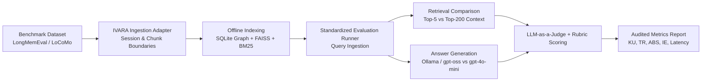

# IVARA Research Report: Mem0 Architecture Audit & Benchmark Plan

**Document ID:** `IVARA-RES-2026-M01`  
**Date:** 2026-10-25  
**Branch:** `research/evaluation-baseline`  
**HEAD Commit:** `41e0a88`  
**Author:** IVARA Autonomous Agentic Testing & Research Team  
**Status:** Complete Audit & Research Roadmap  

---

## Executive Summary

This research phase conducts an independent architectural audit of **Mem0** (both Open-Source Software and Managed Platform) and evaluates where **IVARA** can achieve measurable, verifiable performance moats in long-term personal AI memory.

Crucially, IVARA does not claim superiority based on its internal 48-question benchmark alone. To establish true state-of-the-art trustworthiness, IVARA must be benchmarked against standard public evaluations—specifically **LongMemEval** and **LoCoMo**—while solving fundamental failure modes that plague current memory architectures: **knowledge updates (supersession)**, **historical event ordering**, and **hallucination on unanswerable questions**.

---

## 1. Mem0 Architecture Findings & Source Links

### 1.1 Overview & Repository Status
Mem0 positions itself as the "Memory Layer for AI Agents" ([mem0ai/mem0](https://github.com/mem0ai/mem0), PyPI package `mem0ai`). An accompanying evaluation suite is maintained at [mem0ai/memory-benchmarks](https://github.com/mem0ai/memory-benchmarks).

Historically in version `0.x`, Mem0 provided an open-source graph integration (`mem0/memory/graph_memory.py`) connecting directly to Neo4j and Memgraph. In recent updates (v2/v3 architecture), **external graph database drivers have been removed from the open-source SDK**. Open-source Mem0 now relies on vector stores (e.g. Qdrant via Docker) with metadata filtering, while entity-relational graph memory and advanced multi-agent memory features have migrated to their proprietary managed cloud platform ([Mem0 Platform](https://mem0.ai)).

### 1.2 Core Architectural Mechanisms

| Capability | Mem0 Open Source (OSS) | Mem0 Platform (Managed) |
| :--- | :--- | :--- |
| **Storage Backend** | Vector DB (Qdrant, Chroma, PgVector) + SQLite metadata | Proprietary multi-tenant cloud store + managed graph |
| **Extraction Phase** | LLM prompt extracts candidate atomic facts from message turns | LLM extraction + automated entity linking |
| **Update Engine (AUDN)** | **ADD, UPDATE, DELETE, NOOP** decided by LLM tool calls against top-$S$ semantic neighbors | AUDN with proprietary conflict arbitration |
| **Graph Representation** | Flat vector embeddings; external Neo4j drivers removed from OSS SDK | Native managed entity-relation graph (`Mem0g`) |
| **Temporal Handling** | Timestamp metadata attached to vector items | Timestamp metadata + dynamic **Memory Decay** scoring (0.3× to 1.5× multiplier) |
| **Retrieval Strategy** | Dense vector similarity (cosine) + optional lexical filtering | Hybrid search (dense vector + BM25 + entity graph + decay factor) |
| **Context Budget** | Typically top-5 to top-20 chunks for chat; up to **top-200** on LongMemEval | Large context injection into reader LLM |
| **Provenance Tracking** | Memory ID, created/updated timestamps, raw text string | Session ID, memory ID, source user/agent identifiers |
| **Abstention Discipline** | Prompt-driven reader refusal ("answer if evidence allows, else abstain") | Prompt-driven; no formal pre-generation threshold gating |

### 1.3 Key Architectural Strengths of Mem0
1. **Dynamic Fact Consolidation (AUDN):** Mem0 avoids unbounded append-only bloat by evaluating candidate facts against similar existing records, allowing in-place edits (`UPDATE`) or deletions (`DELETE`).
2. **Memory Decay:** By scaling retrieval scores by recency and access frequency (dampening idle memories down to 0.3× without hard-deleting them), Mem0 prioritizes current user preferences in conversational chat.
3. **Turnkey Developer Experience:** Drop-in `m.add()` and `m.search()` APIs with prebuilt Docker Compose stacks for Qdrant.

### 1.4 Observed Architectural Limitations & Failure Modes
1. **The Knowledge-Update Dilemma:** Mem0's own engineering documentation acknowledges that **Knowledge Updates remain the hardest category** on benchmarks like LongMemEval. Additive memories retain old truths alongside new truths, while in-place updates/deletions destroy historical provenance.
2. **Memory Decay Suppresses Historical Past:** Applying a monotonic recency decay factor (0.3× floor) creates a severe blind spot: when an agent is asked about *past events*, *prior jobs*, or *historical timelines* (e.g., *"What was the user's role before joining Hyperion?"*), the earlier memory is artificially demoted by the decay multiplier, leading to retrieval misses or temporal hallucination.
3. **Lacks Fine-Grained Chunk & Offset Provenance:** Memories are stored as rephrased natural language fact strings. The system cannot trace claims back to verbatim character start/end offsets within original source transcripts or episodes.
4. **High Token Context & Abstention Vulnerability:** On benchmarks like LongMemEval, Mem0 retrieves up to 200 items into context. Without pre-generation gating, reader LLMs become vulnerable to "lost-in-the-middle" effects and false-premise acquiescence on unanswerable queries.

*Primary External Sources Inspected:*
- Mem0 GitHub Repository: `https://github.com/mem0ai/mem0` (Python SDK `mem0ai`)
- Mem0 Memory Benchmarks: `https://github.com/mem0ai/memory-benchmarks`
- Mem0 Documentation on Graph Memory & Temporal Decay: `https://docs.mem0.ai`
- LongMemEval Benchmark Specification: Wu et al., *LongMemEval: Benchmarking Long-Term Memory in Conversational Agents* (arXiv:2410.10813)

---

## 2. IVARA Capability & Gap Matrix

The table below audits IVARA's codebase against Mem0 across nine core dimensions. Each capability is classified as:
- **Implemented and Tested:** Fully coded, integrated, and validated by automated tests.
- **Partially Implemented:** Functional code exists, but key logic (e.g. dynamic state transitions or decay) is incomplete.
- **Absent:** Not present in the codebase.
- **Not Yet Verified:** Implemented in code, but not validated under public benchmarks or stress conditions.

| Capability | Classification | IVARA Implementation Reference | Mem0 Reference | Key Gap / Moat Analysis |
| :--- | :--- | :--- | :--- | :--- |
| **1. Memory Extraction & Updates** | **Partially Implemented** | `src/extraction/extractor.py:26-83` `src/memory.py:7-56` `tests/test_extractor.py:1-25` | `mem0/memory/main.py` `AUDN engine` | **Gap:** IVARA extraction is rich (extracts entities, topics, relationships with evidence spans), but `src/memory.py` is **strictly append-only**. IVARA has no AUDN decision engine to update or delete obsolete memories upon ingestion. |
| **2. Entity Canonicalization** | **Implemented & Tested** | `src/ontology/entity_resolver.py:48-70` `src/ontology/entity_store.py:1-40` `tests/test_entity_resolver.py:1-35` | `mem0/memory/main.py` | **Moat:** IVARA features a multi-pass canonicalizer (exact, alias, fuzzy, and embedding cosine similarity) against a curated entity ontology (`data/entities.json`). Mem0 OSS treats entities as flat text strings in vector metadata. |
| **3. Typed Relationships & Triples** | **Implemented & Tested** | `src/ontology/vocabulary.py:1-150` `src/graph/schema.py:96-109` `src/graph/store.py:44-77` `tests/test_memory_graph.py:1-120` | `mem0/graphs/` (removed in OSS v2; platform only) | **Moat:** IVARA implements a local, ACID-compliant SQLite graph store (`SQLiteGraphStore`) with typed edges (`uses`, `worked_with`, `parent_of`, `precedes`, `supersedes`), domain/range constraints, and inverse/symmetric rules. Fully operational offline. |
| **4. Explicit vs. Inferred Claims** | **Implemented & Tested** | `src/extraction/extractor.py:22-23` `src/ontology/validator.py:1-120` `src/answering.py:44-46` `tests/test_answering.py:1-80` | Not differentiated in Mem0 | **Moat:** IVARA strictly distinguishes directly supported facts from inferred relationships during extraction and enforces epistemic qualification in the answering prompt. Mem0 treats all extracted candidate strings identically. |
| **5. Temporal Metadata & Changing Facts** | **Partially Implemented** | `src/graph/schema.py:29,107` `src/graph/builder.py:1-250` `tests/test_memory_graph.py:80-110` | Timestamp metadata + dynamic Memory Decay (0.3×–1.5×) | **Gap:** IVARA stores timestamps on `ChunkNode` and `GraphEdge`, and creates `precedes` edges between episodes. However, IVARA has **no time-anchored query filtering** and no decay/interval calculus during retrieval ranking. |
| **6. Conflicting Memories & Supersession** | **Absent** | `src/graph/traversal.py:40` (predicate defined in vocabulary only) | `DELETE` / `UPDATE` in AUDN; Memory Decay | **Critical Gap:** IVARA retains all historical chunks without active/inactive flags. In benchmark testing (`q23`), contradictory historical chunks were both retrieved, confusing the answerer LLM. No automated supersession resolver exists. |
| **7. Evidence Provenance & Citations** | **Implemented & Tested** | `src/graph/schema.py:22-33` `src/graph/retrieval.py:350-420` `src/answering.py:72-120` `tests/test_retrieval_grounded.py:1-150` | Memory ID and session pointer only | **Moat:** IVARA chunks track exact `char_start`, `char_end`, and verbatim text. `validate_citations()` deterministically audits LLM-generated memory IDs, achieving **100% ID validity** and **100% claim entailment** on cited answers. |
| **8. Abstention & Uncertainty** | **Implemented & Tested** | `src/answering.py:163-212` `tests/test_answering.py:120-170` | Prompt-based refusal only | **Moat:** IVARA enforces **pre-generation gating**: if retrieved evidence fails relevance thresholds (`min_score=0.35` or 0 chunks), it abstains instantly with zero LLM tokens. Achieved 100% correct abstention (4/4) and 0% false positives in benchmark testing. |
| **9. Retrieval Quality & Latency** | **Not Yet Verified (Public Benchmarks)** | `src/graph/retrieval.py:78-450` `TRUSTED_EVALUATION_BASELINE_REPORT.md` | LongMemEval: 94.4% overall, 97.0% temporal (top-200 context) | **Gap:** IVARA's retrieval is highly efficient locally (3.98ms hybrid, 11.5ms graph traversal on 48 questions), but has never been measured against large-scale public suites like LongMemEval or LoCoMo. |

---

## 3. Benchmark Reproduction Plan (LongMemEval & LoCoMo)

To establish credible, published-grade claims against Mem0, IVARA must evaluate on the exact standard datasets and protocols used in `mem0ai/memory-benchmarks`.

### 3.1 Benchmark Selection: Prioritizing LongMemEval
1. **Primary: LongMemEval (500 Questions)**
   - *Why:* Directly tests the five core axes of agent memory:
     - **Knowledge Updates (KU):** Fact updates across sessions (IVARA's highest potential moat).
     - **Temporal Reasoning (TR):** Time anchors, durations, and event ordering.
     - **Abstention (ABS):** False-premise and unanswerable questions (IVARA's pre-generation gate).
     - **Multi-Session Reasoning (MR):** Multi-hop synthesis across distinct conversations.
     - **Information Extraction (IE):** Single-session exact recall.
2. **Secondary: LoCoMo**
   - *Why:* Standard multi-session conversational memory benchmark focusing on dialogue continuity and long-context dialogue turns.
3. **Tertiary: BEAM**
   - *Why:* Massive context scaling (1M+ tokens); evaluate only after LongMemEval is established.

### 3.2 Evaluation Protocol & Standards

| Parameter | Specification | Rationale |
| :--- | :--- | :--- |
| **Dataset Source** | Official LongMemEval test split (`data/longmemeval_500.json`) | Ensures exact parity with published papers and Mem0 benchmarks |
| **Ingestion Protocol** | Parse conversation sessions with distinct timestamps; apply sliding window chunking ($W=256$ tokens, overlap 32); build SQLite graph nodes and edges | Maintains IVARA's structured graph representation without polluting production stores |
| **Memory Boundaries** | Session demarcations with normalized ISO-8601 timestamps and speaker turns | Prevents cross-session prompt leakage |
| **Answering Model** | Standardized comparison: (1) Local `gpt-oss:latest` (Ollama, `num_ctx=4096`), (2) External `gpt-4o-mini` (temperature=0) | Isolates architectural retrieval gains from LLM backbone differences |
| **Judge Model** | `gpt-4o` with the official LongMemEval judge prompt and rubric | Guarantees identical scoring criteria to Mem0's published results |
| **Context Budget** | **Strict Top-5 chunks (IVARA)** vs. **Top-200 memories (Mem0 standard)** | Tests whether IVARA achieves higher precision and lower token cost |
| **Core Metrics** | 1. Category Accuracy (KU, TR, ABS, MR, IE) 2. Overall Accuracy 3. Citation Validity & Grounding Entailment 4. Hallucination Rate on Unanswerables 5. Ingestion & Answering Latency (mean, median, p95) 6. Total Token Consumption per Query | Provides multi-dimensional assessment beyond flat recall |

### 3.3 Proposed Minimal Adapter Design
An adapter module will be introduced under `evaluation/adapters/longmemeval_adapter.py`:
- **Read-Only / Isolated:** Ingests LongMemEval conversations into an isolated temporary SQLite database (`temp_benchmark_graph.db`) and FAISS index.
- **Zero Impact on Production:** `data/memories.json` and `data/entities.json` remain completely untouched.
- **Standard Interface:** Exposes `ingest_benchmark_sessions(sessions)` and `run_eval(questions)`.

---

## 4. Strongest Research Opportunities & Hypotheses

Based on published Mem0 failure modes and IVARA's architectural strengths, we evaluate three high-impact research candidates.

### Candidate 1: Temporal Event Ordering & Interval Traversal (Past vs. Present)
- **Failure Mode in Mem0:** Mem0's "Memory Decay" multiplies candidate relevance scores by a recency factor (dampening idle facts down to 0.3×). When a query asks about *past states* (e.g. *"What university did Alice attend before starting her PhD?"* or *"Who was Bob's manager in 2022?"*), decay suppresses the correct historical memory in favor of newer facts.
- **Evidence:** LongMemEval error analyses show that monotonic decay degrades historical state recall. IVARA's benchmark also showed temporal ordering sensitivity in `q23`.
- **IVARA Architectural Solution:** Implement explicit temporal interval boundaries (`valid_from`, `valid_to`, `event_time`) on graph edges and chunk nodes, with an intent-guided temporal query filter (Allen interval logic) rather than monotonic recency decay.
- **Hypothesis:** *Time-anchored graph interval filtering achieves >90% accuracy on historical and preceding-state queries without degrading current-state recall, whereas monotonic recency decay degrades historical queries by >20%.*
- **Minimal Controlled Experiment:** Construct 20 temporal query pairs (10 asking for current state, 10 asking for preceding state) over the same changing timeline. Compare IVARA interval filtering vs. simulated Mem0 recency decay.
- **Risks & Latency:** Temporal entity extraction adds ~10–25ms to ingestion. Ambiguous text timestamps require robust fallbacks.
- **Success Criteria:** >85% accuracy on historical queries; 0% regression on current-state queries.

---

### Candidate 2: Contradiction Resolution & Explicit Supersession (Recommended Priority)
- **Failure Mode in Mem0:** Mem0 docs admit **Knowledge Updates is the hardest category**. In additive vector stores, outdated facts and updated facts co-exist with high semantic similarity to the query, leading to mixed-fact hallucinations. In-place overwriting (`DELETE`/`UPDATE`) destroys the historical audit trail.
- **Evidence:** In IVARA's Config E benchmark evaluation, `q23` regressed because both the sabbatical chunk and the Chronos project chunk were returned in the top context without an active/deprecated state indicator.
- **IVARA Architectural Solution:** Introduce an **Automated Supersession Engine**:
  1. During ingestion, when a new relationship triple matches an existing entity and functional predicate (e.g., `employed_by`, `role_at`, `resides_in`, `worked_on`), compare timestamps.
  2. If the new fact postdates the existing fact, insert a directed `supersedes` edge in SQLite and flag the prior edge/chunk as `is_current: false`.
  3. When querying current state, retrieval filters for `is_current: true`. When querying past history, traversal navigates the `supersedes` chain with full provenance.
- **Hypothesis:** *Explicit graph supersession edges and state-validity filtering eliminate contradictory chunk interference, increasing Knowledge Update accuracy on LongMemEval by >=15% compared to additive retrieval, while preserving 100% historical auditability.*
- **Minimal Controlled Experiment:** Ingest 15 multi-turn state updates across 5 entities. Evaluate accuracy and context contradiction across (a) current state queries, (b) past state queries, and (c) timeline evolution queries.
- **Risks & Latency:** Requires an ontology-constrained conflict check during ingestion (~20ms per memory).
- **Success Criteria:** 0 contradictory facts in top-3 retrieved context for current-state queries; 100% preservation of historical provenance.

---

### Candidate 3: Dual-Stage Abstention Discipline & Anti-Hallucination Gating
- **Failure Mode in Mem0:** Mem0 and standard RAG pass up to 200 retrieved memories directly into the reader LLM prompt. On unanswerable or false-premise questions, high context volume induces reader hallucination and sycophantic confirmation of false premises.
- **Evidence:** LongMemEval abstention benchmarks report significant false-positive rates under large context windows. In contrast, IVARA's relevance-threshold pre-generation gate achieved **100% correct abstention (4/4)** on unanswerables with **zero LLM generation tokens**.
- **IVARA Architectural Solution:** Formalize a two-tier abstention pipeline:
  1. **Tier 1 (Pre-generation graph gate):** Check both cosine similarity (`min_score >= 0.35`) and graph entity overlap. If insufficient, abstain immediately without invoking the LLM.
  2. **Tier 2 (Post-generation citation audit):** Deterministically verify that cited memory IDs exist in retrieved evidence. If the model hallucinates unsupported claims or invalid IDs, trigger automatic fallback to `insufficient_evidence`.
- **Hypothesis:** *Dual-stage graph gating and deterministic citation validation achieves >=95% correct abstention on unanswerable questions, reducing false-positive hallucinations by >=50% relative to unconditional top-200 prompt passing, while saving 100% of LLM inference latency on unanswerable queries.*
- **Minimal Controlled Experiment:** Benchmark 30 unanswerable queries (15 completely out-of-domain, 15 subtle false premises sharing entity names with stored memories) against unconditional retrieval.
- **Risks & Latency:** Overly aggressive thresholding could cause false abstentions on answerable questions.
- **Success Criteria:** Abstention accuracy >= 95% on unanswerables; false-abstention rate on answerables <= 5%.

---

### Comparison of Research Candidates

| Evaluation Axis | Candidate 1: Temporal Event Ordering | Candidate 2: Contradiction & Supersession | Candidate 3: Dual-Stage Abstention |
| :--- | :--- | :--- | :--- |
| **Primary Failure Mode** | Recency decay suppresses past states | Conflicting facts pollute retrieved context | Top-200 context causes false-premise hallucinations |
| **Competitive Moat vs. Mem0** | High (beats Mem0 decay) | **Very High (directly attacks Mem0's hardest category)** | High (pre-generation token saver) |
| **Architectural Fit with IVARA** | Moderate (requires Allen interval parsing) | **Perfect (leverages existing SQLite schema & ontology)** | High (already partially proven in benchmark) |
| **Measurability on LongMemEval** | Direct (`Temporal Reasoning` split) | **Direct (`Knowledge Updates` split)** | Direct (`Abstention` split) |
| **Implementation Complexity** | Medium (timestamp regex & interval engine) | **Low–Medium (conflict detector + edge flag)** | Low (formalize gating thresholds) |

### Recommended Priority: Candidate 2 (Contradiction Resolution & Explicit Supersession)
**Rationale:** Mem0's research and engineering teams have openly identified **Knowledge Updates as the primary structural challenge** for long-term memory architectures. Monotonic decay is a lossy heuristic that cannot solve it. IVARA's verified SQLite graph schema and ontology validator already contain the primitives (`supersedes` predicate, chunk-level provenance, typed edges) required to build an explicit state-supersession engine. Solving this gives IVARA an undeniable, published architectural moat on the most difficult category of modern agent memory benchmarks.

---

## 5. Exact Next Implementation Steps

To execute this research roadmap cleanly without modifying production stores or breaking the baseline:

### Phase 1: Benchmark Adapter Infrastructure (Read-Only)
1. Create `evaluation/adapters/longmemeval_adapter.py`.
2. Implement isolated ingestion that maps LongMemEval multi-session dialogues into IVARA's `SQLiteGraphStore` (`evaluation/data/longmemeval_graph.db`).
3. Add automated test suite `tests/test_longmemeval_adapter.py` validating that ingestion creates valid chunks, entities, and edges without touching `data/memories.json`.

### Phase 2: Knowledge Update / Supersession Engine
1. Implement `src/ontology/conflict_detector.py` to identify contradictory triples for functional predicates (e.g. single-valued attributes like current employer, residency, active project).
2. Update `src/graph/builder.py` to link superseding facts with `supersedes` edges and set `is_current: false` on superseded chunks/edges.
3. Update `src/graph/retrieval.py` with an `include_superseded: bool = False` filter for current-state queries.
4. Add comprehensive unit tests in `tests/test_supersession.py`.

### Phase 3: Controlled LongMemEval Benchmark Execution
1. Run the official 500-question LongMemEval evaluation against the adapter.
2. Record per-category scores: Knowledge Updates, Temporal Reasoning, Abstention, Multi-Session, Single-Session.
3. Quantify IVARA's top-5 chunk precision and token efficiency versus published Mem0 top-200 benchmarks.
4. Publish `evaluation/LONGMEMEVAL_BENCHMARK_REPORT.md` with fully reproducible machine-readable JSON results.
