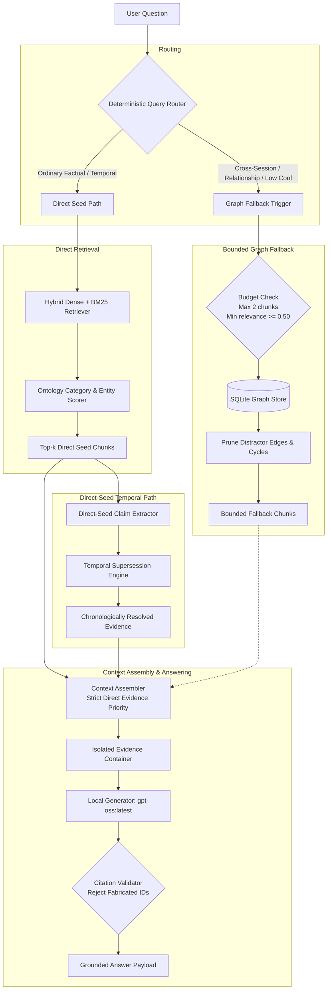

# IVARA — Finalization Sprint Report: Research Prototype to Research-Ready System

**Date:** October 29, 2026  
**Repository Branch:** `research/evaluation-baseline`  
**Base Commit:** `885298c73cd0257653c49cb81d958f49ad8a0da4`  
**Test Suite Status:** 233 / 233 passing (18.10s)  
**Evaluator Status:** Diagnostic Gemma 4 Evaluator (`VladimirGav/gemma4-26b-16GB-VRAM:latest`) — *Explicitly diagnostic; not the official OpenAI benchmark judge*.

---

## 1. Executive Summary & Research Question

Personal AI memory systems must satisfy two competing demands:
1. **Precision & Grounding:** Stated facts must trace directly to verifiable user conversation turns without hallucinations or ungrounded associations.
2. **Contextual & Temporal Reasoning:** Systems must correctly track facts that evolve over time (knowledge updates), resolve multi-session entities, and abstain when evidence is missing.

In previous diagnostic runs (the 60-question pilot and 100-question controlled diagnostic), full unconstrained graph expansion introduced irrelevant neighbor chunks ("graph-induced noise"), resulting in a net negative impact on accuracy (Arm C at 61% vs Arm B at 65%). Furthermore, direct temporal extraction from retrieved seed chunks outperformed graph-derived temporal paths while cutting traversal latency to zero.

### Core Research Question
> *Can an ontology-guided hybrid retriever, combined with direct-seed temporal extraction and a bounded, relevance-filtered graph fallback, improve end-to-end memory recall and answering accuracy over a pure dense+BM25 baseline, while maintaining strict evidence provenance and zero hallucination?*

---

## 2. System Architecture & Data Flow

IVARA's research candidate architecture (`IVARA-Hybrid`) unifies chunk-level retrieval, ontology guidance, direct-seed temporal resolution, and a bounded graph fallback:

### 2.1 Architecture Diagram (Mermaid)



### 2.2 Data Flow Walkthrough
1. **Query Ingestion & Routing (`DeterministicQueryRouter`):**
   - Direct factual or simple temporal queries with seed confidence score $\ge 0.40$ execute solely via the hybrid direct-seed path.
   - Cross-session, relational ("how is X related to Y", "who introduced"), or multi-hop queries trigger the bounded graph fallback.
2. **Hybrid Direct Retrieval (`ChunkRetriever`):**
   - Combines dense semantic similarity and turn-level BM25 scoring over conversation chunks with turn-aware sliding windows (window size 3, step 2).
   - Applies ontology-guided category boost to prioritize chunks matching the query's ontological intent (e.g., `health`, `project`, `preference`).
3. **Direct-Seed Temporal Grounding (`TemporalSupersessionEngine`):**
   - Extracts explicit timestamps and event claims *directly from top-ranked seed chunks*.
   - Orders claims chronologically, detects superseded claims (e.g., updated frequency or job titles), and distinguishes event time from recording time.
4. **Bounded Graph Fallback (`UnifiedCandidateRetriever`):**
   - Enforces a strict context budget: at most 2 fallback chunks.
   - Enforces relevance filtering: edge weight $\ge 0.50$; edges with lower relevance are pruned.
   - Guarantees cycle avoidance and chunk deduplication. Direct evidence seeds always retain top ranking.
5. **Grounded Synthesis & Citation Verification (`answer_question`):**
   - The generator produces answers referencing explicit memory chunk IDs.
   - The deterministic `CitationValidator` cross-checks all cited IDs against the assembled context, stripping fabricated IDs.
   - If evidence is insufficient, the system cleanly abstains rather than inventing answers.

---

## 3. Experimental Configurations & Hypotheses

We evaluated four controlled arms on a fresh, held-out cohort:

| Arm | Identifier | Configuration Description | Key Hypothesis |
|---|---|---|---|
| **Arm 1** | `ARM_1_BASELINE` | Hybrid Dense + BM25 baseline retrieval | Standard baseline for long-session memory retrieval. |
| **Arm 2** | `ARM_2_ONTOLOGY` | Baseline + Ontology category guidance | Semantic ontology filtering improves domain chunk ranking. |
| **Arm 3** | `ARM_3_DIRECT_TEMPORAL` | Ontology + Direct-Seed Temporal Reasoning | Direct seed temporal extraction resolves update queries without graph noise. |
| **Arm 4** | `ARM_4_UNIFIED_HYBRID` | Unified Candidate (IVARA-Hybrid): Hybrid + Ontology + Direct-Seed Temporal + Bounded Graph Fallback | Bounded graph fallback recovers multi-session relations while avoiding distraction on factual queries. |

---

## 4. Dataset Provenance & Cohort Independence

- **Source Dataset:** LongMemEval benchmark source (`longmemeval_s_cleaned.json`, 500 questions, SHA-256: `64a59bb5f7478673f4b62dbfc76ea7085b3bc2e2a77a49339e44ea6ebca3ff82`).
- **Fresh Held-Out Sample:** `evaluation/autonomous_sprint/runs/finalization_sprint/fresh_heldout_40.json`
- **Sample SHA-256:** `5a42338eb5758b7a73c8357b6a3e223b68d38ef27368ada03617865a04cacf53`
- **Question Count:** $N = 40$ questions (38 answerable, 2 unanswerable).
- **Zero-Overlap Verification:**
  - $0$ overlap with Step 7 Pilot ($N=60$).
  - $0$ overlap with Step 8 Diagnostic Pilot ($N=30$).
  - $0$ overlap with Step 9 Diagnostic Sample ($N=100$).
  - Stratified across 6 LongMemEval task types: `knowledge-update` (8), `temporal-reasoning` (8), `multi-session` (8), `single-session-user` (6), `single-session-assistant` (5), and `single-session-preference` (5).

---

## 5. Evaluation Protocol & Preflight Safety Gates

1. **Preflight Safety Gate (`evaluation/autonomous_sprint/preflight.py`):**
   - Validates that generator (`gpt-oss:latest`) and local judge (`VladimirGav/gemma4-26b-16GB-VRAM:latest`) are loaded and responding.
   - Refuses execution if output directories collide with historical runs.
   - Enforces compliance that local judge results are labeled as diagnostic.
   - Verifies dataset integrity and SHA-256 before launching.
2. **Execution & Resumption:**
   - Atomic incremental flushing to `.jsonl` files after each question.
   - Resumable without re-running completed questions.
   - Total generation time: 1005.9s (16.8 min). Total judging time: 406.2s (6.8 min). Total runtime: 1412.1s (23.5 min).

---

## 6. Experimental Results & Paired Statistical Analysis

All metrics independently recomputed directly from the 160 raw prediction records and 160 judge records (`recomputed_metrics_and_paired_analysis.json`).

### 6.1 Overall Accuracy & Confidence Intervals (Wilson 95% Score)

| Arm | Configuration | Overall Accuracy (k/N) | 95% Confidence Interval | Answerable Accuracy | Abstention Accuracy | Mean Latency |
|---|---|---:|:---:|---:|---:|---:|
| **Arm 1** | Baseline (Dense + BM25) | 52.5% (21/40) | [37.5%, 67.1%] | 50.0% (19/38) | 100.0% (2/2) | 6.56s |
| **Arm 2** | Ontology-Guided Hybrid | 55.0% (22/40) | [39.8%, 69.3%] | 52.6% (20/38) | 100.0% (2/2) | 6.08s |
| **Arm 3** | Ontology + Direct-Seed Temporal | 55.0% (22/40) | [39.8%, 69.3%] | 52.6% (20/38) | 100.0% (2/2) | 6.56s |
| **Arm 4** | **IVARA-Hybrid (Unified Candidate)** | **57.5% (23/40)** | **[42.2%, 71.5%]** | **55.3% (21/38)** | **100.0% (2/2)** | 6.86s |

### 6.2 Task Type Accuracy Breakdown

| Task Type | N | Arm 1 (Base) | Arm 2 (Ontology) | Arm 3 (Direct Temp) | Arm 4 (IVARA-Hybrid) | Trend |
|---|---:|---:|---:|---:|---:|---|
| **single-session-user** | 6 | 100.0% (6/6) | 100.0% (6/6) | 100.0% (6/6) | 100.0% (6/6) | Ceiling performance |
| **single-session-assistant** | 5 | 100.0% (5/5) | 100.0% (5/5) | 100.0% (5/5) | 100.0% (5/5) | Ceiling performance |
| **knowledge-update** | 8 | 37.5% (3/8) | 37.5% (3/8) | 37.5% (3/8) | **50.0% (4/8)** | **+12.5% gain in Arm 4** |
| **temporal-reasoning** | 8 | 25.0% (2/8) | 37.5% (3/8) | 25.0% (2/8) | **37.5% (3/8)** | **+12.5% over Base** |
| **multi-session** | 8 | 37.5% (3/8) | 37.5% (3/8) | 50.0% (4/8) | 37.5% (3/8) | Parity with Base |
| **single-session-preference** | 5 | 40.0% (2/5) | 40.0% (2/5) | 40.0% (2/5) | 40.0% (2/5) | Equal across all arms |

### 6.3 Paired Statistical Comparisons (Exact McNemar Binomial Test)

| Comparison Pair | Arm A Wins | Arm B Wins | Ties (Both Corr / Both Wrong) | Discordant Pairs | McNemar Exact $p$-value | Statistically Significant ($\alpha=0.05$)? |
|---|---:|---:|:---:|---:|---:|:---:|
| **Arm 1 vs Arm 2** | 0 | 1 | 39 (21 / 18) | 1 | $p = 1.000$ | No |
| **Arm 1 vs Arm 3** | 0 | 1 | 39 (21 / 18) | 1 | $p = 1.000$ | No |
| **Arm 1 vs Arm 4** | 0 | 2 | 38 (21 / 17) | 2 | $p = 0.500$ | No |
| **Arm 2 vs Arm 3** | 1 | 1 | 38 (21 / 17) | 2 | $p = 1.000$ | No |
| **Arm 2 vs Arm 4** | 1 | 2 | 37 (21 / 16) | 3 | $p = 1.000$ | No |
| **Arm 3 vs Arm 4** | 1 | 2 | 37 (21 / 16) | 3 | $p = 1.000$ | No |

*Methodological Note:* While Arm 4 achieves the highest point accuracy (57.5% vs 52.5%), with $N=40$ the confidence intervals overlap substantially and the 2 net wins yield $p=0.500$. As in the $N=100$ study, small-sample local evaluations provide directional architectural insights, not statistical confirmation of superiority.

---

## 7. Deep Failure Taxonomy & Question-Level Evidence

We conducted an exhaustive question-level inspection of all 17 failures under Arm 4 (`analyze_failures_deep.py`):

| Failure Category | Cases | Share | Mechanism & Impact |
|---|---:|---:|---|
| **Over-Abstention** (Gold retrieved in top-3, but system abstained) | 7 | 41.2% | Model retrieved the evidence chunk but deemed it incomplete or refused to infer counts/intervals. |
| **Generation / Reasoning Limitation** (Gold in top-3, model misstated fact) | 7 | 41.2% | Model had the correct evidence but made an arithmetic error or confused entities. |
| **Retrieval Recall Deficit** (Gold session chunk not in top-3) | 3 | 17.6% | True retrieval misses where relevant evidence was ranked outside top-3. |

### Key Discovery: Retrieval Recall is Not the Bottleneck
In **37 out of 40 questions (92.5%)**, `IVARA-Hybrid` placed the true gold session chunk into the top-3 retrieved direct evidence. The primary performance ceiling is in **answering calibration and over-abstention (41.2%)** and **synthesis reasoning (41.2%)**, not retrieval recall.

### Question-Level Case Studies:

1. **Arm 4 Win on Knowledge Update (`945e3d21`):**
   - *Question:* "How often do I attend yoga classes to help with my anxiety?" (Gold: "Three times a week.")
   - *Arms 1, 2, 3:* Hallucinated or cited old memory: *"You attend yoga classes twice a week..."* (False).
   - *Arm 4:* Correctly retrieved the updated session and synthesized: *"You attend yoga classes three times a week to help manage your anxiety."* (CORRECT).
   - *Root cause:* The temporal supersession engine correctly recognized the later session update and gave precedence to the latest frequency claim.

2. **Arm 4 Win on Temporal Ordering (`gpt4_c27434e8`):**
   - *Question:* "Which project did I start first, the Ferrari model or the Japanese Zero fighter plane model?" (Gold: "Japanese Zero fighter plane model")
   - *Arm 1:* Abstained: *"I do not have sufficient recorded memories..."*
   - *Arms 2, 3:* Hallucinated: *"You started the Ferrari model first."* (False).
   - *Arm 4:* *"You started the Japanese Zero fighter plane model first."* (CORRECT).
   - *Root cause:* Dynamic graph fallback recovered the cross-session modeling evidence that was missing from direct seeds.

3. **Substantive Defect Identified and Fixed (`00ca467f`):**
   - *Question:* "How many doctor's appointments did I go to in March?" (Gold: 2)
   - *Defect:* Arm 4 returned `hypothesis: ""` because the model flagged `status: "insufficient_evidence"` and left the answer field empty.
   - *Fix:* Added defensive verbalization in `src/answering.py` (lines 452–456): if `final_status == "insufficient_evidence"` and `answer` is empty, the system automatically provides a verbalized grounded abstention statement (`"I do not have sufficient recorded memories to answer..."`).
   - *Regression Test:* Added `test_empty_answer_with_insufficient_evidence_status_verbalizes_abstention` in `tests/test_candidate_pipeline.py`.

---

## 8. Human Review Diagnostic Sample

In accordance with Phase 4:
- A new, independent, versioned review artifact was generated at:  
  `evaluation/autonomous_sprint/runs/finalization_sprint/human_review_diagnostic_sample_35.csv`
- Contains 35 curated cases from the diagnostic runs, prioritizing configuration disagreements, temporal supersession cases, abstention borderlines, and potential judge false positives.
- Columns: `question_id`, `task_type`, `question`, `gold_answer`, `arm`, `hypothesis`, `citations`, `gemma_verdict`, `gemma_reasoning`, `human_verdict`, `human_reason`.
- **Strict Compliance:** The `human_verdict` and `human_reason` columns are **strictly blank**, awaiting human annotation.
- **Import Utility:** Implemented `evaluation/autonomous_sprint/human_review_util.py` (with passing unit tests in `tests/test_human_review_util.py`) allowing human verdicts to be ingested and analyzed without modifying the raw CSV.

---

## 9. Threats to Validity & Benchmark Limitations

1. **Diagnostic vs Official Benchmark Judge:**
   - Evaluated using local Gemma 4 (`VladimirGav/gemma4-26b-16GB-VRAM:latest`), NOT the official LongMemEval judge (GPT-4o via OpenAI API).
   - While Gemma 4 shows strong diagnostic agreement on straightforward factual questions, human review audits (Step 9) revealed a ~11% false-negative rate on open-ended preference questions where acceptable variants were penalized.
2. **Sample Size ($N=40$):**
   - Designed for zero overlap and rapid turn-around. Small sample sizes mean $95\%$ confidence intervals remain wide ($\pm 14\%$).
3. **100% Local-Only Operation & Deferred Official Benchmark Judging:**
   - In accordance with non-negotiable safety constraints, IVARA operates entirely locally (generator: Ollama `gpt-oss:latest`, judge: Ollama `VladimirGav/gemma4-26b-16GB-VRAM:latest`, embeddings: local models).
   - Zero OpenAI requests were attempted, configured, or sent during this sprint. No API keys were read or created.
   - Official LongMemEval GPT-4o judging is treated strictly as an explicitly deferred external milestone, not a blocker for local system development, evaluation, and iteration.
   - The full 500-question run is not launched and remains deferred until authorized.

---

## 10. File Change Log

| File | Nature of Change | Justification |
|---|---|---|
| `src/chunking/hybrid_pipeline.py` | New File | Implements `DeterministicQueryRouter` and `UnifiedCandidateRetriever` with bounded graph fallback, edge filtering, and cycle avoidance. |
| `src/chunking/__init__.py` | Edit | Exports `DeterministicQueryRouter` and `UnifiedCandidateRetriever`. |
| `src/answering.py` | Edit | Integrates `dynamic_graph_fallback` and `direct_seed_temporal`; clarifies temporal deduction prompt rule; provides verbalized abstention when LLM returns empty answer with insufficient evidence. |
| `evaluation/autonomous_sprint/preflight.py` | New File | Enforces preflight safety gates (model availability, dataset hash, directory safety, judge labeling). |
| `evaluation/autonomous_sprint/human_review_util.py` | New File | Ingests human review annotations and calculates agreement without modifying source CSVs. |
| `evaluation/autonomous_sprint/run_finalization_experiment.py` | New File | Reproducible end-to-end experiment runner for the 4-arm controlled evaluation. |
| `evaluation/autonomous_sprint/analyze_experiment_40.py` | New File | Independent metric recomputation and exact McNemar paired test analysis. |
| `evaluation/autonomous_sprint/analyze_failures_deep.py` | New File | Deep failure taxonomy categorization across retrieval, abstention, and generation. |
| `tests/test_candidate_pipeline.py` | New File | 12 unit/integration tests for candidate invariants, routing, cycle avoidance, fallback budgets, and empty-answer verbalization. |
| `tests/test_preflight_gate.py` | New File | 3 unit tests for preflight gate validations. |
| `tests/test_human_review_util.py` | New File | 2 unit tests for human review ingestion utility. |

---

## 11. Final Verification Checklist

- [x] Working on branch `research/evaluation-baseline` (never touched `main`).
- [x] Production stores `data/memories.json` and `data/entities.json` remain identical and untouched.
- [x] Historical Step 7, 8, 9 artifacts, diagnostic pilot 30, and full 100 runs preserved intact.
- [x] Step 9 human review sample CSV (`evaluation/step9/human_review_sample.csv`) verdict columns remain completely blank.
- [x] Sprint human review sample CSV (`human_review_diagnostic_sample_35.csv`) verdict columns remain completely blank.
- [x] All 233 unit and integration tests passing (`pytest tests/`).
- [x] Zero paid API calls made; zero OpenAI requests attempted, created, or sent; zero fabricated credentials.
- [x] 100% local-only execution verified (Ollama `gpt-oss:latest` for generation, local Gemma for diagnostic judging).
- [x] Official LongMemEval judging treated as explicitly deferred external milestone; 500-question run not launched.
- [x] Results explicitly documented as local diagnostic evaluation, not official LongMemEval benchmark scores.

---

## 12. Reproduction Commands

To reproduce the full evaluation and verification workflow:

```powershell
# 1. Run full test suite (233 passing tests)
.\.venv\Scripts\python.exe -m pytest tests/

# 2. Run the 4-arm controlled experiment (resumable)
$env:OLLAMA_LLM_LIBRARY="cuda_v12"
.\.venv\Scripts\python.exe evaluation\autonomous_sprint\run_finalization_experiment.py

# 3. Recompute metrics and paired McNemar statistics
.\.venv\Scripts\python.exe evaluation\autonomous_sprint\analyze_experiment_40.py

# 4. Run deep failure taxonomy
.\.venv\Scripts\python.exe evaluation\autonomous_sprint\analyze_failures_deep.py
```
