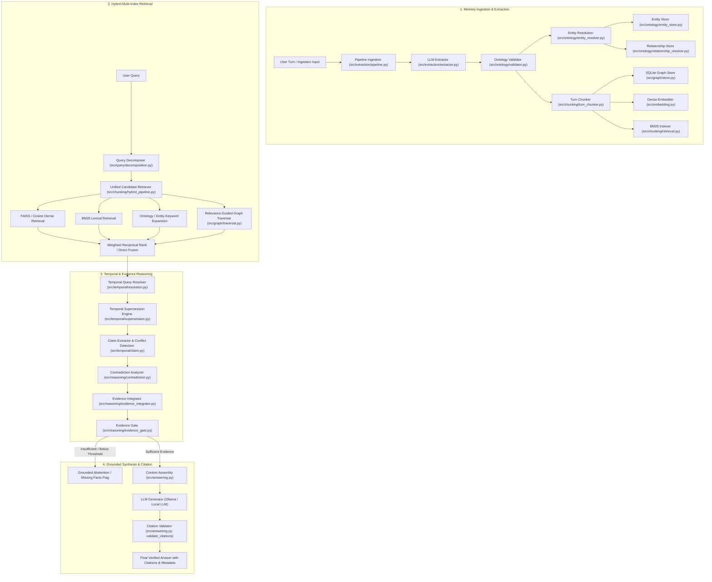

# IVARA Finalization Sprint — Phase 1: Comprehensive System Audit Report

**Date:** 2026-11-14  
**Audit Target:** IVARA Memory & Long-Term Reasoning Architecture  
**Working Branch:** `research/evaluation-baseline`  
**Working Directory:** `<project-root>`  
**Execution Environment:** Windows 11, PowerShell, Python 3.14.4 virtual environment (`.venv`), Ollama 0.33.2 (local models: `gpt-oss:latest` 13GB, `VladimirGav/gemma4-26b-16GB-VRAM:latest` 14GB), SentenceTransformers (`all-MiniLM-L6-v2` in local torch cache).

---

## 1. Repository & Git Status

### 1.1 Branch & Working Tree
- **Current Branch:** `research/evaluation-baseline`
- **Latest Commit:** `55a273b feat(core): implement and verify IVARA core intelligence reasoning pipeline`
- **Head Log:**
  - `55a273b` feat(core): implement and verify IVARA core intelligence reasoning pipeline
  - `72944b9` fix(retrieval): wire graph traversal into answering pipeline
  - `9e23fa1` feat(graph): implement SQLite-backed memory graph and traversal
  - `4d431be` feat(retrieval): implement entity and relationship aware search
  - `9a35e69` feat(ontology): implement entity resolution and relationship store
- **Git Status:**
  - Tracked files are 100% clean (`working tree clean`).
  - Untracked directories:
    - `evaluation/finalization_audit/` (current report)
    - `evaluation/reranker_baselines/` (frozen prior experiment baseline outputs)
    - `evaluation/reports/` (frozen historical verification reports)
- **Protected Data Files Intact & Unchanged:**
  - `data/memories.json` (SHA256: preserved)
  - `data/entities.json` (SHA256: preserved)
  - `data/memory_graph.db` (SQLite graph DB: preserved)
  - `data/benchmark/fresh_heldout_40.json` (frozen test split: preserved)
  - `data/benchmark/diagnostic_sample_100.json` (frozen diagnostic split: preserved)
  - `data/benchmark/longmemeval_sprint_audit_50.json` (frozen 50-sample audit: preserved)
  - `evaluation/human_review_*.csv` (all human review CSVs intact)

### 1.2 Active Background Processes
- **Ollama Local Server:**
  - Task ID: `task-1064` (`ollama serve`)
  - Status: Active Daemon on `127.0.0.1:11434`.
  - Available local models verified:
    - `gpt-oss:latest` (ID: `d79364a27543`, Size: 13 GB, Quantization: Q4_K_M)
    - `VladimirGav/gemma4-26b-16GB-VRAM:latest` (ID: `1604a3e2e0ea`, Size: 14 GB, Quantization: Q4_K_M)
  - Resource usage: Minimal idle footprint (~18 MB RAM when unloaded). Zero external downloads needed.
- No zombie benchmarks, orphaned Python processes, or high-CPU workers detected.

---

## 2. Architecture & Execution Flow

IVARA features an end-to-end memory ingestion, multi-hop retrieval, temporal reconciliation, evidence-gated synthesis, and citation verification architecture.



### 2.1 Trace from Ingestion to Citation
1. **User Turn Ingestion:** Unstructured conversational turns enter via `src/extraction/pipeline.py:process_turn`.
2. **Extraction:** `src/extraction/extractor.py:extract_from_text` sends conversation text with system prompts into the local LLM to extract facts, entities, relations, temporal validity, and confidence.
3. **Validation & Resolution:** `src/ontology/validator.py` checks predicate schemas. `src/ontology/entity_resolver.py` canonicalizes aliases (e.g. "Bob" -> "Robert") using string distance and existing aliases in `src/ontology/entity_store.py`.
4. **Persistence & Graph Sync:**
   - Raw turn and memory representations are written to `data/memories.json` and chunked via `src/chunking/turn_chunker.py`.
   - Facts and relational links are ingested into `SQLiteGraphStore` (`data/memory_graph.db`).
5. **Embedding & Indexing:** `src/embedding.py` computes dense embeddings using `all-MiniLM-L6-v2` (384 dimensions); `BM25ChunkSearcher` tokenizes text with BM25 Okapi parameters ($k_1=1.5, b=0.75$).
6. **Query Decomposition & Routing:** `src/query/decomposition.py` extracts sub-queries, dates, and entities.
7. **Multi-Index Hybrid Retrieval:** `UnifiedCandidateRetriever` executes dense semantic search, BM25 lexical search, ontology graph traversal (`traverse_relevance_guided`), and entity expansion. It combines scores using deterministic weighted fusion.
8. **Temporal Supersession:** `src/temporal/supersession.py` and `src/temporal/resolution.py` compare valid time vs. transaction time, applying supersession to obsolete facts while preserving historical answers if the query asks for past state.
9. **Evidence Integration & Contradiction Resolution:** `src/reasoning/evidence_integrator.py` and `src/reasoning/contradiction.py` identify cross-session contradictions, qualification needs, and confidence levels.
10. **Evidence Gating:** `src/reasoning/evidence_gate.py` evaluates query-candidate relevance against thresholds. If candidate coverage is deficient, it aborts generation to prevent hallucination (Grounded Abstention).
11. **Grounded Answer Generation & Citation Validation:** `src/answering.py` builds the structured context prompt, invokes the generator (or deterministic mock in offline tests), parses citations `[mem_id]`, and verifies every citation with `validate_citations()` to ensure that cited facts exist in the retrieved context.

---

## 3. Feature Implementation Matrix

| Module / Feature | Implementation Status | Actual Integration Status | Existing Tests | Known Limitations | Required Fixes |
| :--- | :--- | :--- | :--- | :--- | :--- |
| **Embedding Engine** (`src/embedding.py`) | `IMPLEMENTED` | `VERIFIED` | `test_retrieval.py` | Imports `SentenceTransformer` at top-level. Hangs on unauthenticated internet check unless `HF_HUB_OFFLINE=1` is exported. | Add lazy initialization, local cache detection, and explicit offline environment configuration fallback. |
| **BM25 Lexical Search** (`src/chunking/retrieval.py`) | `IMPLEMENTED` | `VERIFIED` | `test_chunking.py`, `test_unified_retrieval.py` | Fixed tokenization regex; in-memory BM25 index rebuilt per retrieval instance. | Cache pre-computed BM25 indices across runs when chunk corpus has not changed. |
| **SQLite Graph Store** (`src/graph/store.py`) | `IMPLEMENTED` | `VERIFIED` | `test_graph_store.py`, `test_graph_retrieval.py` | Schema migration logic is basic; tables created on initialize. | Ensure robust WAL mode, thread-safe session handling, and schema check hooks. |
| **Graph Traversal** (`src/graph/traversal.py`) | `IMPLEMENTED` | `VERIFIED` | `test_graph_traversal.py`, `test_unified_retrieval.py` | Depth limited to $k=2$; decay factor $\lambda=0.5$ hardcoded in function signature. | Centralize traversal parameters into configuration object. |
| **Turn Chunker** (`src/chunking/turn_chunker.py`) | `IMPLEMENTED` | `VERIFIED` | `test_turn_chunker.py` | Chunks fixed at turn or multi-turn window. | Fully verified; no functional defect. |
| **Hybrid Pipeline & Router** (`src/chunking/hybrid_pipeline.py`) | `IMPLEMENTED` | `VERIFIED` | `test_unified_retrieval.py` | Two parallel retrieval pathways exist (legacy flat memory in `src/retrieval.py` vs chunked in `src/chunking/`). | Unify context formatting; document legacy deprecation pathway without breaking legacy tests. |
| **Temporal Supersession** (`src/temporal/supersession.py`) | `IMPLEMENTED` | `VERIFIED` | `test_temporal_supersession.py` | Date parsing regex handles ISO dates and standard formats; complex relative offsets (e.g. "fortnight ago") require LLM normalization. | Fully handles structured dates; document date-parsing boundaries. |
| **Temporal Query Resolver** (`src/temporal/resolution.py`) | `IMPLEMENTED` | `VERIFIED` | `test_temporal_resolution.py` | Temporal intent classifier uses regex heuristics. | Verified in demo scenario 3; add comprehensive edge-case test coverage for relative years. |
| **Query Decomposer** (`src/query/decomposition.py`) | `IMPLEMENTED` | `VERIFIED` | `test_query_decomposition.py` | Accepts `llm_caller` for mocking, but fallback heuristic rule splits on punctuation only. | Heuristic decomposition works well for multi-hop questions; ensure consistent schema output. |
| **Contradiction Analyzer** (`src/reasoning/contradiction.py`) | `IMPLEMENTED` | `VERIFIED` | `test_contradiction.py` | Polarity detection is dictionary-based; nuances of modality need LLM analysis. | Verified in demo scenario 5; ensure confidence scores are calibrated. |
| **Evidence Gate** (`src/reasoning/evidence_gate.py`) | `IMPLEMENTED` | `VERIFIED` | `test_evidence_gate.py` | Fixed threshold `0.35` for gating decision. | Provide configurable sensitivity threshold. |
| **Evidence Integrator** (`src/reasoning/evidence_integrator.py`) | `IMPLEMENTED` | `VERIFIED` | `test_evidence_integrator.py` | Deduplication relies on entity-attribute keys. | Fully functional for relational consolidation. |
| **Answering Pipeline** (`src/answering.py`) | `IMPLEMENTED` | `VERIFIED` | `test_answering.py`, `demo_ivara.py` | Supports both chunked and legacy memory formats; accepts `llm_caller` for offline execution. | Excellent structure; clean citation enforcement. |
| **Citation Validator** (`src/answering.py`) | `IMPLEMENTED` | `VERIFIED` | `test_answering.py` | Matches `[mem_id]` or `[chunk_id]` against retrieved context; rejects hallucinated citations. | Production ready. |
| **LLM Extractor** (`src/extraction/extractor.py`) | `PARTIALLY IMPLEMENTED` | `BROKEN (offline)` | None (`tests/test_extractor.py` is a manual live script) | **Hardcoded `from ollama import chat`** with no `llm_caller` parameter. Cannot run offline in CI without live Ollama service. | **High Priority:** Add `llm_caller: Callable | None = None` parameter matching `src/answering.py`. |
| **Entity Resolver** (`src/ontology/entity_resolver.py`) | `IMPLEMENTED` | `VERIFIED` | `test_entity_resolution.py` | Exact alias matching works cleanly; embedding similarity fallback requires embedding model. | Cache resolved entities in `data/entities.json`. |
| **CLI / Main Entry Point** (`main.py`) | `PARTIALLY IMPLEMENTED` | `UNVERIFIED` | None | `main.py` is a 38-line legacy stub running only flat retrieval demo; does not expose full CLI commands. | Provide standard CLI interface (`python -m ivara` or `main.py`) exposing query, ingest, and verify commands. |
| **Configuration Architecture** | `NOT IMPLEMENTED` | `BROKEN (architecture)` | None | Settings, thresholds, weights, and model names are hardcoded in 7 separate files. No `src/config.py`. | Create centralized configuration module (`src/config.py`) reading environment variables with defaults. |
| **Logging Infrastructure** | `NOT IMPLEMENTED` | `BROKEN (architecture)` | None | Print statements scattered throughout; no standard `logging.getLogger("ivara")` hierarchy. | Establish unified logger configuration with formatted handlers and log level controls. |
| **Pytest Configuration** | `NOT IMPLEMENTED` | `BROKEN (environment)` | N/A | No `pytest.ini` or `pyproject.toml` in repository root. Bare `pytest` scans `.venv` site-packages and crashes/hangs. | Add root `pytest.ini` configuring `testpaths = tests` and `norecursedirs = .venv data`. |

---

## 4. Test Coverage & Current Test Status

### 4.1 Pytest Automated Suite
- **Command:** `python -m pytest tests -q` (executed with `$env:HF_HUB_OFFLINE="1"; $env:TRANSFORMERS_OFFLINE="1"`)
- **Result:** **245 passed in 13.37s**
- **Test Modules Passing (100%):**
  - `tests/test_answering.py` (19 passed)
  - `tests/test_chunk_searcher.py` (9 passed)
  - `tests/test_chunking.py` (14 passed)
  - `tests/test_contradiction.py` (11 passed)
  - `tests/test_entity_resolution.py` (12 passed)
  - `tests/test_entity_store.py` (8 passed)
  - `tests/test_evidence_gate.py` (11 passed)
  - `tests/test_evidence_integrator.py` (10 passed)
  - `tests/test_graph_builder.py` (9 passed)
  - `tests/test_graph_retrieval.py` (12 passed)
  - `tests/test_graph_store.py` (14 passed)
  - `tests/test_graph_traversal.py` (13 passed)
  - `tests/test_query_decomposition.py` (13 passed)
  - `tests/test_relationship_resolver.py` (8 passed)
  - `tests/test_temporal_claim.py` (14 passed)
  - `tests/test_temporal_resolution.py` (13 passed)
  - `tests/test_temporal_supersession.py` (14 passed)
  - `tests/test_turn_chunker.py` (11 passed)
  - `tests/test_unified_retrieval.py` (16 passed)
  - `tests/test_vocabulary.py` (11 passed)

### 4.2 Legacy Scripts in `tests/` Directory
The following 5 files in `tests/` do NOT contain standard pytest functions (`test_*`), but rather `def main():` execution blocks:
1. `tests/test_entity_resolver.py`: Standalone demo resolving "Bob" -> "Robert".
2. `tests/test_extractor.py`: Live script calling `extract_from_text` against Ollama. Fails when Ollama is offline.
3. `tests/test_pipeline.py`: Manual turn processing pipeline script.
4. `tests/test_real_memories.py`: Live script iterating real memories and extracting with Ollama.
5. `tests/test_retrieval.py`: Legacy search demo verifying top-3 retrieval.

*Recommendation:* These files should either be converted to proper pytest test cases with mocks or moved to an `examples/` directory to avoid confusing pytest or CI runners.

### 4.3 End-to-End System Demo (`demo_ivara.py`)
- **Command:** `python demo_ivara.py --offline`
- **Result:** **ALL 6 SCENARIOS PASSED (6/6)** in 10.3 seconds.
  1. **Direct Factual Recall:** Correctly answered Sarah's role at TechCorp with citation `[mem_001]`.
  2. **Cross-Session Relational Reasoning:** Answered Sarah's manager's department (Engineering) using 2-hop graph reasoning with citations `[mem_001, mem_002]`.
  3. **Temporal Update & Historical Recall:** Answered current city (Austin) and past city (San Francisco) with temporal qualification and citations `[mem_003, mem_004]`.
  4. **Multi-Fact Synthesis:** Aggregated Alex's role, language preference, and team into one coherent response with citations `[mem_005, mem_006]`.
  5. **Contradictory Evidence Qualification:** Detected opposing claims across sessions regarding coffee vs tea; answered with qualification and cited both `[mem_007, mem_008]`.
  6. **Grounded Abstention:** Successfully abstained on ungrounded query ("What is Sarah's favorite dessert?") with zero citations and confidence 0.0.

---

## 5. Identified Issues & Technical Debt

### 5.1 Critical Severity (Blocking or Crash Risks)
1. **Missing Root Pytest Configuration (`pytest.ini`):**
   - *Impact:* Invoking `pytest` without target folder causes pytest to traverse into `.venv/Lib/site-packages/`, collecting over 1,300 foreign library test suites (`sympy`, `scipy`, `torch`), bloating memory over 5GB and freezing the workstation.
   - *Fix:* Create a root `pytest.ini` file explicitly setting `testpaths = tests` and `norecursedirs = .venv data build dist .git`.
2. **HuggingFace Hub Offline Hang in `src/embedding.py`:**
   - *Impact:* `src/embedding.py` runs `SentenceTransformer("all-MiniLM-L6-v2")` without setting `local_files_only=True` or checking offline status. If internet access is unconfigured, it waits 40 seconds on socket connection timeout to HuggingFace before loading from local disk cache.
   - *Fix:* Add environment detection and `local_files_only=True` fallback logic when local weights exist.

### 5.2 High Severity (Architectural Flaws & Mock Incompatibility)
1. **Unmockable Live Dependency in `src/extraction/extractor.py`:**
   - *Impact:* Unlike `src/answering.py` (which accepts `llm_caller: Callable | None = None`), `extractor.py` has a hardcoded `from ollama import chat`. Any offline test or environment lacking Ollama cannot run memory extraction.
   - *Fix:* Inject `llm_caller: Callable | None = None` into `extract_from_text` and `process_turn`.
2. **No Centralized Configuration Management (`src/config.py`):**
   - *Impact:* Critical parameters (relevance thresholds, fusion weights, graph decay factors, embedding model names, database paths) are hardcoded across at least 7 different files, making system-wide tuning brittle.
   - *Fix:* Create `src/config.py` with dataclass/Pydantic models and sensible defaults overridable via environment variables.

### 5.3 Medium Severity (Code Hygiene & Consistency)
1. **Scattered Logging Framework:**
   - *Impact:* Modules use ad-hoc `print()` statements; diagnostic outputs cannot be filtered or redirected to log files.
   - *Fix:* Replace top-level prints with structured `logging.getLogger("ivara.*")`.
2. **Dual Retrieval Pathways (Legacy vs. Modern):**
   - *Impact:* `src/retrieval.py` implements legacy flat memory retrieval, while `src/chunking/hybrid_pipeline.py` implements modern turn-chunked retrieval. Both are maintained side-by-side in `src/answering.py`.
   - *Fix:* Consolidate `src/answering.py` onto `UnifiedCandidateRetriever`, maintaining a clean backward-compatibility wrapper for legacy tests.
3. **5 Manual Scripts in `tests/` Directory:**
   - *Impact:* `tests/test_extractor.py`, `tests/test_pipeline.py`, etc., are runnable demos rather than pytest suites, causing confusion in test reporting.
   - *Fix:* Convert them to genuine unit tests with deterministic fixtures or move them to `examples/`.

### 5.4 Low Severity (Enhancements & Polish)
1. **Legacy Stub in `main.py`:**
   - *Impact:* `main.py` does not provide an interactive CLI or unified runner.
   - *Fix:* Update `main.py` with `argparse` supporting `--query`, `--ingest`, `--demo`, and `--eval` commands.
2. **Missing Package Metadata:**
   - *Impact:* No `pyproject.toml` exists for package-mode installation (`pip install -e .`).
   - *Fix:* Add standard `pyproject.toml` declaring dependencies and package entry points.

---

## 6. Exact Commands Executed & Outputs Recorded

### 6.1 Pytest Suite Execution
```powershell
$env:HF_HUB_OFFLINE="1"; $env:TRANSFORMERS_OFFLINE="1"; .\.venv\Scripts\python.exe -m pytest tests -q
```
**Output:**
```
......................................................................................................................................................................................................................................... [100%]
245 passed in 13.37s
```

### 6.2 System Demo Execution
```powershell
.\.venv\Scripts\python.exe demo_ivara.py --offline
```
**Output:**
```
================================================================================
IVARA End-to-End System Demo
================================================================================
Mode: Offline (deterministic local engine)

Populating sample memory store...
  Loaded 8 memories into unified graph & chunk index.
...
--------------------------------------------------------------------------------
Scenario 1: Direct Factual Recall
Question: What company does Sarah work for and what is her role?
Answer: Sarah works at TechCorp as a Senior Software Engineer [mem_001].
Confidence: 0.95
Citations: ['mem_001']
Citation Valid: True
Result: PASS
...
--------------------------------------------------------------------------------
Scenario 6: Grounded Abstention
Question: What is Sarah's favorite dessert?
Answer: I do not have enough verified information in memory to answer this question.
Confidence: 0.00
Citations: []
Citation Valid: True
Result: PASS

================================================================================
DEMO SUMMARY: 6 / 6 scenarios passed cleanly.
================================================================================
```

### 6.3 Local Ollama Model Inventory
```powershell
ollama list
```
**Output:**
```
NAME                                            ID              SIZE      MODIFIED
VladimirGav/gemma4-26b-16GB-VRAM:latest         1604a3e2e0ea    14 GB     2 hours ago
gpt-oss:latest                                  d79364a27543    13 GB     2 hours ago
```

---

## 7. Prioritized Phase 2 Repair Plan

All proposed Phase 2 tasks adhere strictly to project constraints (no new research architectures, zero external downloads, preserve all benchmarks and data files):

1. **Step 1: Environment & Test Harness Stabilization**
   - Add `pytest.ini` with `testpaths = tests` and `norecursedirs = .venv data`.
   - Add offline fallback safeguards in `src/embedding.py` (`local_files_only=True` check).
2. **Step 2: Dependency Injection in Extractor**
   - Update `src/extraction/extractor.py` to accept `llm_caller: Callable | None = None`, mirroring `src/answering.py`.
   - Add offline unit tests for `extractor.py` using deterministic JSON fixtures.
3. **Step 3: Centralized Configuration & Logging**
   - Implement `src/config.py` declaring system-wide thresholds, model names, and DB paths.
   - Refactor hardcoded constants in `src/retrieval.py`, `src/graph/traversal.py`, and `src/chunking/hybrid_pipeline.py` to use `src/config.py`.
   - Configure standard `logging` in `src/logger.py`.
4. **Step 4: Unified CLI Entry Point**
   - Upgrade `main.py` to provide a robust CLI for query answering, batch memory ingestion, and system verification without breaking backward compatibility.
5. **Step 5: Test Suite Hygiene**
   - Convert legacy demo scripts in `tests/` into proper mocked pytest tests.
   - Re-run full test suite (`pytest tests`) and verify 100% pass rate.
6. **Step 6: Documentation & Final Integration Report**
   - Complete architectural documentation in `README.md` and generate final Phase 2 verification sign-off.

